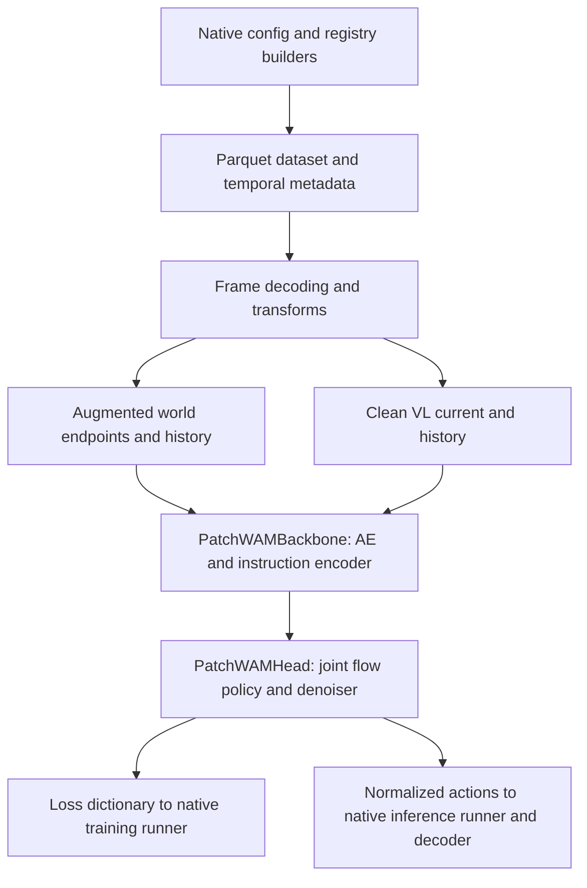

# PatchWAM port: implementation and code review guide

The port puts PatchWAM's joint world/action flow model behind FluxVLA's existing
config builders, model interface, dataset pipeline, and runners. The main new
code adapts those interfaces; the numerical model, specialized VLM, and image
augmentation utilities come from the local PatchWAM checkout.

Use this note as a reading order. At each step, follow the named methods and
check the associated invariant before moving deeper into the implementation.
The shorter [usage guide](patchwam.md) covers setup and CLI examples.

## How the implementation is divided

| Part | Implementation choice | Main responsibility |
| --- | --- | --- |
| Model interface | `PatchWAMVLA(BaseVLA)` | Adapt native batches, call backbone/head, return losses and normalized actions |
| Observation backbone | Registered `PatchWAMBackbone(nn.Module)` | Own the frozen autoencoder and instruction encoder; preserve optional language LoRA |
| Policy head | `PatchWAMHead(PatchFlowPolicy)` | Build a configurable denoiser and reuse the copied flow objective/action codec |
| Official denoiser | `PatchWAMFluxDenoiser(OfficialFluxDenoiser)` | Load local FLUX.2 weights and retain PatchWAM's masked attention execution |
| Training data | `PatchWAMParquetDataset(ParquetDataset)` plus registered transforms | Add temporal metadata, decode selected frames, and separate clean VL inputs from augmented world inputs |
| Evaluation data | `PatchWAMLiberoEvalDataset(LiberoParquetEvalDataset)` | Retain raw task instructions and emit the native prediction batch |
| Training/evaluation engine | Existing FluxVLA runners and scripts | Optimization, scheduling, checkpoint/resume machinery, and LIBERO environment stepping |

The copied code is under `fluxvla/models/third_party_models/patchwam/`.
Runtime model/data code imports that local package; it does not import the
sibling PatchWAM checkout. The autoencoder/transformer still require the official
`flux2` package or a configured local source checkout, plus local weight assets.



## Step 1 — Establish the contract from one config

Start with [patchwam_libero_full_finetune.py](../configs/patchwam/patchwam_libero_full_finetune.py).
Read `_transforms`, `_dataset`, `model`, `runner`, and `inference` in that order.

Check that the child dataset uses `action_key='action'`, its statistics name
matches the wrapper, state statistics map to `proprio`, and the normalizer reads
that same key. The collator belongs to `runner`. Check that its tensor/meta keys
match the final `PatchWAMKeep` output. Train and validation are built separately,
with the explicit dataset `training` flag and augmentation setting.

Then compare the other two configs. These differences are intentional:

| Recipe | World input | Instruction encoder | History/adapters | Actions/state |
| --- | --- | --- | --- | --- |
| [LIBERO](../configs/patchwam/patchwam_libero_full_finetune.py) | Two 224x224 cameras; 224x448 horizontal mosaic | Qwen3 text | No history or language LoRA | 7 / 8; min/max normalization |
| [RobotWin](../configs/patchwam/patchwam_robotwin_vlm_full_finetune.py) | Three 240x320 cameras; compact 288x256 mosaic | Qwen3-VL | Frozen, current image only | 14 / 14; mean/std normalization |
| [RoboDojo example](../configs/patchwam/patchwam_robodojo_vlm_history_example.py) | Three separate 256x256 views | Qwen3-VL | 20 history slots; LoRA and required subtask labels | 14 / 14; mean/std normalization |

All three use Klein base 4B, packed latent width 128, text feature width 7680,
16 action targets, and a future endpoint 16 rows after the current observation.
For source comparison, read the corresponding `libero.yaml`, `robotwin_vlm.yaml`,
and `robodojo_vlm_history.yaml` in `/home/chuong/workspace/PatchWAM/configs/`.
Review the RoboDojo update budget separately: its source requires a supplied
max-update budget; the native file is an example, not a validated benchmark run.

**Tests:** [test_patchwam_config.py](../test/test_configs/test_patchwam_config.py).

## Step 2 — Read the native model interface

Open [patchwam_vla.py](../fluxvla/models/vlas/patchwam_vla.py). Start with
`PatchWAMVLA.__init__`, `_prepare_batch`, `forward`, and `predict_action`.
Compare its inheritance and component construction with
[BaseVLA](../fluxvla/models/vlas/base_vla.py).

`forward` asks the backbone to encode the observations, adds normalized states
as `proprio`, adapts action masks, and calls the head. It adds the optional
language auxiliary loss once, using the instruction encoder's weight.
`predict_action` encodes only conditioning observations and calls the head's
sampler, returning normalized `[B, horizon, action_dim]` actions.

Read `resolve_action_padding` carefully: native masks mean **True = valid**;
the copied policy's `action_is_pad` and `action_dim_is_pad` mean **True = padded**.
Temporal masks `[B,H]`, coordinate masks `[B,H,A]`, and dimension masks `[B,A]`
are handled separately. A dimension mask needs an explicit horizon axis when
combined with a coordinate mask, including when batch size equals horizon.

**Tests:** [test_patchwam.py](../test/test_models/test_patchwam.py), especially
mask conversion, all-invalid/NaN padding, and seeded sampling.

## Step 3 — Trace one sample's temporal indices

Read [patchwam_dataset.py](../fluxvla/datasets/patchwam_dataset.py), particularly
`_pre_transform_hook`, `_row_timestamp`, and `_history_clocks`. Then inspect the
small hook addition in [parquet_dataset.py](../fluxvla/datasets/parquet_dataset.py).

The inherited dataset owns parquet reading, action windows, statistics, and
transform execution. The subclass adds current/future timestamps and world/VL
history metadata before the transforms run. A current row `r` corresponds to
actions at `r` through `r+15` and an image endpoint at `r+16`. A tail window
repeats its last valid image row and marks the unavailable endpoint invalid.

Review both the selected pixels' timestamps and their validity masks. Bounds,
episode identity, and dataset-root identity must agree. World history and VL
history use separate calls to the copied `PastFrameSelector`, on the original
recording clock. Validation passes `training=False` to remove training jitter
and dropout.

**Tests:** [test_patchwam_dataset.py](../test/test_datasets/test_patchwam_dataset.py),
including episode tails and the two-root history case.

## Step 4 — Follow decoding, augmentation, and camera packing

Read [transform_patchwam.py](../fluxvla/transforms/transform_patchwam.py) alongside
the config's transform list. Follow this sequence:

1. `PatchWAMRawInputs` maps raw state while retaining temporal metadata/stats.
2. `PatchWAMDecodeFrames` uses the native video decoder for requested world and
   distinct VL-history timestamps inside the selected episode video.
3. `PatchWAMCleanVL` captures clean current/past head-camera inputs before world
   camera resizing and augmentation.
4. `PatchWAMResizeCameras` applies the source camera geometry. The native
   `NormalizeStatesAndActions` handles state/action normalization.
5. `PatchWAMEndpoints` selects current/future images and constructs validity masks.
6. `PatchWAMWorldAugment` runs the copied clip/appearance augmenter on world
   images and world history, leaving the clean VL tensors untouched.
7. `PatchWAMComposeWorld`, `PatchWAMWorldHistory`, and `PatchWAMKeep` produce the
   fields the configured collator consumes.

Check augmentation at the per-camera size, camera ordering, and the difference
between a mosaic and `camera_video`. Parameters are shared across time within
each camera clip; cameras and collected history clips receive their own parameter
draws. Check invalid history slots after augmentation/packing as well.
`PatchWAMSelectWindow` and `PatchWAMSelectHistory` support predecoded tensors;
the supplied configs use direct video decoding.

Useful sample shapes before collation:

| Field | Shape / meaning |
| --- | --- |
| `world_frames` | `[V,17,3,Hc,Wc]`, decoded/resized values in `[0,1]` |
| `world_endpoints` | `[V,2,3,Hc,Wc]`, current and future |
| `video` | `[3,2,Hm,Wm]`, mosaic in `[-1,1]` |
| `camera_video` | `[V,3,2,Hc,Wc]`, present for separate views |
| `history_video`, `history_valid` | `[K,3,Hc,Wc]` and `[K]` |
| `vl_current`, `vl_history` | `[3,448,448]` and `[K,3,448,448]`, clean inputs |
| `frame_masks`, `img_masks` | `[2]` and `[number of encoded views]`, True means valid |
| `actions`, `states` | `[16,A]` and `[P]`, normalized |

Collation adds a batch dimension. Mosaic configs encode one fused view;
separate-camera configs preserve the individual view groups.

**Tests:** [test_patchwam_transforms.py](../test/test_transforms/test_patchwam_transforms.py)
for source augmentation, clean-VL isolation, geometry, and online history.

## Step 5 — Review observation encoding and parameter ownership

Read [patchwam_backbone.py](../fluxvla/models/backbones/vlms/patchwam_backbone.py),
then [encoding.py](../fluxvla/models/third_party_models/patchwam/encoding.py).
The latter extracts the source `FluxAssetPolicy._encode` into an independent
function taking explicit token/text widths.

Trace the current/future image paths through the autoencoder into
`reference_tokens` / `future_tokens` `[B,N,128]`. Current-view position groups
are `10+view`; future groups are `view`. History is encoded, pooled to a small
raster, appended to reference context, and assigned negative slot groups.
`sampling_future_length` counts the current raster, excluding appended history.

Check that masked current/future/history pixels are zeroed before the AE, that
token masks match the raster layout, and that generated future length is stable
when history grows. Follow text/cache validation and the actual projection-width
checks; Klein-4B's 7680 features come from three concatenated encoder readouts.

In `apply_trainable_policy` and `train`, confirm that AE/base/vision remain frozen
while configured language LoRA residuals can train. The backbone owns encoders;
the head owns the denoiser and state projection, with disjoint parameter names.

**Tests:** [test_patchwam_backbone.py](../test/test_models/patchwam/test_patchwam_backbone.py).

## Step 6 — Inspect the copied VLM and its local adaptations

Read `LocalInstructionEncoder` in
[flux.py](../fluxvla/models/third_party_models/patchwam/flux.py) for LIBERO, then
`VisualInstructionEncoder` in
[vision_language.py](../fluxvla/models/third_party_models/patchwam/vision_language.py)
for RobotWin/RoboDojo. Focus on `_attach_adapters`, `_prepare_sample`, and `forward`.

The visual encoder orders past images, the current image, and the instruction
causally; optional subtask sentences are supervision targets. Review which hidden
states become conditioning features, and ensure target sentences/future world
images cannot leak into those features. Past visual features are pooled; LoRA
is attached to the copied language projections.

These modules preserve PatchWAM's specialized FLUX/Qwen interfaces. The local
Transformers compatibility edits handle the newer image-feature return object
and `get_rope_index` arguments. Read
[ATTRIBUTION.txt](../fluxvla/models/third_party_models/patchwam/ATTRIBUTION.txt)
before comparing copies with `src/patchwam/models/` in the source checkout.

**Tests:** [test_patchwam_vision_language.py](../test/test_models/patchwam/test_patchwam_vision_language.py)
runs a genuine tiny Qwen3-VL forward/backward and checks causal conditioning,
LoRA gradients, frozen parameters, and required labels.

## Step 7 — Review the head and numerical policy

Read [patchwam_head.py](../fluxvla/models/heads/patchwam_head.py), then the copied
[policy.py](../fluxvla/models/third_party_models/patchwam/policy.py),
[codec.py](../fluxvla/models/third_party_models/patchwam/codec.py),
[flow.py](../fluxvla/models/third_party_models/patchwam/flow.py), and
[geometry.py](../fluxvla/models/third_party_models/patchwam/geometry.py).

`PatchWAMHead` builds its denoiser through `HEADS`, validates input widths, and
inherits the flow calculation. Follow action encoding into repeated latent
coordinates, noise/sigma sampling, `_velocity`, weighted losses, and the Euler
sampling loop. The visibility mask prevents conditioning-prefix queries from
reading generated future/action tokens; `isolate_actions` adds optional separation
between the generated modalities and is false in these recipes.

The main numerical additions are optional invalid-future handling: sanitize
invalid targets before perturbation, hide invalid keys from attention, and
exclude them from video loss. Review the no-mask path against source for parity.
The copied `OfficialFluxDenoiser` manually executes FLUX blocks to apply this
attention visibility; the tiny denoiser is an offline testing component.

**Tests:** the core test file and
[test_patchwam_flux_adapter.py](../test/test_models/patchwam/test_patchwam_flux_adapter.py),
which exercises real small official FLUX.2 blocks and projection dimensions.

## Step 8 — Check loading and distributed boundaries

Return to `load_patchwam_state_dict` and `from_pretrained` in the VLA. Review
format classification, required trainable keys, unexpected keys, shapes,
finiteness, and validation before parameter mutation.

| Format | Source keys | Loading path |
| --- | --- | --- |
| Bare PatchWAM policy | Unprefixed head keys | Format-aware `from_pretrained` |
| Compact PatchWAM with LoRA | `policy.*` and trainable `text_encoder.*` | Format-aware `from_pretrained`; frozen assets loaded separately |
| Native FluxVLA | `vla_head.*`, `vlm_backbone.*` | Native save/resume/eval loading, or `from_pretrained` |

`checkpoint_mapping_report` is a diagnostic helper. Actual initialization uses
format-aware loading. The native inference CLI's `--ckpt-path` uses the existing
eval loader and expects native weights.

Read `get_fsdp_wrapping_policy`: it wraps only the called `PatchWAMHead` boundary.
Wrapping individual FLUX blocks would bypass FSDP forward hooks because the copied
adapter manually executes them. The supplied training recipes select DDP;
distributed FSDP execution remains unverified.

**Tests:** [test_patchwam_checkpoint.py](../test/test_models/patchwam/test_patchwam_checkpoint.py)
and the ownership/resume checks in the backbone tests.

## Step 9 — Trace the existing runners and real inference inputs

Read [scripts/train.py](../scripts/train.py) and
[BaseTrainRunner](../fluxvla/engines/runners/base_train_runner.py): the native
runner invokes `self.vla(**batch)` and owns optimization. Registration additions
in the dataset, transform, backbone, head, and VLA `__init__.py` files make the
new `type` names available to the existing builders.

For inference, read [scripts/inference.py](../scripts/inference.py),
[patchwam_eval_dataset.py](../fluxvla/datasets/patchwam_eval_dataset.py), and the
prediction/decoding section of
[LiberoEvalRunner](../fluxvla/engines/runners/libero_eval_runner.py).
The dataset retains the raw prompt and produces images/masks/normalized states.
The model returns normalized actions; the runner decodes each action once before
stepping the environment.

Review `PatchWAMHistoryBuffer` separately as a helper: it requires episode/reset
and original-clock timestamps, explicit ambiguous layouts, and compatible world
size/range. RobotWin/RoboDojo benchmark inference and a benchmark history loop
are not wired by these configs.

## Step 10 — Use tests to verify the entire path

Read [test_patchwam_pipeline.py](../test/test_datasets/test_patchwam_pipeline.py)
from fixture creation through the config-derived training/validation tests and
raw-LIBERO inference test. The fixture writes real parquet, metadata statistics,
and MP4s; the native wrapper aggregates statistics, the decoder reads frames,
and the configured transforms/collator feed a tiny model through loss/backward.
The inference test retains shipped 224x448 geometry and uses identical sampling
noise to check that changing the instruction affects prediction.

Read [test_patchwam_parity.py](../test/test_models/patchwam/test_patchwam_parity.py)
for normalization and inverse-decoding comparison with source code. When reviewing
test coverage, distinguish injected tiny encoders, genuine tiny Qwen/FLUX modules,
and full pretrained/GPU execution. Some source/adapter tests depend on local source
or tokenizer paths and can skip when those assets are absent.

From the repository root, the focused review command is:

```bash
CUDA_VISIBLE_DEVICES='' /home/chuong/miniconda3/envs/fluxvla/bin/python -m pytest \
  --cpu-model-tests \
  test/test_configs/test_patchwam_config.py \
  test/test_datasets/test_patchwam_pipeline.py \
  test/test_models/patchwam/test_patchwam_checkpoint.py -q
```

To select the whole current PatchWAM test set:

```bash
CUDA_VISIBLE_DEVICES='' /home/chuong/miniconda3/envs/fluxvla/bin/python -m pytest \
  --cpu-model-tests \
  test/test_models/test_patchwam.py \
  test/test_models/patchwam/ \
  test/test_datasets/test_patchwam_dataset.py \
  test/test_datasets/test_patchwam_pipeline.py \
  test/test_transforms/test_patchwam_transforms.py \
  test/test_configs/test_patchwam_config.py -q
```

These commands use the current worktree's relocated model-test paths. The older
[acceptance record](agent-work/patchwam/ACCEPTANCE.md) and `test/cpu-tests.txt`
still reference the previous locations. Recorded port verification was 83
PatchWAM tests, 24 affected dataset regressions, and 14 focused acceptance tests;
those are historical results, not a new run for this documentation change.

For the patch itself, inspect both staged and unstaged changes: `git diff --cached`
and `git diff`. Copies added as new files need comparison with their PatchWAM
source originals; the attribution file identifies the expected local edits.

## What still needs hardware or additional implementation

Full-size pretrained training, distributed FSDP, and real robot benchmark
rollouts have not been validated. EMA/Self-Flow optimizer/teacher hooks are
explicitly unsupported by the native wrapper. RobotWin/RoboDojo have training
configs and direct model prediction, but no native benchmark inference runner.
Online history has tested buffering contracts and needs benchmark-loop wiring.

For a first review, prioritize temporal alignment and masks (steps 3–4), clean
VL conditioning and LoRA ownership (steps 5–6), and checkpoint format handling
(step 8). These are the main places where the port adapts source behavior to
FluxVLA's interfaces.
