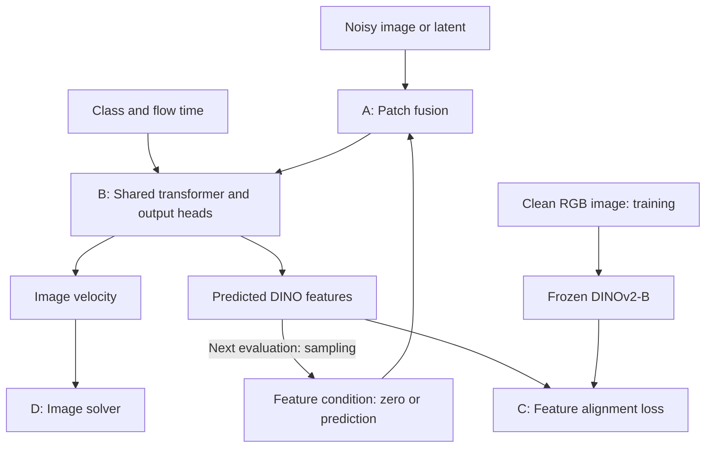
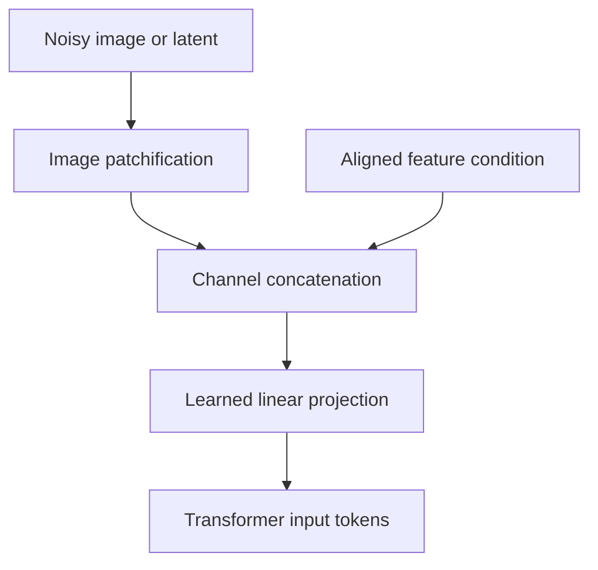
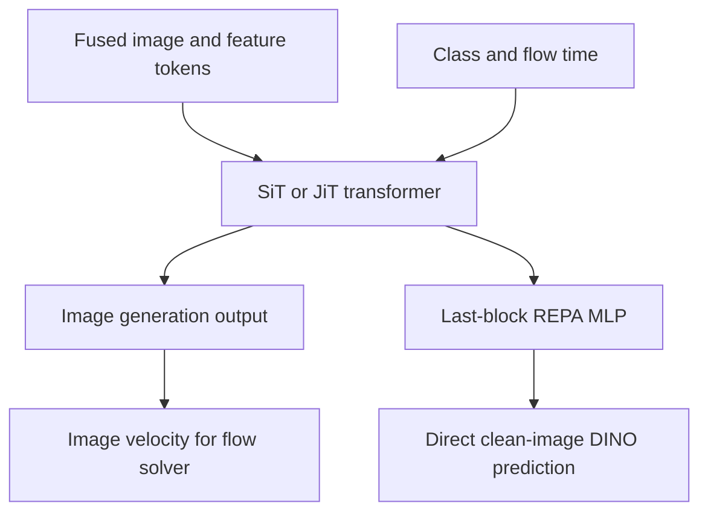
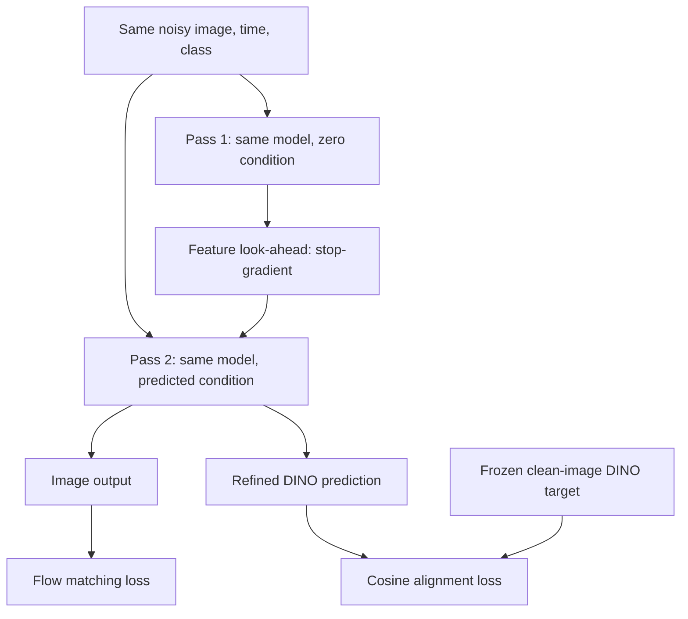
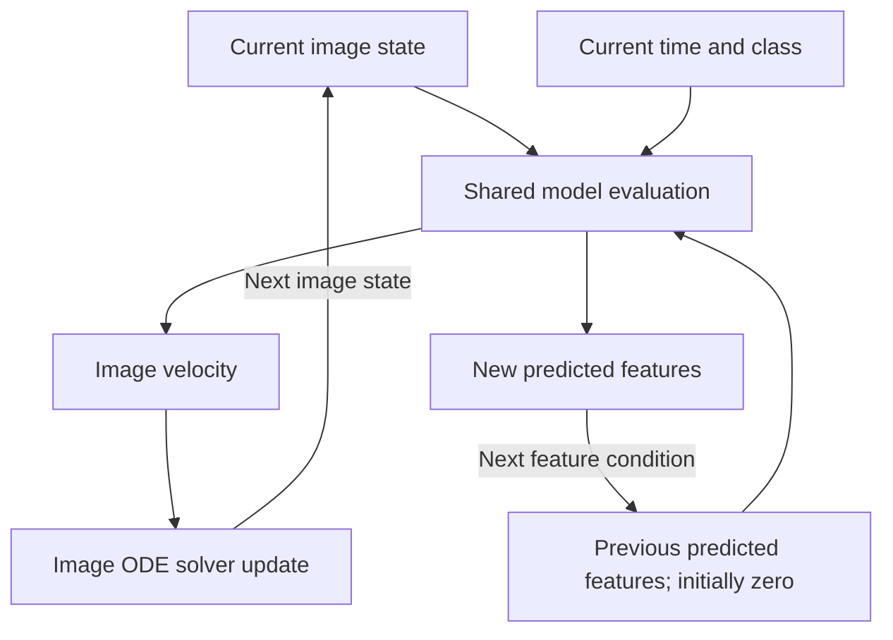

# DINO Forcing — Reorganized Method

Source: Ghosh et al., *Dino Forcing Flow Models: Do not denoise what you can predict*, arXiv:2610.11751v1, 8 October 2026. Sources inspected: supplied paper, especially §§3–5 and Appendices A–C. [Official implementation](https://github.com/arijit-hub/dino_forcing/tree/master/src) was supplied but could not be retrieved in this session; implementation details below come from the paper. Questions are omitted as requested.

## 2. Approach or Method

### 2.1 Method summary and interfaces

**DINO Forcing (DF) predicts a clean-image semantic representation and uses it as self-conditioning while generating the image.** Unlike co-denoising methods, it does not add Gaussian noise to DINO features or integrate a second feature ODE. The generator outputs an image velocity and a direct DINO-feature prediction. A frozen DINOv2-B encoder supplies clean-image feature targets during training only. (§3)

Training normally uses two evaluations of the same network: a no-gradient look-ahead prediction with zero feature conditioning, followed by a trainable evaluation conditioned on that prediction. Sampling instead carries the predicted features from one solver evaluation into the next. The output remains an image, in VAE latent space or directly in pixel space.

| Interface | Contents / shape | Consumer / role |
|---|---|---|
| Training sample | Clean RGB image I and class label y | Image-flow target and frozen DINO teacher |
| Image state | xₜ: noisy VAE latent or RGB image | Trainable flow model |
| Image patch tokens | B × T × D | Channel fusion |
| Feature condition | B × T × D′; D′ = 768 | Zeros, detached prediction, or occasional teacher features |
| Teacher target | z* = ϕ(I), spatially aligned patch features | Representation alignment loss |
| Network outputs | Image velocity vθ and feature prediction ẑ | Image solver and next feature condition |
| Final output | Generated RGB image; VAE decoding for latent variant | Image generation |

Notation: B is batch size, T is patch count, D is image-token channel width, D′ is DINO-feature width, and d_model is transformer hidden width. Flow time t increases from **noise at 0 to data at 1**; k indexes solver evaluations. There is no representation-specific time variable.

**Overview of a model evaluation**, with training supervision and sampling feedback marked separately:

### 2.2 Block A — Spatially aligned channel fusion

Patchify the noisy image/latent and concatenate its tokens with the feature condition **along channels**, keeping T unchanged. A learned linear projection maps fused channels to transformer width. (§3.1, Appendix B)

Schematic interface equation:

$$
q=\operatorname{Linear}([\operatorname{Patchify}(x_t);z_{\mathrm{cond}}]_{\mathrm{channels}}),
\quad
[B,T,D+D']\rightarrow[B,T,d_{\mathrm{model}}].
$$

The paper describes matching spatial token grids without a fusion-stage resampling operation. This is channel fusion, not concatenation of extra DINO tokens along the sequence. DF adds representation-related input/output projections; preserving the transformer backbone does not mean every parameter shape is unchanged.

### 2.3 Block B — Shared generator and direct representation predictor

The backbone is SiT for latent generation or JiT for pixel generation. The representation branch attaches to the **last transformer block**, using a REPA-style MLP to predict 768-dimensional DINOv2-B patch features. (§5.1, Appendix A/Table 8)

For explanatory notation, write the two model outputs as:

$$
F_\theta(x_t,t,y,z_{\mathrm{cond}})
=(v_\theta,\hat z).
$$

This is schematic interface notation, not a numbered paper equation. The feature output estimates the representation of the underlying clean image; it is neither a feature velocity nor the DINO encoding of the noisy input. The frozen teacher is not run on generated images during ordinary sampling.

### 2.4 Block C — Two-pass training and alignment

**Pass 1:** evaluate the shared model with zero feature conditioning, without gradients. Keep its feature prediction as a detached look-ahead.

**Pass 2:** evaluate the same noisy image, time, and class again, now conditioned on that look-ahead. Optimize image generation and the refined feature prediction. (§3.1, Fig. 3)

Using the paper’s noise-to-data direction, an explanatory linear flow path is
xₜ = (1−t)ε + tx, with ε ∼ N(0,I). Here x is the clean generation-space target: VAE latent for SiT, RGB for JiT. This restates the convention underlying the velocity target; it is not separately numbered in the paper.

The loss is (paper Eqs. 1–2):

$$
\mathcal L_{\mathrm{total}}
=\mathcal L_{\mathrm{FM}}+\lambda\mathcal L_{\mathrm{Align}},
\qquad
\mathcal L_{\mathrm{FM}}
=\|v_\theta-(x-\epsilon)\|^2,
$$

$$
\mathcal L_{\mathrm{Align}}
=-\left\langle
\frac{\hat z}{\|\hat z\|},
\frac{\phi(I)}{\|\phi(I)\|}
\right\rangle.
$$

The clean RGB image supplies ϕ(I), including when x lives in VAE space. Alignment supervises Pass 2’s feature prediction, not the detached Pass 1 tensor. The forward graph through Pass 1 is not differentiated.

Training exceptions (§5.1, Appendix A):
- **10%:** optimize the zero-conditioned first pass alone, so the model learns the sampling initialization case.
- **5%:** use ground-truth DINO features as the condition.
- **10% null class conditioning:** enables guidance training.

The paper lists these rates without fully specifying their joint sampling precedence. No implementation questions are included.

### 2.5 Block D — One image trajectory with feature feedback

Start from x⁽⁰⁾ ∼ N(0,I) and z_cond⁽⁰⁾ = 0. At each solver evaluation, predict both image velocity and DINO features; integrate the image state and carry the feature prediction forward as the next condition. (§3.2, Fig. 4)

A **schematic Euler recurrence** makes the distinction explicit:

$$
(v^{(k)},\hat z^{(k)})
=F_\theta(x^{(k)},t_k,y,z_{\mathrm{cond}}^{(k)}),
$$

$$
x^{(k+1)}=x^{(k)}+(t_{k+1}-t_k)v^{(k)},
\qquad
z_{\mathrm{cond}}^{(k+1)}=\hat z^{(k)}.
$$

The representation update is replacement by a prediction, not numerical integration. Sampling does not repeat the two-pass training procedure at every step. The latent variant uses Euler; the pixel variant uses Heun, so the recurrence above illustrates the Euler case rather than specifying Heun’s internal evaluations.

### 2.6 Training, sampling, and reported configuration

| Setting | Latent-space DF | Pixel-space DF |
|---|---|---|
| Backbone | SiT | JiT |
| Generation space | sd-vae-ft-ema VAE latents | RGB pixels |
| Image resolution | 256² or 512² | 256² |
| Patch size | 2 | 16 |
| Frozen representation teacher | DINOv2-B | DINOv2-B |
| Representation dimension | 768 | 768 |
| Prediction branch | Final block, REPA MLP | Final block, REPA MLP |
| Alignment weight λ | 0.5 | 0.03 |
| Optimizer / learning rate | Adam / 10⁻⁴ constant | Adam / 2×10⁻⁴ constant |
| Sampling | Euler ODE, 50 steps | Heun ODE, 50 steps |
| Reported guided sampling | AutoGuidance, weaker L model at 150K | CFG with interval (0.1,1) |

The generator, fusion projection, and representation prediction branch are trained; the DINO teacher stays frozen. The latent variant uses an existing VAE rather than learning a DINO-to-RGB decoder. The feature branch remains active during inference, while the teacher is only a training supervisor.

**Scope relevant to world-action models:** DF retains image generation and its flow loss. It provides predicted DINO features as semantic guidance; it does not replace image generation with feature-only prediction, and it does not itself define a robot action head or manipulation policy.

Source index: core method/losses §3.1; rollout §3.2; latent implementation and training exceptions §5.1; pixel variant §5.2; settings Appendix A/Table 8; token fusion Appendix B; branch placement and first-pass training Appendix C.

