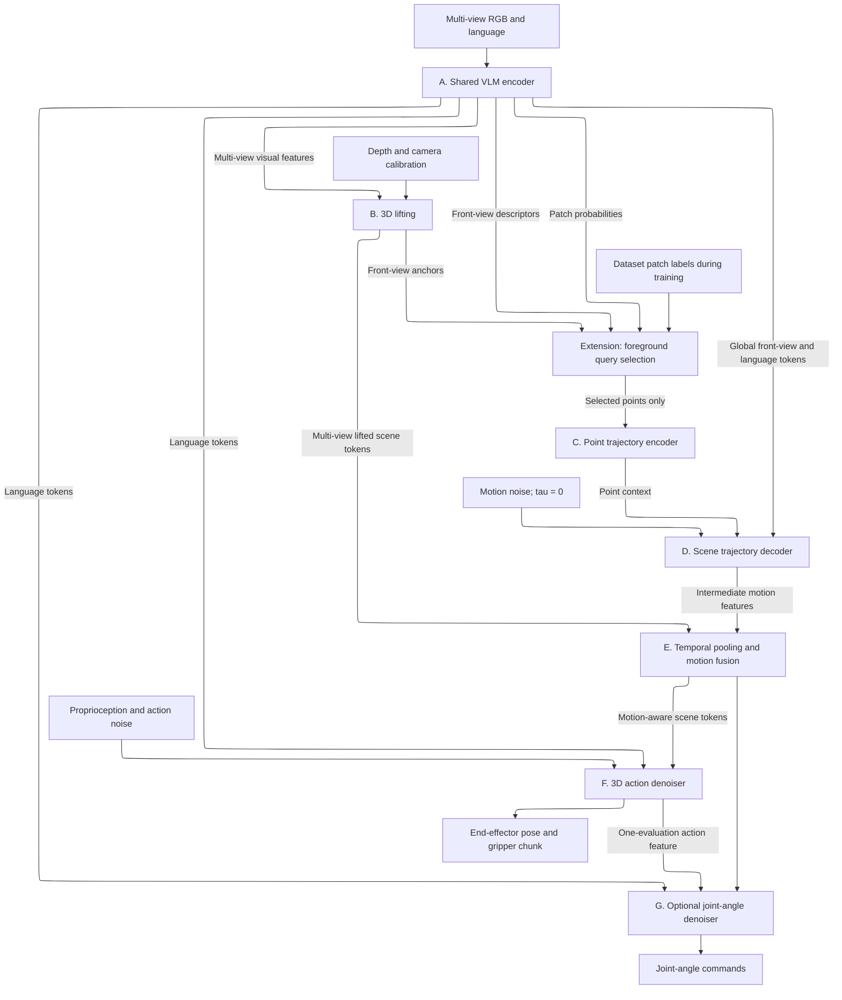
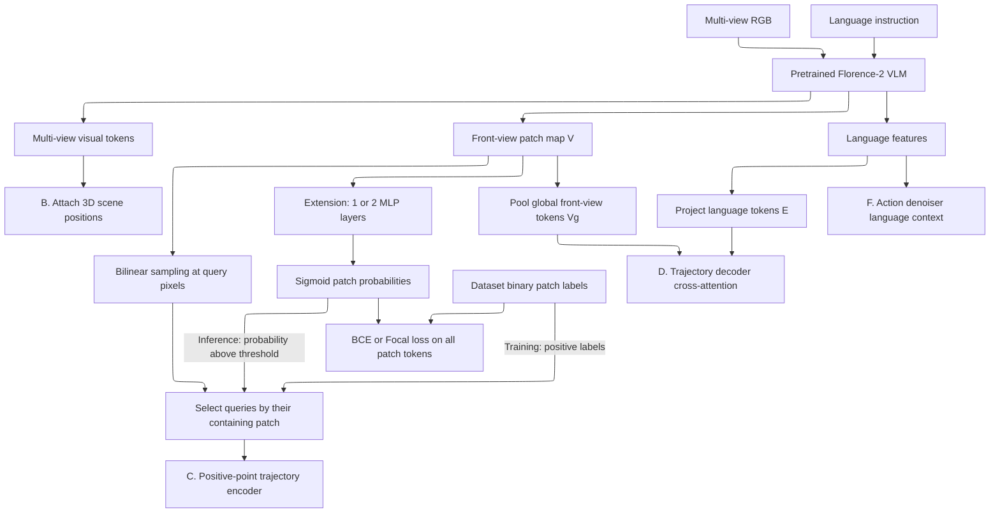
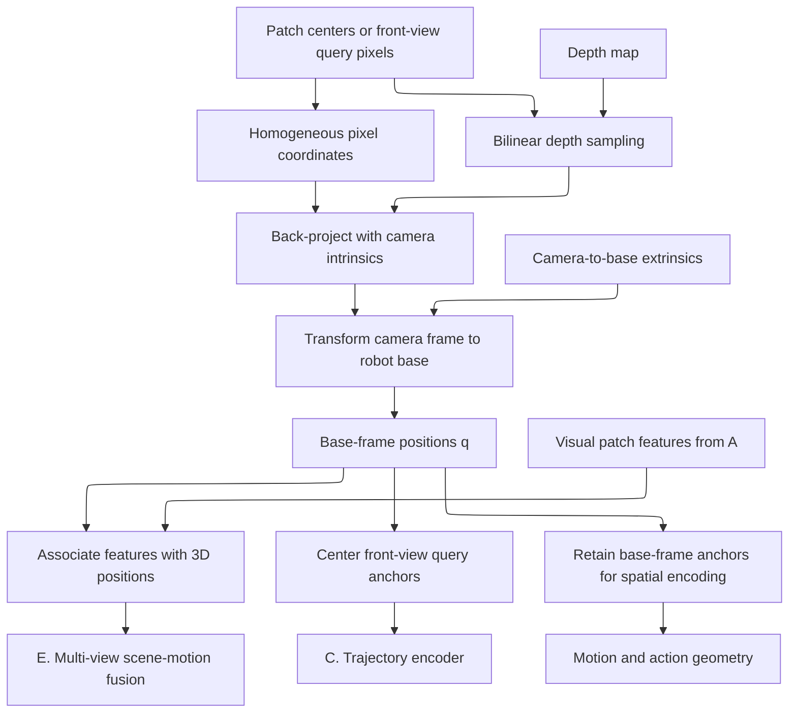
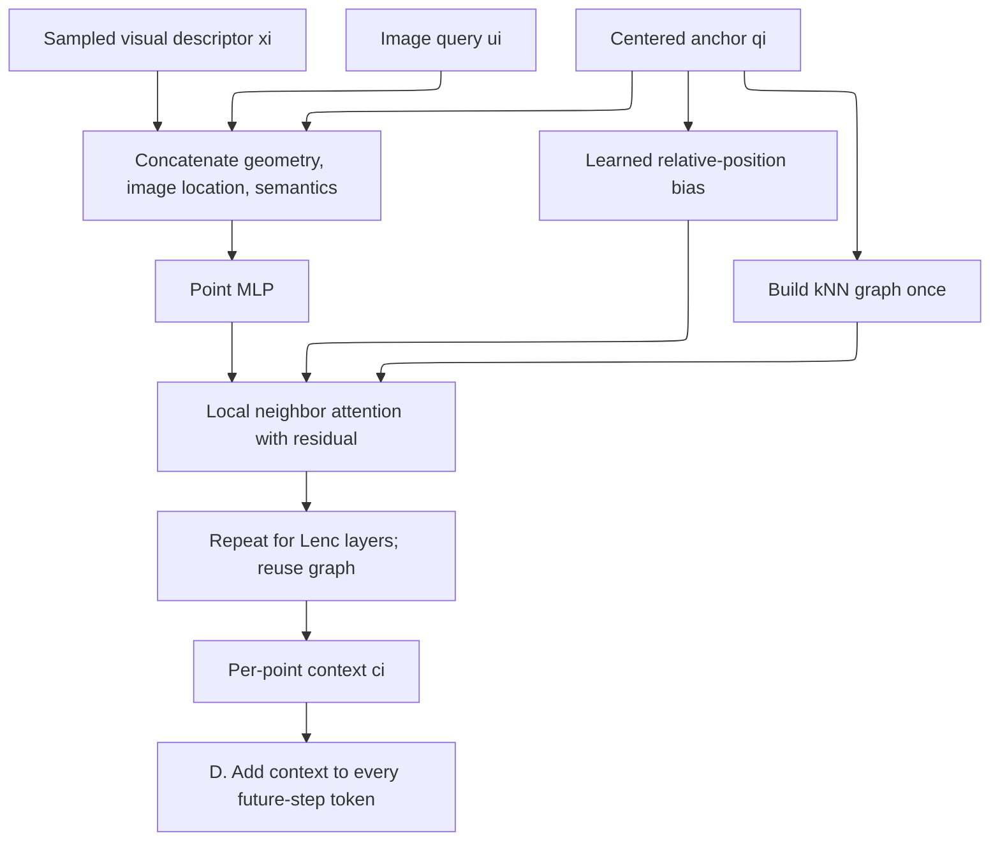
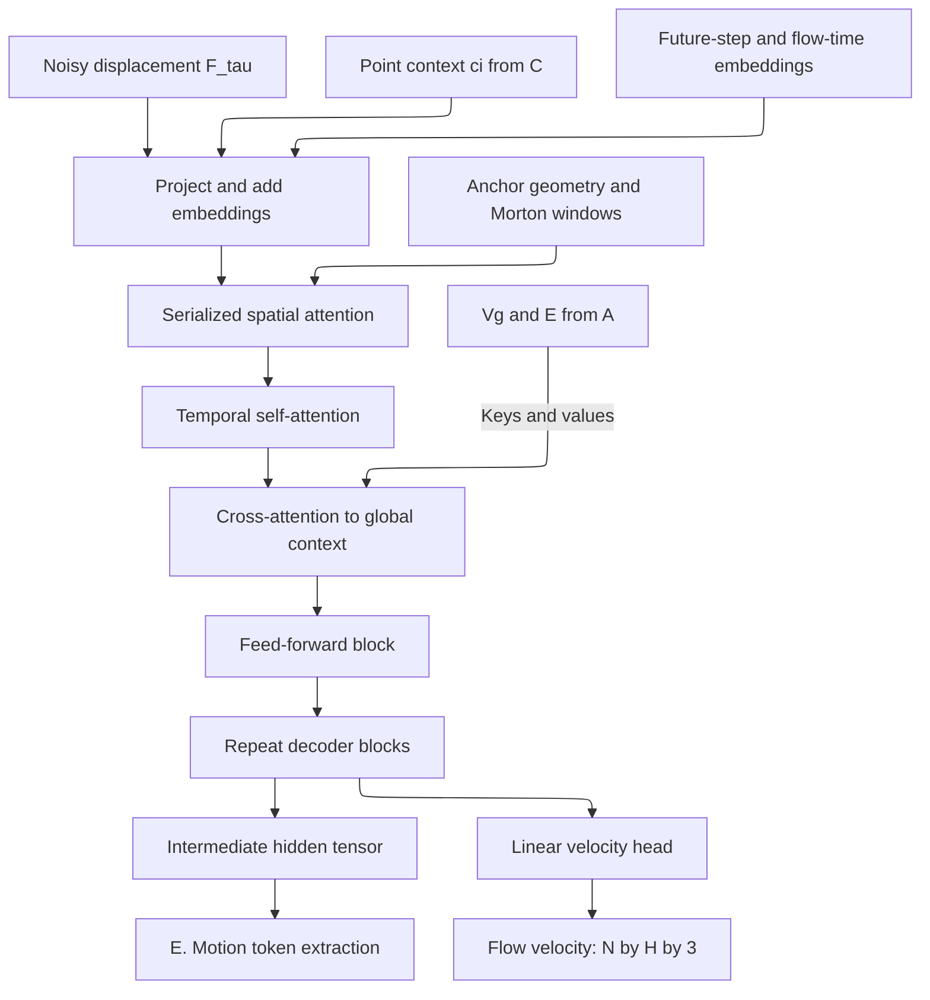
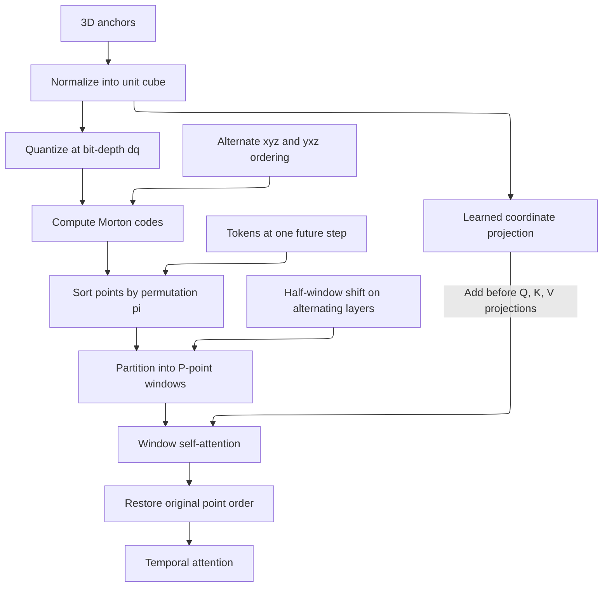
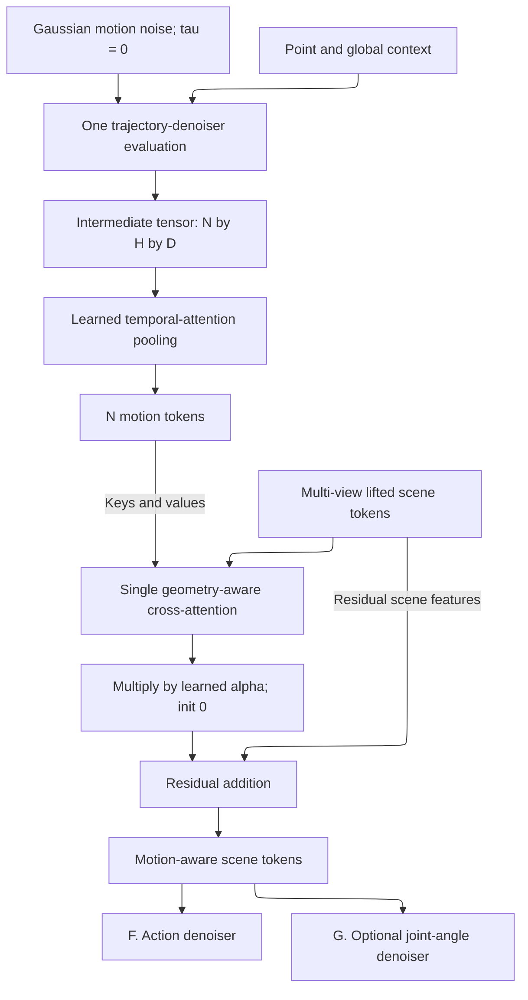
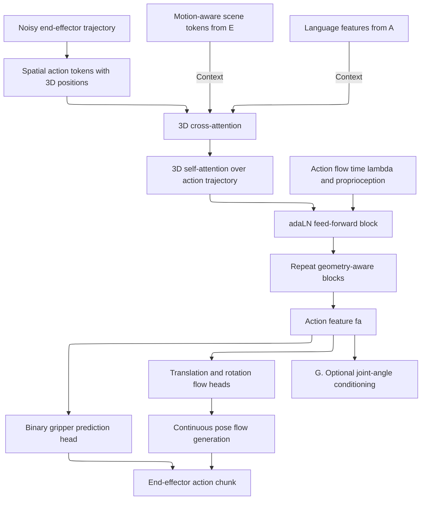
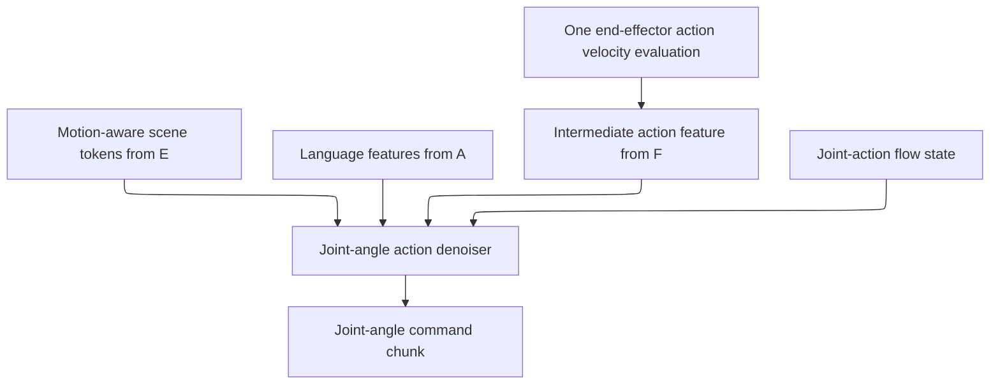

# GeomVLA — Reorganized Method

Source: *GeomVLA: Unifying Scene, Motion, and Action in 3D*, arXiv:2609.13812v2. This document reorganizes Section 2 of `GeomVLA.md` around the method's blocks, using the paper's Section 3 and Appendix to clarify their connections. Original-paper descriptions are retained alongside clearly marked **user-defined extensions**; §2.11 records the user's implementation choices. The patch classifier and foreground-only query routing are extensions, not features reported by GeomVLA. Equations identified as **schematic** explain wiring without claiming an exact implementation reported by the authors.

## 2. Approach or Method

### 2.1 Method summary, inputs, outputs, and high-level architecture

GeomVLA connects scene perception, future-motion reasoning, and robot action generation through a shared robot-base 3D frame. A pretrained Florence-2 VLM provides visual and language features. Depth and camera calibration attach metric 3D positions to the visual tokens. A front-view trajectory denoiser learns future motion for a grid of 3D anchors. During policy inference, the model reads intermediate features from **one trajectory-denoiser evaluation on noise at flow time τ = 0**, pools them into motion tokens, and fuses them into the multi-view scene representation. A separate flow-based action denoiser generates end-effector pose and gripper chunks from this motion-aware representation, language, and proprioception.

The predicted scene trajectories serve as a learned source of latent conditioning. The policy does not need to fully reconstruct those trajectories or execute them as a robot plan. An optional downstream joint-angle denoiser uses the same 3D reasoning pathway to generate joint-space commands.

**User-defined extension:** a parallel MLP–sigmoid branch classifies every front-view visual patch. During training, dataset-provided patch labels select which sampled points enter the trajectory encoder and decoder; only positive points receive trajectory supervision. During inference, predicted patch probabilities above a configured threshold select points for optional explicit 3D trace generation. The multi-view scene representation remains available to the action path.

#### Inputs and outputs

| Interface | Contents | Where used |
|---|---|---|
| Multi-view RGB observations | Images $\{I_v\}_{v=1}^{n_v}$ | Shared VLM; all views support the action scene representation |
| Depth and calibration | $D_v$, intrinsics $K_v$, camera-to-base transform $(R_v,t_v)$ | Lift visual tokens and front-view queries into the robot base frame |
| Language instruction | $\ell$ | VLM language embeddings; trajectory and action conditioning |
| Robot proprioception | $p$, including the current end-effector pose needed for spatial anchoring | Proprioceptive tokens and action adaLN conditioning; full vector unspecified |
| Motion noise and flow time | $\mathcal F_0$, $\tau$ | Trajectory denoiser; policy latent read uses $\tau=0$ |
| Action noise and flow time | $A_0$, $\lambda$ | Continuous pose flow matching and generation |
| Main policy output | $A=(a_1,\ldots,a_T)$: translation and rotation deltas plus binary gripper states | End-effector control |
| Optional control output | Joint-angle action chunk | GeomVLA-JA control |
| Internal motion outputs | Flow velocity $u_\theta$, intermediate features $Z^{\mathrm{int}}$, pooled motion tokens $z_i^m$ | Motion training and policy conditioning |
| Optional reconstructed motion | Future 3D point positions $q_i^{(t)}$ | Explicit trajectory prediction; requires flow integration |
| Extension: patch labels | Dataset-provided binary label for every front-view patch token | Classification supervision on all real patch tokens; ground-truth query selection in training |
| Extension: patch probabilities | One sigmoid probability per front-view patch token | Inference query selection for optional trace prediction |

At training time, demonstration actions supervise the action denoiser, and SpatialTrackerV2 point-track pseudo-labels supervise the trajectory denoiser in Stage 1. Noise is an internal generative input, separate from the sensor observations.

#### High-level block diagram

The diagram shows the **policy latent path with the user-defined foreground selector**, including the selector's training label input. Training selection uses ground-truth labels; inference selection uses predicted patch probabilities. Block D can be evaluated once for latent features, while explicit 3D trace reconstruction is optional and requires flow integration (§2.5). Motion noise and action noise belong to separate flows. Whether a deployment disables the entire latent motion branch, rather than only explicit trace reconstruction, is a separate policy choice.

#### Notation and main interfaces

| Symbol | Meaning / shape |
|---|---|
| $n_v$ | Number of camera views; renamed here to avoid collision with the paper's visual-map symbol $V$ |
| $V\in\mathbb R^{H_v\times W_v\times d_v}$ | Front-view VLM patch feature map |
| $f_v$, $f_\ell$ | Multi-view visual tokens and language features |
| $f_v^{\mathrm{lift}}$ | Visual scene features associated with base-frame positions |
| $V_g$, $E\in\mathbb R^{L\times d_t}$ | Pooled front-view visual tokens and projected language tokens for the motion decoder |
| $u_i=(u_i,v_i)$ | Front-view image query location |
| $q_i=q_i^{(0)}$, $\tilde q_i$, $\hat q_i$ | Base-frame anchor, centered anchor, and unit-cube-normalized anchor |
| $N=400$ | Number of front-view anchors: a regular $20\times20$ grid |
| $M=H_vW_v$ | Number of front-view patch tokens classified by the extension; independent of the query-grid count $N$ |
| $y_j$, $p_j$ | Dataset binary label and predicted probability for patch token $j$ |
| $\rho(i)$ | Discrete patch index containing sampled query $u_i$ |
| $N_{\mathrm{sel}}$ | Number of selected query points per sample; can vary and can be zero |
| $H=15$ | Future motion horizon in temporally downsampled steps |
| $T$ | Robot action chunk length, distinct from $H$ |
| $c_i\in\mathbb R^D$ | Geometry-aware context token for anchor $i$ |
| $\mathcal C=(\{c_i\},V_g,E)$ | Conditioning for the trajectory decoder |
| $\mathcal F\in\mathbb R^{N\times H\times3}$ | Per-step point displacement tensor; normalization is made explicit where needed |
| $Z\in\mathbb R^{N\times H\times D}$ | Trajectory decoder hidden tensor |
| $z_i^m$ | One pooled motion token per anchor |
| $f_v^{\mathrm{mot}}$ | Scene features after motion fusion |
| $\tau$, $\lambda$ | Motion-flow time and action-flow time, respectively |

### 2.2 Block A — Shared VLM feature extraction

**Input:** multi-view RGB images and the language instruction. **Output:** patch-level visual tokens and language embeddings; the front view also supplies local descriptors and pooled global tokens to the motion branch. The original backbone uses public Florence-2 initialization. **User-defined extension:** additionally output one foreground/moving probability per front-view patch token and route only selected queries to the motion encoder.

The following diagram includes the requested extension in parallel with bilinear descriptor sampling. The classifier receives the **patch map**, rather than the sampled query descriptors.

For front-view query $u_i$, the local visual descriptor is

$$
x_i=\operatorname{BilinearSample}(V,u_i).
$$

This sampling equation restates the Appendix's procedure. The local descriptor $x_i$ enters Block C's MLP. The pooled front-view tokens $V_g$ and projected language tokens $E$ enter Block D's cross-attention as global context. Multi-view visual features instead enter Block B and then the action path through Block E. Thus, the local point encoder and global decoder conditioning are two distinct connections from the VLM.

**Reported limits:** the paper does not identify the exact Florence-2 extraction layers, pooling implementation for $V_g$, or language projection architecture. It does not prescribe selecting the first K VLM layers or interleaving expert layers with layer-specific VLM K/V caches. Those are features of the separate combined proposal, rather than the original GeomVLA method.

#### User-defined patch classifier and foreground routing

Flatten the front-view map into $M=H_vW_v$ patch vectors $v_j\in\mathbb R^{d_v}$. Apply a shared classifier independently to every visual patch token:

$$
z_j=g_\psi(v_j),\qquad p_j=\sigma(z_j),\qquad j=1,\ldots,M.
$$

The head contains **one or two learned affine/MLP layers**, with one scalar logit per patch. A concrete schematic parameterization is $g_\psi(v)=Wv+b$ for one layer, or $g_\psi(v)=W_2 a(W_1v+b_1)+b_2$ for two layers. The hidden width and intermediate activation $a$ are configuration choices. Sigmoid is applied to the final logit, yielding a binary segmentation-like foreground probability map.

The dataset supplies binary patch labels $y_j\in\{0,1\}$. Preserve the previously specified foreground annotation convention, including annotated manipulation objects and manipulators when present in the dataset. Labels are not generated from displacement thresholds or predicted probabilities. Every real patch token, positive or negative, receives classification supervision; padding is masked when batching.

For sigmoid binary classification, “Cross Entropy” means **binary cross entropy**. A stable implementation uses BCE-with-logits on $z_j$, although the output probability is $p_j$. Alternatively use binary Focal loss:

$$
\mathcal L_{\mathrm{BCE}}=-\frac1M\sum_{j=1}^{M}
\left[y_j\log p_j+(1-y_j)\log(1-p_j)\right],
$$

$$
p_j^{\mathrm{true}}=y_jp_j+(1-y_j)(1-p_j),\qquad
\alpha_j^{\mathrm{true}}=y_j\alpha_{\mathrm{cls}}+(1-y_j)(1-\alpha_{\mathrm{cls}}),
$$

$$
\mathcal L_{\mathrm{focal}}=-\frac1M\sum_{j=1}^{M}
\alpha_j^{\mathrm{true}}(1-p_j^{\mathrm{true}})^\gamma\log p_j^{\mathrm{true}}.
$$

These equations specify the extension, not a loss reported by GeomVLA. Configure the loss choice and any Focal parameters without assigning unrequested numerical defaults.

For each sampled query $u_i$, let $\rho(i)$ identify its **containing patch** on the front-view patch grid. Query feature sampling remains bilinear, but routing uses this discrete patch membership:

$$
\mathcal S_{\mathrm{train}}=\{i:y_{\rho(i)}=1\},\qquad
\mathcal S_{\mathrm{infer}}=\{i:p_{\rho(i)}>\theta_{\mathrm{patch}}\}.
$$

Gather the selected descriptors, query locations, and 3D anchors together before Block C. Negative-patch queries are excluded from **both** the Point Trajectory Encoder and Decoder and receive no 3D trajectory loss. Training selection uses the dataset labels regardless of classifier errors; predicted probabilities and the inference threshold never select the training regression set. Positive-label stationary or temporarily occluded points retain their label; trajectory validity masks separately determine which trajectory targets can be supervised.

The classification map covers all $M$ front-view tokens, while trajectory queries form a separate grid of $N$ candidate points. Patch-to-query association must use the actual resized/cropped image-to-token geometry; bilinear descriptor sampling does not imply interpolation of categorical labels. The precise label aggregation for patches containing both foreground and background remains a dataset annotation choice.

At inference, thresholded patch predictions select candidate points only when the motion branch is evaluated. **Explicit 3D trace inference is optional.** If enabled, generate traces only for selected queries; if only policy motion features are needed, the same selected queries can supply the one-pass $\tau=0$ latent path without reconstructing traces. Skipping explicit reconstruction does not by itself specify whether latent motion conditioning is disabled.

### 2.3 Block B — Lift visual features and query anchors into 3D

**Input:** visual features, depth, calibration, and front-view query pixels. **Output:** multi-view lifted scene tokens for Block E and front-view anchors for Blocks C–E.

Lifting associates a visual feature with a metric position; it should not be interpreted as an additional depth-prediction network. For visual patch tokens, the paper obtains depth by bilinearly interpolating the four neighboring depth samples at the patch center. Intrinsics and extrinsics then map that center into the robot base frame. Front-view query points use the same geometric mapping.

For one camera, Appendix Eq. (7) states

$$
\bar u_i=[u_i,v_i,1]^\top,
\qquad
q_i=R_{c\to b}\big(D(u_i)K^{-1}\bar u_i\big)+t_{c\to b},
$$

$$
\tilde q_i=q_i-\frac1N\sum_{j=1}^{N}q_j.
$$

The second equation is applied to the trajectory encoder's front-view anchor set. The paper **explicitly states** that centered coordinates $\tilde q_i$ remove global translation from this coordinate input, while uncentered base-frame positions $q_i$ are retained for downstream spatial encoding. It does not give a complete tensor-by-tensor wiring specification identifying every later use of these retained anchors.

Block C uses $\tilde q_i$ for the point MLP and kNN geometry. Block D further normalizes anchors for serialization. Scene and action attention use positions in the shared base frame. Centering one internal coordinate input does not establish translation invariance of the whole network, because image coordinates and visual descriptors remain inputs.

The motion branch consumes **only the front-camera RGB-D observation and its calibration**. The action scene representation uses **multiple views**. Proprioceptive features are also represented as learnable tokens anchored at the current end-effector pose; their detailed interaction with the action adaLN conditioning is unspecified.

**Extension connection:** gather anchors using Block A's selected-query indices before passing them to the motion encoder. Center the selected valid anchor set, using $N_{\mathrm{sel}}$ in place of $N$ in the encoder centering operation. This selection concerns the point-motion path; the multi-view lifted scene tokens still provide the full scene context to the action path.

### 2.4 Block C — Local geometry-aware point trajectory encoder

**Input:** front-view descriptors $x_i$, image queries $u_i$, and centered anchors $\tilde q_i$. **Output:** per-point context $\{c_i\}_{i=1}^N$, passed to Block D.

The initial token follows Appendix Eq. (8):

$$
h_i^{(0)}=\operatorname{MLP}\big([\tilde q_i;u_i;x_i]\big)\in\mathbb R^D.
$$

The paper's equation concatenates image coordinates directly. It does not specify Fourier encoding for these coordinates.

A k-nearest-neighbor graph $\mathcal N_k(i)$ is built once over $\{\tilde q_i\}$ and reused across all encoder layers. Local attention uses a learned relative-position bias (Appendix Eq. (9)):

$$
s_{ij}^{(r)}=
\frac{(W_q^{(r)}h_i^{(r)})^\top(W_k^{(r)}h_j^{(r)})}{\sqrt{d_h}}
+b(\tilde q_j-\tilde q_i),
\qquad
\alpha_{ij}^{(r)}=\operatorname{softmax}_{j\in\mathcal N_k(i)}s_{ij}^{(r)},
$$

$$
h_i^{(r+1)}=h_i^{(r)}+
\sum_{j\in\mathcal N_k(i)}\alpha_{ij}^{(r)}W_v^{(r)}h_j^{(r)},
\qquad
c_i=h_i^{(L_{\mathrm{enc}})}.
$$

Here $d_h$ is the per-head key dimension. The same anchor geometry supplies neighbor selection and relative offsets, while visual descriptors supply semantics. The output $c_i$ is added to every future-step token for point $i$ in Block D. The full motion-decoder context is

$$
\mathcal C=(\{c_i\}_{i=1}^N,V_g,E).
$$

The local encoder uses kNN attention; the trajectory decoder uses Morton window attention instead. The paper does not report the encoder's numerical neighbor count $k$.

**Extension connection:** Block C receives only $\mathcal S_{\mathrm{train}}$ during training or $\mathcal S_{\mathrm{infer}}$ when the inference motion branch is requested. Apply its MLP and kNN attention to this selected set. Its output has $N_{\mathrm{sel}}$ point tokens, which are the only point context passed to Block D. Batched variable-size sets require padding masks or packed tensors; padded entries must not become neighbors or loss targets.

### 2.5 Block D — 3D scene trajectory decoder

**Extension interface:** the original equations below describe GeomVLA's full-grid decoder. For the foreground-only extension, replace the point dimension $N$ by $N_{\mathrm{sel}}$ and gather ground-truth trajectories by the same selected-query indices. Decoder tokens have shape $N_{\mathrm{sel}}\times H\times D$ and flow outputs have shape $N_{\mathrm{sel}}\times H\times3$. Spatial serialization and temporal attention operate only on selected points; global visual/language context remains available.

**Input:** noisy displacement tensor $\mathcal F_\tau$, flow time $\tau$, point context $c_i$, front-view global tokens $V_g$, language tokens $E$, and anchor geometry. **Output:** a flow velocity tensor of shape $N\times H\times3$ and an intermediate hidden tensor used by Block E.

#### Prediction target and two different integrations

GeomVLA predicts **per-step displacement increments**, rather than spline controls or absolute future positions (paper Eq. (1)):

$$
\mathcal F_{\mathrm{metric}}
=\{\Delta q_i^{(t)}\}_{i=1,t=1}^{N,H}\in\mathbb R^{N\times H\times3},
\qquad
q_i^{(t)}=q_i^{(0)}+\sum_{s=1}^{t}\Delta q_i^{(s)}.
$$

The reported grid has $N=20\times20=400$ anchors and $H=15$ future steps. Demonstration videos are downsampled by a factor of three, so the motion horizon spans 45 frames at the original rate.

Two integrations have different roles: **flow integration** generates the displacement tensor from noise, and **cumulative summation over future steps** converts metric increments into point positions. Neither is required for the policy's one-pass latent read.

#### Flow-matching input construction

Let $\mathcal F=\mathcal N(\mathcal F_{\mathrm{metric}})$ denote the normalized pseudo-ground-truth tensor. The paper specifies a normalization and inverse transform but does not fully define their statistics. Sample $\mathcal F_0\sim\mathcal N(0,I)$ and $\tau\sim\mathcal U(0,1)$. Appendix Eq. (10) gives

$$
\mathcal F_\tau=(1-\tau)\mathcal F_0+\tau\mathcal F,
\qquad
u^\star=\mathcal F-\mathcal F_0.
$$

Thus $\tau=0$ is noise and $\tau=1$ is the normalized displacement target. The network $u_\theta(\mathcal F_\tau,\tau,\mathcal C)$ predicts this flow velocity; its immediate output is not itself a metric displacement trajectory.

For each anchor and future step, Appendix Eq. (11) constructs

$$
Z_{i,t}^{(0)}=W_F\mathcal F_{\tau,i,t}+c_i+e_t+\phi(\tau),
$$

where $e_t$ is a learned future-step embedding and $\phi(\tau)$ a sinusoidal flow-time embedding. Future-step index $t$ and generative flow time $\tau$ are separate variables.

#### Decoder sub-block diagram

Each attention and feed-forward sub-block uses pre-LayerNorm and residual connections. Appendix Eq. (13) specifies the order

$$
Z\xrightarrow{\mathrm{SerSpatial}}Z
\xrightarrow{\mathrm{Temporal}}Z
\xrightarrow{\mathrm{Cross}([V_g;E])}Z
\xrightarrow{\mathrm{FFN}}Z.
$$

**Spatial attention:** for each fixed future step $t$, connect nearby anchors through serialized windows. **Temporal attention:** for each fixed anchor $i$, connect its $H$ future steps. **Cross-attention:** trajectory features are queries; $[V_g;E]$ supplies global visual-language context. Point context $c_i$ enters through the initial token sum, rather than being specified as an extra cross-attention memory sequence.

#### Serialized spatial attention in detail

Normalize anchors coordinate-wise:

$$
\hat q_i=
\frac{\tilde q_i-\min_j\tilde q_j}{\max_j\tilde q_j-\min_j\tilde q_j}.
$$

Quantize these coordinates at bit-depth $d_q$, compute 3D Morton/Z-order codes, and sort by permutation $\pi$. Attention operates within non-overlapping windows of $P$ consecutive points. Using **zero-based serialization indices** $r,s$, a reindexed version of Appendix Eq. (12) is

$$
W_P(r)=\{s:\lfloor s/P\rfloor=\lfloor r/P\rfloor\},
$$

$$
\operatorname{SerSpatial}(Z)_{\pi(r),t}
=\operatorname{Attn}\left(
Z_{\pi(r),t};\{Z_{\pi(s),t}:s\in W_P(r)\}\right).
$$

After attention, the inverse permutation restores the original point ordering. Layers alternate canonical $(x,y,z)$ and axis-permuted $(y,x,z)$ Morton orderings and apply Swin-style half-window shifts on alternating layers. A learned projection of normalized coordinates is added before Q/K/V projections. Window attention costs $O(P^2)$ per window; these ordering changes expand the effective receptive field without global all-point attention.

The paper does not report numerical $P$ or $d_q$, nor how degenerate coordinate ranges or incomplete windows are handled.

#### Motion-weighted trajectory loss

SpatialTrackerV2 supplies point-track pseudo-labels from the demonstrations. Their base-frame increments supervise the velocity head through the motion-weighted rectified-flow objective (paper Eq. (2), Appendix Eq. (14)):

$$
\mathcal L_{\mathrm{traj}}
=\mathbb E_{\tau,\mathcal F_0}\left[
\sum_{i=1}^{N}\sum_{t=1}^{H}
w_{i,t}\left\|u_\theta(\mathcal F_\tau,\tau,\mathcal C)_{i,t}-u^\star_{i,t}\right\|_2^2
\right],
$$

$$
w_{i,t}=m_{i,t}\cdot
\max\left[
\sigma\left((\|\Delta q_{i,t}\|-\tau_w)\kappa/\tau_w\right)^\gamma,
w_{\min}
\right].
$$

| Quantity | Function |
|---|---|
| $m_{i,t}$ | Validity mask excluding occlusion, invalid depth, or SpatialTrackerV2 confidence below 0.05 |
| $\tau_w$ | Motion-magnitude threshold within the soft saliency weighting |
| $\kappa$ | Sigmoid sharpness |
| $\gamma$ | Saliency exponent |
| $w_{\min}$ | Nonzero floor retaining valid static-point supervision |

This is the **original GeomVLA loss weighting**, not foreground/background classification or positive-only regression. Valid static points still contribute. A static displacement target does not have a zero flow target: if $\mathcal F=0$, then $u^\star=-\mathcal F_0$. Numerical values of the four weighting constants are not reported, and the paper does not provide an unweighted-loss ablation.

**User-defined extension:** restrict the trajectory objective to ground-truth-positive selected queries:

$$
\mathcal L_{\mathrm{traj}}^+
=\mathbb E_{\tau,\mathcal F_0}\left[
\sum_{i\in\mathcal S_{\mathrm{train}}}\sum_{t=1}^{H}
w_{i,t}\left\|u_\theta(\mathcal F_\tau^+,\tau,\mathcal C^+)_{i,t}-u^\star_{i,t}\right\|_2^2
\right].
$$

Here $i$ denotes the retained original query identity, even when tensors are packed using new selected-point indices. Superscript $+$ denotes the gathered positive subset. Validity masks still exclude unreliable targets. The new selection rule removes negative points from regression; whether to retain the original soft motion weighting within the positive subset remains a loss-configuration choice. It must not reintroduce negative queries or generate classification labels.

#### Explicit trajectory reconstruction

To reconstruct trajectories, integrate the velocity field from noise using explicit Euler steps. A **schematic discretization** of the Appendix's stated procedure is

$$
\mathcal F_{\tau_{r+1}}
=\mathcal F_{\tau_r}
+(\tau_{r+1}-\tau_r)\,
u_\theta(\mathcal F_{\tau_r},\tau_r,\mathcal C).
$$

Apply the inverse training normalization to the endpoint tensor and cumulatively sum its metric increments from $q_i^{(0)}$. The Appendix says a small number of flow steps is used but gives no exact step count. **For action conditioning, Block E reads intermediate features at τ = 0 instead of running this reconstruction.**

### 2.6 Block E — Extract motion tokens and fuse them into scene tokens

**Extension connection:** when foreground routing is enabled, the intermediate tensor and pooled motion tokens contain only selected anchors: $N_{\mathrm{sel}}\times H\times D$ and $N_{\mathrm{sel}}$ tokens, respectively. Fuse these foreground motion tokens into the full multi-view scene-token set. Preserve the selected anchors' base-frame positions and original query identities through pooling and fusion.

**Input:** Block D's intermediate decoder features, multi-view lifted scene tokens, and spatial positions. **Output:** motion-aware scene tokens $f_v^{\mathrm{mot}}$ for Block F and optional Block G.

The intermediate tensor contains one feature for each anchor and future step. A learned temporal-attention query pools the $H$ features of each anchor into a single token. A **schematic expression**, rather than a reported exact pooling formula, is

$$
z_i^m=\operatorname{TemporalAttentionPool}
\left(\{Z^{\mathrm{int}}_{i,t}\}_{t=1}^{H}\right).
$$

A single geometry-aware cross-attention fuses those tokens into the scene. The following is also a **schematic reconstruction of the paper's prose**:

$$
f_v^{\mathrm{mot}}=f_v^{\mathrm{lift}}
+\alpha\,\operatorname{CrossAttn3D}
\left(f_v^{\mathrm{lift}},\{z_i^m\}_{i=1}^{N}\right),
\qquad \alpha_{\mathrm{init}}=0.
$$

Scene tokens supply the queries, and pooled motion tokens supply keys and values. The geometric attention couples their spatial representations. The paper describes the fusion as geometry-aware but does not fully specify its positional implementation. Zero initialization means this new residual contribution starts at zero; it does not make the whole model equivalent to a separately trained no-motion policy.

This block reads **hidden motion features**, not the final three-channel velocity predictions, fully denoised trajectories, or robot actions. The paper does not identify which decoder layer supplies $Z^{\mathrm{int}}$ or provide the complete temporal-pooling architecture. One forward evaluation at $\tau=0$ is the reported policy-inference procedure; there is no motion integration loop on this path.

### 2.7 Block F — Geometry-aware 3D action denoiser

**Input:** motion-aware multi-view scene tokens, language features, proprioception, and noisy action trajectories at flow time $\lambda$. **Output:** continuous pose-flow velocities and binary gripper-state predictions, used to generate $T$-step end-effector action chunks.

#### Action block diagram

Noisy end-effector trajectories are represented as spatial action tokens with explicit 3D positions. Paper Eqs. (3)–(5) describe the feature updates:

$$
f_a\leftarrow\operatorname{CrossAttn3D}
\left(f_a,[f_v^{\mathrm{mot}};f_\ell]\right),
$$

$$
f_a\leftarrow\operatorname{SelfAttn3D}(f_a),
$$

$$
f_a\leftarrow\operatorname{adaLN\text{-}FFN}(f_a;\lambda,p).
$$

The diagram follows this reported update order; the paper does not give a layer-indexed schedule analogous to the combined proposal. Cross-attention connects action queries to scene/language context. Self-attention connects action tokens across the predicted trajectory. The adaLN feed-forward block conditions on action-flow time and proprioception.

The paper states that all attention layers in this action pathway use **3D rotary positional embeddings derived from token positions**. This aligns scene and action attention with shared spatial geometry. The frequency schedule, position normalization, and positional treatment of language tokens are not specified. Section 3.1 also describes learnable proprioceptive tokens anchored at the current end-effector pose; the exact relationship between that token pathway and Eq. (5)'s adaLN pathway is not fully defined.

#### Action loss and outputs

Continuous translation and rotation are trained with rectified flow; the gripper has separate binary supervision (paper Eq. (6)):

$$
\mathcal L_\pi=\mathbb E_{\lambda,A_0}\left[
\left\|v_\theta(A_\lambda,\lambda,f_a)-v^\star\right\|_2^2
+\operatorname{BCE}(f_\theta^{\mathrm{open}},a^{\mathrm{open}})
\right].
$$

Here $A_0$ is Gaussian action noise, $A_\lambda$ an interpolated continuous pose action, and $v^\star$ its target flow velocity. $a^{\mathrm{open}}$ is the binary gripper target. The paper does not compare separate BCE against joint continuous pose/gripper regression. It does not report the action integration solver or its exact step count; the Appendix's Euler statement concerns **scene trajectory reconstruction**.

#### Action parameterization and connections to execution

The policy outputs translation and rotation **deltas**, plus a binary gripper state. Their interpretation depends on the benchmark:

| Benchmark | Pose-delta reference | Rotation representation | Action horizon $T$ |
|---|---|---|---|
| CALVIN | Chained per-step: each pose relative to the preceding pose | Euler | 10 |
| LIBERO | Chained per-step: each pose relative to the preceding pose | Axis-angle | 10 |
| RoboTwin2.0 | Every pose relative to the current observed pose | 6D internally | 16 in Appendix Table 4's five-task configuration |
| Real world | Every pose relative to the current observed pose | 6D | 8 |

For chained deltas, the execution conversion reconstructs poses successively from the observed pose. For current-state-relative deltas, each predicted pose uses the same observed reference. This action convention is separate from Block D's point trajectories, which always use cumulative per-step displacement increments.

The reported CALVIN latency protocol predicts ten actions per `model.step()` call and executes all ten before the next query. The PDF does not establish that execution schedule for every benchmark.

### 2.8 Block G — Optional joint-angle denoiser, GeomVLA-JA

**Input:** language features $f_\ell$, motion-aware scene tokens $f_v^{\mathrm{mot}}$, and the end-effector action feature after one action velocity-field evaluation. **Output:** joint-angle commands, replacing direct execution of the Cartesian action chunk.

The noisy joint-action flow state in the diagram follows the stated rectified-flow formulation; the paper does not specify its detailed input embedding or full decoder architecture. The joint-angle denoiser is trained with the **same rectified-flow objective as Eq. (6)**. It uses Cartesian action features as intermediate reasoning rather than executing the predicted Cartesian trajectory directly. The paper describes conditioning on those features; it does not describe converting a finalized Cartesian plan to joints through inverse kinematics.

GeomVLA-JA and the paper's 2D-JA comparison use the same VLM, joint-angle denoiser, and training data. The comparison places their different perception/motion representations under a matched output action space. This document retains that method relationship without the original summary's benchmark-result discussion.

### 2.9 Training and inference connections across blocks

#### Two-stage optimization

| Stage | Supervision | Trainable modules | Connection through the method |
|---|---|---|---|
| 1: trajectory pretraining | Motion-weighted $\mathcal L_{\mathrm{traj}}$ on SpatialTrackerV2 pseudo-labels | Trajectory encoder and decoder; VLM frozen | Trains Blocks C–D to represent front-view future point motion |
| 2: joint policy fine-tuning | **Only** $\mathcal L_\pi$: pose flow loss plus gripper BCE | Action denoiser, pretrained trajectory denoiser, and VLM jointly | Action gradients connect Block F through motion fusion and intermediate features back into the trajectory branch |

The trajectory pseudo-label loss is **dropped in Stage 2**. The motion module then receives supervision through the action objective, rather than continued direct trajectory supervision. The paper does not provide a before/after measurement isolating how this changes trajectory accuracy. No robot-action pretraining is used; the pretrained component is Florence-2, and robot training uses benchmark demonstrations.

**Extension training objectives:** whenever the patch head is trained, supervise all real front-view patch tokens with $\mathcal L_{\mathrm{cls}}\in\{\mathcal L_{\mathrm{BCE}},\mathcal L_{\mathrm{focal}}\}$. In a trajectory-supervised stage, the schematic combined objective is $\mathcal L_{\mathrm{cls}}+\lambda_{\mathrm{traj}}\mathcal L_{\mathrm{traj}}^+$; add $\mathcal L_\pi$ when action training is active. The classification/trajectory weights and whether trajectory supervision is retained in revised Stage 2 remain configuration decisions. The original paper's action-only Stage 2 describes the baseline, not a requirement to drop the extension's classifier loss.

#### End-to-end policy inference

1. Encode RGB observations and language with Block A.
2. Attach 3D positions using depth and calibration in Block B; build the front-view point context in Block C.
3. Evaluate Block D **once** on Gaussian displacement noise at $\tau=0$, reading intermediate decoder features.
4. Pool those features and fuse them into multi-view scene tokens in Block E.
5. Generate continuous pose actions with Block F's action flow, and predict gripper states with its binary head.
6. Execute the end-effector action chunk, or use Block G to generate joint-angle commands in the optional variant.

The scene, point motion, and Cartesian action representations share the robot base frame, while internal centering and normalization serve specific sub-blocks. Motion horizon $H$, action horizon $T$, and the two flow times are distinct. The main efficiency choice is the one-pass **motion latent read**; action generation still uses its own flow process.

**Extension inference procedure:** classify all front-view patches, associate each candidate query with its containing patch, and retain queries satisfying $p_{\rho(i)}>\theta_{\mathrm{patch}}$. Evaluate the motion branch on this set when requested. Full flow integration and trace reconstruction occur only when `infer_3d_trace` is enabled; the policy may still use a one-pass latent read when explicit traces are disabled. A practical empty-set handling recommendation is to return an empty trace set, skip empty motion attention, and use the lifted scene representation for action conditioning. During training an empty positive set gives zero trajectory loss while classification remains supervised; implementation must avoid division by zero. These handling recommendations are engineering additions rather than reported paper details.

#### Reported architecture sizes

These settings are reproduced from Appendix Table 4 to make the block descriptions concrete; optimization schedules, dataset inventories, evaluation results, and critical review are omitted from this method-only document.

| Architecture setting | CALVIN | LIBERO | RoboTwin2.0 five-task configuration | Real world |
|---|---|---|---|---|
| Trajectory hidden width | 512 | 384 | 320 | 128 |
| Local point encoder layers | 6 | 6 | 6 | 4 |
| Trajectory decoder layers | 8 | 8 | 8 | 8 |
| Trajectory attention heads | 16 | 8 | 8 | 8 |
| Action hidden width | 960 | 912 | 912 | 256 |
| Action shared attention layers | 16 | 16 | 16 | 16 |
| Action attention heads | 16 | 16 | 16 | 16 |

The action shared attention layers are described as action–scene fusion blocks shared by translation and rotation prediction. The table does not resolve the unspecified VLM extraction layers, latent-read layer, or detailed attention wiring noted above.

### 2.10 Questions — Missing or unclear implementation details

The following questions identify information needed to reproduce the method more precisely. Some concern explicitly unreported parameters; others ask how the described operations are implemented. The alternatives in these questions are possibilities to clarify, not additional claims about the authors' implementation. The paper already specifies the front-view motion path, centered encoder coordinates, decoder attention order, one-pass motion read at inference, and Stage 2's action-only loss.

#### Block A: VLM features and multimodal interfaces

1. **Which Florence-2 checkpoint and feature-extraction layers are used?** Identify the tensors supplying the spatial patch map, multi-view scene features, and language features. Are the visual descriptors already language-conditioned at their extraction point? **Implementation answer:** the user-defined layer-selection and action-attention policy is recorded in §2.11.1; checkpoint and exact feature-tensor choices remain to be specified for each backbone.
2. **How are global visual tokens $V_g$ and projected language tokens $E$ constructed?** Specify the pooling operation, retained token counts, projections, widths, and padding masks. These determine the trajectory decoder's cross-attention memory.
3. **How are multiple views processed and combined?** Specify image resolution, preprocessing, view order, view embeddings if any, and whether language processing is shared across views. How do the resulting token coordinates map back to image/depth pixels?

#### Block B: Depth, calibration, and spatial coordinates

4. **How are RGB and depth aligned after resizing or cropping?** Specify depth units, camera conventions, updated intrinsics, and calibration handling for moving wrist cameras. The back-projection formula is given, but the preprocessing must preserve its coordinate correspondence.
5. **Where exactly are the $20\times20$ query points placed?** Specify image coverage, border inclusion, pixel-center convention, and the coordinate conversion used for bilinear sampling of the lower-resolution VLM map.
6. **What happens to an anchor with invalid depth?** Is it removed, padded, replaced, or retained with masks? Which points contribute to centering and unit-cube bounds? Clarify how invalid anchors affect attention, separately from the trajectory-loss validity mask.
7. **Where are the retained uncentered positions used downstream?** Provide the positions attached to scene, motion, proprioceptive, and action tokens at each attention interface. Appendix Eq. (7) confirms that these positions are retained but does not fully map their later uses.

#### Block C: Point encoder

8. **What is the kNN neighbor count and graph convention?** Specify inclusion of the query itself, distance metric, tie handling, and masking when fewer than $k$ valid anchors exist. The graph is built once and reused, as reported.
9. **What are the point MLP and relative-position bias architectures?** Specify coordinate/image-location scaling, layer widths, activations, normalization, and whether $b(\tilde q_j-\tilde q_i)$ is shared or per-head/per-layer.
10. **What is the complete local encoder block?** Eq. (9) gives the attention update; clarify any additional LayerNorm, output projections, feed-forward layers, dropout, and residual ordering needed to reproduce the implemented block.

#### Block D: Trajectory targets, decoder, and loss

11. **What is the exact displacement normalization and inverse transform?** Specify statistics, their estimation split, per-axis treatment, clipping, and whether normalization is global, per-dataset, or per-sample. This is necessary to reconstruct metric trajectories correctly.
12. **How are SpatialTrackerV2 tracks converted into valid base-frame increment targets?** Specify the tracker configuration, camera-motion handling, temporal sampling, treatment of short clips, and validity of an increment when either endpoint is occluded or unreliable.
13. **What are $P$, $d_q$, and the precise serialization schedule?** Specify quantization rounding, equal-code ties, layer-by-layer axis ordering and shifts, padding of incomplete windows, and masking that prevents shifted-window wraparound artifacts. How are zero coordinate ranges handled?
14. **What are the remaining decoder dimensions and projections?** Specify future-step and flow-time embeddings, the normalized-coordinate projection, attention/head dimensions, FFN expansion, and projections that make $c_i$, $V_g$, and $E$ compatible with the decoder width.
15. **What are the numerical values and units of $\tau_w$, $\kappa$, $\gamma$, and $w_{\min}$?** Is motion saliency computed from metric or normalized increments? Is the loss reduced by valid entries, total entries, or summed as written, and what happens when all targets are invalid?
16. **How many Euler steps are used for explicit trajectory reconstruction, and at which times?** This question concerns the optional trajectory output; the policy's motion-feature read is already specified as one evaluation at $\tau=0$.

#### Block E: Motion pooling and fusion

17. **Which decoder layer and sub-block supply $Z^{\mathrm{int}}$?** Is the feature taken before or after normalization/FFN? A hook at a different point produces a different policy-conditioning tensor even with the same trained decoder.
18. **What is the exact temporal-attention pooling architecture?** Specify whether the learned query is shared across anchors, head count, projections, output width, residuals, and any temporal mask. Confirm that pooling returns one token per anchor.
19. **How is the geometry-aware fusion attention implemented?** Specify motion-token positions, scene-token positions, positional encoding, width adapters, attention masks, and residual-scale parameterization. The paper states a learned scalar initialized to zero, but the schematic fusion equation does not define these internal operations.
20. **How is the one-pass motion read used during Stage 2 training?** Is it also evaluated at $\tau=0$, and is motion noise freshly sampled, fixed, or reused? Clarify the gradient path through pooling/fusion and any detach operations. Joint optimization is reported; these choices determine the actual training connection.

#### Block F: Action tokens, 3D attention, and execution

21. **How are noisy pose deltas converted into spatial action-token positions?** For both chained and current-state-relative actions, specify whether 3D attention positions come from the noisy trajectory, reconstructed poses, or another reference, and whether they change during flow integration.
22. **What is the full action transformer block and 3D RoPE construction?** Specify the layer schedule/counting convention, residuals, Q/K/V projections, XYZ frequency allocation, rotated channel subset, and position scaling. How are language tokens handled when they have no physical 3D location? For the reported width 912 with 16 heads, clarify projection dimensions and the rotary-channel layout rather than assuming every head channel is rotated.
23. **What exactly enters the proprioceptive pathways?** Specify the state vector, normalization, number and insertion point of learnable tokens, pose used for anchoring, and the conditioning network for adaLN. How are the token and adaLN routes combined?
24. **How are pose-flow and gripper predictions implemented and generated?** Specify continuous-action normalization, interpolation/noise conventions, translation/rotation loss scaling, gripper logits versus probabilities, and whether gripper output depends on flow time. Give the action integration solver, time schedule, and step count; these are not established by the scene-trajectory Euler statement.
25. **How are rotation deltas composed and action chunks executed?** Specify Euler/axis-angle conventions, 6D rotation decoding and projection, transform composition order, clipping or limits, and single-/dual-arm token layouts. What replanning frequency and number of executed actions are used outside the reported CALVIN latency protocol?

#### Block G: Optional joint-angle control

26. **What is the joint-angle denoiser architecture and action representation?** Specify layer sizes, conditioning interfaces, joint ordering, absolute versus delta targets, normalization, noise/flow schedule, and gripper handling under the stated Eq. (6) objective.
27. **Which end-effector feature conditions the joint-angle denoiser?** Identify its layer, flow time, noise input, and pooling/projection. Are the Cartesian and joint-angle branches trained jointly, and which losses and gradients update the intermediate Cartesian branch?

#### Reproduction priorities

The first details to resolve are **VLM tensor selection, metric/normalized coordinate conventions, motion-latent extraction and fusion, action-token spatial positions, 3D RoPE, and action generation**. These define the connections between blocks; matching only the published hidden widths and layer counts would leave materially different implementations possible. Neighbor/window sizes and loss-weight constants then determine important numerical choices within those blocks. The optional joint-angle questions can be deferred when implementing the Cartesian policy first.

### 2.11 User-defined implementation answers

These answers specify the user's configurable implementation. They supplement the paper description and are not claims that GeomVLA reports these configurations. Question numbers refer to §2.10.

#### 2.11.1 Answer to Question 1 — Backbone layers and action attention

**Decision:** make VLM layer selection and the action-head attention style configurable for the chosen backbone. Use the following configuration fields; `start_layer` is the normalized spelling of the user's “Star-layer.” No numerical defaults are assigned by this answer.

| Configuration field | Meaning |
|---|---|
| `start_layer` | First VLM transformer layer in the selected range |
| `end_layer` | Endpoint of the selected VLM layer range |
| `type` | `Interleave` or `Full` |

**Attention behavior:**

| Condition | Action-head behavior | Architectural analogy named by the user |
|---|---|---|
| Multiple selected VLM layers; `type: Interleave` | Alternate action self-attention and cross-attention to selected VLM transformer layers | SmolVLA |
| Multiple selected VLM layers; `type: Full` | Each action-head layer performs self-attention followed by cross-attention to the selected VLM backbone context | MolmoAct |
| `start_layer == end_layer` | Use one VLM layer as the cross-attention context for **every** action-head layer; use the Full pattern at every head layer | GROOT |

The single-layer case takes precedence over `type`: an Interleave setting with equal start/end layers therefore resolves to Full attention using the same VLM layer throughout the action head. The architecture names are the user's design analogies; this table defines the requested behavior rather than asserting complete equivalence to those models.

Consistent with the user's earlier attention-order decision, **self-attention comes first**. With zero-based action-head indices, Interleave uses self-attention at layers 0, 2, 4, … and cross-attention at layers 1, 3, 5, …. Full uses self-attention then cross-attention within every layer. Feed-forward, residual, and normalization details remain covered by Question 22.

For action cross-attention, action features supply the queries and the selected VLM layer supplies the conditioning context. In the single-layer case, that context is reused throughout the head. This choice connects **Block A's configurable VLM features to Block F's action expert**. How it combines with Block E's motion-aware scene context remains part of the detailed attention wiring.

**Still to specify:** backbone/checkpoint, zero- versus one-based VLM layer indices, endpoint inclusivity, action-head depth, and the mapping from each cross-attention operation to a selected VLM layer. For example, Interleave does not by itself determine whether VLM layers corresponding to self-attention-only head layers are skipped or whether cross-attention consumes selected VLM layers consecutively. Also specify the exact feature tensor, projection/width adapters, positional handling, and whether context is read from hidden states or native VLM K/V caches. This answer defines the configurable policy without assigning those remaining implementation choices.

#### 2.11.2 Additional decision — Patch classification and foreground-only motion

The detailed branch and equations are specified in §2.2 and propagated into Blocks B–E and §2.9.

| Aspect | User-defined behavior |
|---|---|
| Classifier input | Front-view patch map $V$, in parallel with bilinear query sampling |
| Classifier architecture | One or two MLP layers; final sigmoid; one scalar probability per patch token |
| Classification supervision | Binary cross entropy or binary Focal loss on every real front-view visual token |
| Label source | Dataset annotations; no motion-threshold label generation |
| Training query routing | Keep only queries whose containing patch has ground-truth label 1 |
| Trajectory supervision | Only retained positive queries with valid trajectory targets; negative queries excluded from encoder, decoder, and loss |
| Inference query routing | Keep queries whose containing patch probability is strictly above the configured threshold |
| Explicit trace inference | Optional; generated only for selected queries when enabled |

Suggested configuration field names are `patch_head_layers` (1 or 2), `patch_head_hidden_dim` when needed, `patch_loss` (`bce` or `focal`), Focal parameters when applicable, `patch_probability_threshold`, and `infer_3d_trace`. These names are an implementation proposal; no numerical defaults are assigned.

**Remaining extension questions:** define the patch-label policy for mixed foreground/background patches, the exact image-to-patch membership mapping, and variable-length batching/empty-set behavior. Confirm the revised Stage 2 loss weights and retention of trajectory supervision. Also define whether disabling explicit trace output preserves the policy's foreground latent read or disables the entire motion branch; the two switches serve different purposes.

**Source locations:** paper §3.1 (scene features), §3.2 and Appendix Eqs. (7)–(14) (trajectory encoder, decoder, and loss), §3.3 Eqs. (3)–(6) (motion fusion, action denoiser, joint-angle extension), §3.4 (training and pseudo-label horizons), §4.1 (pose-delta conventions), and Appendix Table 4 (architecture and action representations). Section 2.11 is sourced from the user's implementation decisions in this conversation.
