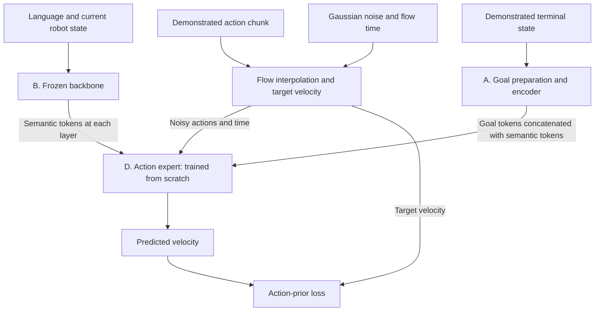
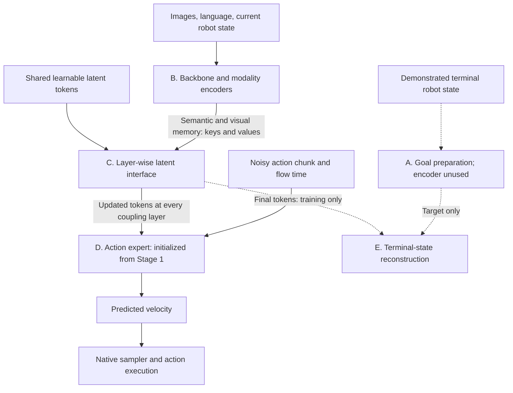
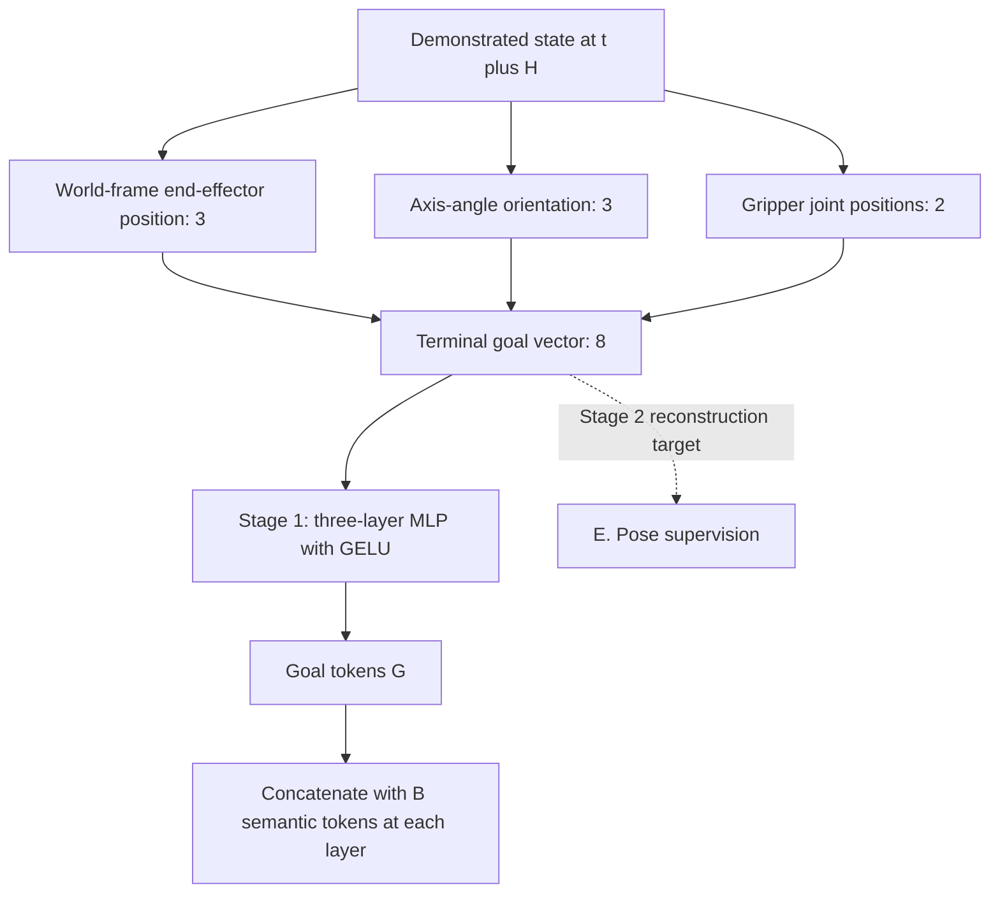
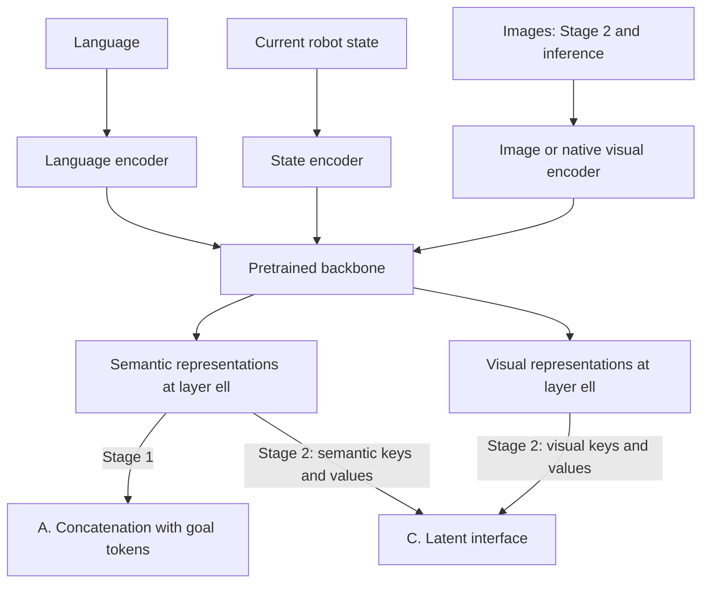
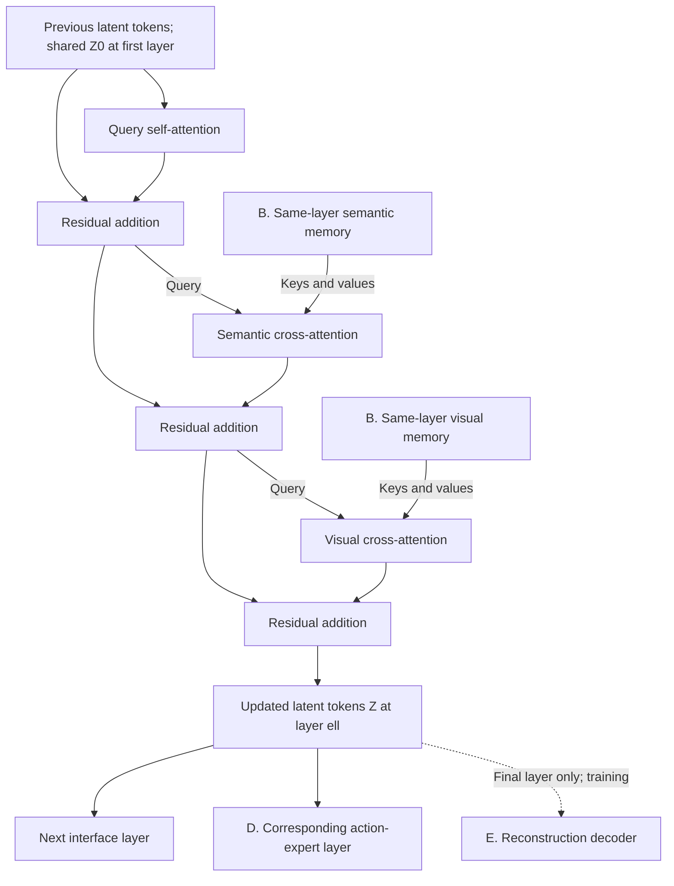
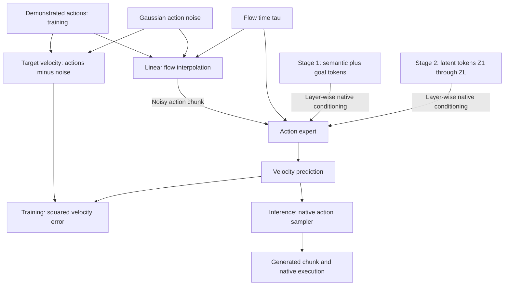
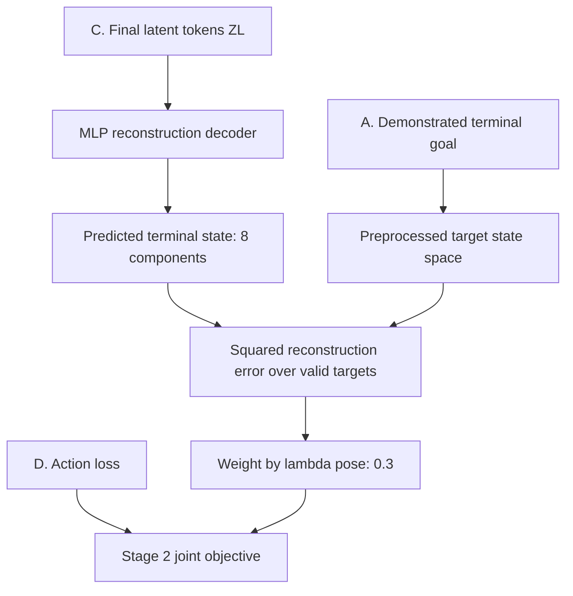

# LIT — Reorganized Method

**Paper:** Jianman Lin, Shailesh, Zhongyi Luo, and Jiafei Duan, *Breaking the Vision–Action Shortcut: Latent Interface Training for Generalizable Robot Foundation Models*.

**Source inspected:** the complete supplied 10-page PDF, including Eqs. (1)–(8), Fig. 2, and the training/integration descriptions. The supplied PDF contains no appendix or supplement and shows no explicit version identifier. Page references below are PDF page numbers. External code and the underlying frameworks' papers were not inspected.

This document explains the original method. Diagrams reorganize the reported wiring; explanatory equations are marked **schematic**. Architecture-specific settings absent from the supplied paper remain unresolved.

## 2. Approach or Method

### 2.1 Method summary, inputs, outputs, and high-level architecture

**Latent Interface Training (LIT)** changes both action-expert training and the route by which visual information reaches that expert. In **Stage 1**, a frozen backbone processes language and robot state without images. A trainable goal encoder embeds the terminal end-effector state of each demonstrated action chunk. These goal tokens are concatenated with the backbone's semantic representations to condition a randomly initialized action expert. The expert learns to generate actions toward a demonstrated spatial goal without access to visual correlations.

In **Stage 2**, the pretrained action expert is conditioned by a new latent interface. A bank of 100 learnable tokens is updated at successive coupling layers using query self-attention, semantic cross-attention, and visual cross-attention. Each layer's updated tokens condition the corresponding action-expert layer. A decoder reconstructs the same terminal state used in Stage 1 from the final latent tokens. Action and reconstruction losses jointly train all active modules, including the backbone. **At inference, the latent interface remains, but both the goal encoder and reconstruction decoder are omitted.** The action expert receives visual information through the latent interface only. [Sec. III, pp. 3–4; Fig. 2]

The numerical terminal goal is a training input in Stage 1 and a training target in Stage 2. Stage 2 does **not** decode a numerical goal and pass that decoded value to the expert: the expert consumes the layer-wise latent tokens directly. Those tokens are not assigned a reported one-token-to-one-pose-coordinate meaning.

#### Inputs and outputs

| Interface | Contents / shape | Consumer / role |
|---|---|---|
| Runtime visual observation \(o_t\) | Image observation(s); camera count, resolution, and history depend on the framework and are not enumerated | Block B in Stage 2 and inference; absent in Stage 1 |
| Runtime language \(l\) | Task instruction; tokenization and maximum length not specified | Block B in both stages and inference |
| Runtime robot state \(s_t\) | Current proprioceptive state; complete dimensionality and preprocessing not specified | Block B in both stages and inference |
| Demonstrated action chunk \(A_t\) | \((a_t,\ldots,a_{t+H-1})\); schematically \(H\times d_a\) | Supervision for Block D; native horizon and action representation retained |
| Demonstrated terminal state \(g_t\) | \([p_{t+H};r_{t+H};q_{t+H}]\in\mathbb R^8\) | Block A goal conditioning in Stage 1; Block E reconstruction target in Stage 2 |
| Internal flow noise \(\epsilon\) and time \(\tau\) | Gaussian noise shaped like \(A_t\); \(\tau\sim\mathcal U(0,1)\) during training | Block D action interpolation and velocity supervision |
| Shared learnable initial tokens \(Z^0\) | \(100\times d\); model parameters rather than sensor inputs or sampled action noise | Initialization of Block C for each policy input |
| Immediate expert prediction \(\hat v_t^\tau\) | Velocity tensor matching the action chunk | Block D native action sampler |
| Policy output | Generated continuous action chunk | Robot execution using the framework's native procedure |
| Auxiliary training output \(\hat g_t\) | Reconstructed eight-component terminal state in preprocessed state space | Block E reconstruction loss; omitted at inference |

#### High-level architecture: Stage 1

The arrows show training conditioning and supervision. Block C and Block E are introduced only in Stage 2.

#### High-level architecture: Stage 2 and inference

Solid arrows are the runtime data path. Dashed arrows are training-only reconstruction and supervision. During training, the action-generation branch also uses demonstrated actions to form the flow loss, as in Stage 1.

There is no backbone-to-action-expert bypass in the Stage 2 diagram. The separate semantic and visual memory arrows in Block C below describe token groups; they do not establish that semantic hidden states are independent of images after backbone processing.

#### Notation and interfaces

| Symbol | Meaning / interface | Reported setting or limitation |
|---|---|---|
| \(t\) | Environment/control timestep | Different from flow time and coupling depth |
| \(H\) | Action-chunk horizon | Native framework horizon; values not specified |
| \(d_a\) | Per-action dimension, introduced here for shape bookkeeping | Native framework representation; not specified |
| \(g_t\) | Demonstrated terminal robot state at \(t+H\) | Eight components: 3 position + 3 axis-angle + 2 gripper joints |
| \(p,r,q\) | World-frame end-effector position, axis-angle orientation, gripper joint positions | Units, orientation branch convention, and preprocessing not specified |
| \(\ell=1,\ldots,L\) | Coupling-layer index and number of coupling layers | Per-framework layer selection/count not specified |
| \(H^{\mathrm{sem}}_{\ell,t},H^{\mathrm{vis}}_{\ell,t}\) | Semantic and visual backbone representations | Schematically token sequences; token counts and widths not specified |
| \(G_t=E_\eta(g_t)\) | Stage 1 goal-token sequence | Output token count and width not specified |
| \(C_{\ell,t}\) | Stage 1 concatenation of semantic and goal tokens | Token concatenation, not feature-axis concatenation |
| \(Z^0,Z_{\ell,t}\) | Initial and updated latent tokens | \(K=100\); width \(d\) adapted to native interfaces |
| \(m\) | Number of consecutive coupling layers sharing interface attention parameters | Numerical value not specified |
| \(q(\ell)=\lceil\ell/m\rceil\) | Attention parameter-sharing group | Unrelated to gripper-vector \(q\) in Eq. (2) |
| \(\tau\) | Flow interpolation time | Training range \([0,1]\), with noise at 0 and demonstrated actions at 1 |
| \(\theta,\eta,\omega\) | Action expert, goal encoder, reconstruction decoder parameters | Stage-specific trainability described in Section 2.7 |
| \(\lambda_{\mathrm{pose}}\) | Auxiliary loss weight | 0.3 |

### 2.2 Block A — Demonstrated goal preparation and Stage 1 goal encoder

#### Role and interface

Block A extracts an eight-component terminal goal from the demonstrated robot trajectory and, in Stage 1 only, converts it into conditioning tokens. Its inputs are the demonstrated terminal state and the chunk horizon. Its outputs are \(g_t\) for supervision and \(G_t\) for the Stage 1 action expert. The paper calls the MLP an “SE(3) encoder,” although its input also includes gripper state. [Sec. III-A–B, p. 3]

#### Operations and equations

The chunk contains \(H\) actions, but the target is the state **after** that chunk, at \(t+H\):

\[
A_t=(a_t,\ldots,a_{t+H-1}). \tag{1}
\]

\[
g_t=[p_{t+H};r_{t+H};q_{t+H}]\in\mathbb R^8. \tag{2}
\]

The encoder is a **trainable three-layer MLP with GELU activations**. The same goal-token sequence is concatenated with each coupling layer's semantic representations:

\[
G_t=E_\eta(g_t),\qquad
C_{\ell,t}=[H^{\mathrm{sem}}_{\ell,t};G_t],
\quad\ell=1,\ldots,L. \tag{3}
\]

Here \([\cdot;\cdot]\) concatenates tokens. For ordinary concatenation, the two sequences must have compatible feature widths; the paper does not provide the encoder output shape or architecture-specific alignment details. The goal is an absolute terminal state in the reported world frame, not a reported displacement target or an entire trajectory.

#### Connections and unresolved details

In Stage 1, \(C_{\ell,t}\) supplies native conditioning to Block D. In Stage 2, \(g_t\) supervises Block E, while the goal encoder no longer supplies action conditioning. At inference, ground-truth terminal state is unnecessary.

The MLP hidden widths, goal-token count, preprocessing, and boundary handling for chunks near the end of a demonstration are **not specified in the provided source**. The reconstruction loss is explicitly in preprocessed state space; the matching Stage 1 preprocessing implementation is not detailed.

### 2.3 Block B — Backbone and modality representations

#### Role and interface

Block B is the pretrained vision–language or world-model backbone together with its modality encoders. In Stage 1, it processes only language and current robot state and emits per-layer semantic representations. In Stage 2 and inference, it also processes visual observations and supplies semantic and visual memory to Block C. [Sec. III-B–D, pp. 3–4; Sec. IV-A, p. 5]

This diagram is schematic across the supported frameworks. It does not prescribe a new encoder arrangement for a WAM or assert that every framework uses separately named physical language/state encoder modules.

#### Operations and trainability

At each coupling layer, the paper identifies two representation groups:

\[
H^{\mathrm{sem}}_{\ell,t},\qquad H^{\mathrm{vis}}_{\ell,t}.
\]

The first corresponds to language and state representations; the second corresponds to visual representations. These are intermediate hidden representations, not predicted spatial goals or actions. The interface accesses the representations at each respective backbone layer, even when interface attention weights are shared across several layers.

In Stage 1, the backbone and its modality encoders are frozen. In Stage 2, they are jointly optimized with the interface and action expert. The method therefore does not retain a permanent gradient barrier between the action loss and the visual backbone.

#### Connections and unresolved details

Stage 1 semantic tokens pass to the concatenation in Block A. Stage 2 semantic and visual tokens become distinct key/value sources for the two cross-attention operations in Block C. They do not directly condition Block D outside that interface.

Exact checkpoints, extraction points before/after normalization, token masks, positional treatment, and representation widths are **not specified in the provided source**. Since the backbone can mix modalities internally, selecting language/state token positions does not by itself prove image-independent semantic content in Stage 2.

### 2.4 Block C — Layer-wise latent interface

#### Role and interface

Block C aggregates backbone information into the action expert's visual-conditioning interface. It receives learned initial tokens, the preceding layer's latent state, and same-layer semantic/visual memory from Block B. It emits \(Z_{\ell,t}\) to the corresponding action-expert layer and to the next interface layer. The final \(Z_{L,t}\) also supplies Block E during training. [Sec. III-C, p. 4, Eqs. (6)–(7)]

#### Initialization and attention updates

The initial token bank is shared across inputs:

\[
Z^0\in\mathbb R^{K\times d},\qquad K=100,\qquad Z_{0,t}=Z^0.
\]

It is learned during Stage 2 and reset to the same parameter bank for each policy input. It is distinct from the Gaussian noise used for action generation; the paper does not define it as recurrent robot memory across control timesteps.

Preserving the paper's three residual updates:

\[
\begin{aligned}
\bar Z_{\ell,t}
&=Z_{\ell-1,t}
 +\operatorname{SA}_{q(\ell)}(Z_{\ell-1,t}),\\
\widetilde Z_{\ell,t}
&=\bar Z_{\ell,t}
 +\operatorname{CA}^{\mathrm{sem}}_{q(\ell)}
   (\bar Z_{\ell,t};H^{\mathrm{sem}}_{\ell,t}),\\
Z_{\ell,t}
&=\widetilde Z_{\ell,t}
 +\operatorname{CA}^{\mathrm{vis}}_{q(\ell)}
   (\widetilde Z_{\ell,t};H^{\mathrm{vis}}_{\ell,t}),
\quad\ell=1,\ldots,L.
\end{aligned} \tag{6}
\]

The sequence is **self-attention → semantic cross-attention → visual cross-attention**, with a residual addition after each operation. Latent tokens supply queries. Semantic or visual backbone representations supply keys and values, respectively. The semantic attention output therefore becomes the query input to visual attention; these are sequential operations rather than parallel branches.

Every \(m\) consecutive coupling layers share interface attention parameters:

\[
q(\ell)=\left\lceil\frac{\ell}{m}\right\rceil.
\]

Sharing attention parameters does not share backbone activations or freeze the latent state across those layers. Each layer still reads its own backbone memory and updates its own sequential latent activations.

#### Connections and unresolved details

Block D receives the set \(Z_{1:L,t}=\{Z_{\ell,t}\}_{\ell=1}^L\) through its native layer-wise conditioning mechanism. Block E reads the final token set only. No additional numeric-goal decoding step is reported between Block C and Block D.

Eq. (6) and the prose define \(Z_{\ell,t}\) after visual cross-attention as the expert-conditioning tokens. **Fig. 2 drawing ambiguity:** the outgoing expert-conditioning arrow is drawn near the semantic cross-attention row rather than explicitly from the visual cross-attention output. This summary follows the completed update in Eqs. (6)–(7); the exact implementation tap should be confirmed.

The token width, attention head counts, sharing interval \(m\), normalization/FFN structure, positional encodings, and any architecture-specific projections are **not specified in the provided source**. Eq. (6) reports attention and residual operations; the diagrams do not silently add an FFN, normalization, or gating block.

### 2.5 Block D — Action expert, flow objective, and native sampling

#### Role and interface

Block D predicts a continuous action chunk using the framework's action expert. The expert is randomly initialized for Stage 1 and transferred into Stage 2. It receives noisy actions, flow time, and layer-wise conditioning: semantic-plus-goal tokens in Stage 1 or latent-interface tokens in Stage 2. Its immediate output is a velocity prediction, while the native sampler produces the executable action chunk. [Sec. III-B–D, pp. 3–4]

The two conditioning branches are alternatives by stage. The clean-action interpolation and target branches are training-only; inference starts from action noise without demonstrated actions.

#### Flow interpolation and prediction

For the flow-matching formulation reported in the paper:

\[
\tau\sim\mathcal U(0,1),\qquad \epsilon\sim\mathcal N(0,I),
\]

\[
\widetilde A_t^\tau=(1-\tau)\epsilon+\tau A_t,
\qquad v_t^\star=A_t-\epsilon. \tag{4}
\]

The noise has the same shape as the action chunk. Here \(\tau\) is generation time, not robot timestep \(t\) or backbone layer \(\ell\). The interpolation runs from noise at \(\tau=0\) toward demonstrated data at \(\tau=1\); reversing that convention would reverse the target velocity sign.

In Stage 1:

\[
\hat v_t^\tau=v_\theta
 (\widetilde A_t^\tau,\tau;C_{1:L,t}),\qquad
\mathcal L_{\mathrm{prior}}
 =\mathbb E_{A_t,\tau,\epsilon}
  \left[\|\hat v_t^\tau-v_t^\star\|_2^2\right]. \tag{5}
\]

In Stage 2:

\[
\hat v_t^\tau=v_\theta
 (\widetilde A_t^\tau,\tau;Z_{1:L,t}). \tag{7}
\]

\(\mathcal L_{\mathrm{act}}\) follows Eq. (5) with \(C_{1:L,t}\) replaced by \(Z_{1:L,t}\). The goal encoder is updated through the Stage 1 action objective; a separate Stage 1 pose-reconstruction objective is not reported.

#### Native conditioning and action generation

LIT retains native action representations, horizons, objectives, and backbone/action-expert architectures. Integration is described at the following level:

| Framework | Native interaction / behavior reported | LIT connection |
|---|---|---|
| \(\pi_{0.5}\) | Separate VLM and action branches in a mixture of transformers, coupled through shared self-attention | Layer-wise latent conditioning replaces unrestricted visual conditioning; precise attention mask/projection changes are not supplied |
| MolmoAct2 | Expert cross-attends to corresponding per-layer VLM KV caches | Per-layer latent tokens supply the conditioning through the native mechanism |
| FAST-WAM | Future-video prediction during training; action-only inference without future prediction | Latent interface bridges world-model representations and the action expert; native action-only inference retained |
| ImageWAM | Image-editing denoising retained at inference; resulting KV caches condition the action expert without target-image decoding | Latent interface constrains conditioning while native inference behavior is retained |

[Sec. III-D, p. 4; Sec. IV-A, p. 5]

For interpreting flow generation, the associated continuous evolution can be written **schematically**, not as an additional numbered paper equation:

\[
\frac{dX_t(\tau)}{d\tau}
 =v_\theta(X_t(\tau),\tau;Z_{1:L,t}),
\qquad X_t(0)=\epsilon,
\qquad \hat A_t=X_t(1).
\]

The paper defers the solver, discrete step schedule, decoding, and execution to each framework. It does not specify a universal Euler sampler, step count, action denormalization, delta composition, or number of actions executed before replanning. For WAMs, the conditioning may involve native world-model denoising; this schematic equation does not establish that all backbone/interface activations are computed once and held fixed during every native sampling step.

### 2.6 Block E — Terminal-state reconstruction and auxiliary supervision

#### Role and interface

Block E encourages the final latent representation to retain the demonstrated chunk's goal-relevant spatial information. An MLP decoder reads \(Z_{L,t}\) and predicts the same terminal state used in Stage 1. The decoder is a training branch; its output does not numerically condition the expert. [Sec. III-C, p. 4, Eq. (8)]

“Preprocessed target state space” indicates the reported comparison space. The paper does not define a specific normalizer or conversion function, so the diagram does not prescribe one.

#### Prediction and objective

\[
\begin{aligned}
\hat g_t&=D_\omega(Z_{L,t}),\\
\mathcal L_{\mathrm{pose}}&=\|\hat g_t-g_t\|_2^2,\\
\mathcal L_{\mathrm{stage2}}
 &=\mathcal L_{\mathrm{act}}
   +\lambda_{\mathrm{pose}}\mathcal L_{\mathrm{pose}},
\qquad\lambda_{\mathrm{pose}}=0.3.
\end{aligned} \tag{8}
\]

The prose adds that reconstruction is computed in **preprocessed state space and averaged over valid targets**. Eq. (8) displays a per-target squared norm; the exact masking and reduction across batches, dimensions, or padded chunks are not given. Position, axis-angle, and gripper entries all belong to this eight-component target. A geodesic rotation loss or separately weighted component losses are not reported.

The input is the final latent **token set**, not a specified single token or a specified pooled descriptor. The decoder's pooling/flattening strategy, layer count, and hidden widths are **not specified in the provided source**. The three-layer GELU description applies to the Stage 1 encoder, not automatically to this decoder.

### 2.7 Training and inference across blocks

#### Training stages and gradient connections

| Stage | Objective / supervision | Frozen and trainable modules | Cross-block connection |
|---|---|---|---|
| Stage 1: image-free action pretraining | \(\mathcal L_{\mathrm{prior}}\), using demonstrated actions and terminal goals | Backbone/modality encoders frozen; goal MLP and randomly initialized action expert trainable | B semantic tokens concatenate with A goal tokens to condition D; action-loss gradients update D and A |
| Transition | Transfer learned action-expert parameters | Stage 1 expert initializes Stage 2; backbone was unchanged in Stage 1 | Encoded ground-truth-goal conditioning is replaced by the latent interface; a latent-to-goal-token distillation objective is not reported |
| Stage 2: visual interface learning | \(\mathcal L_{\mathrm{act}}+0.3\mathcal L_{\mathrm{pose}}\) | Backbone/modality encoders, expert, latent bank, interface attention modules, and reconstruction MLP jointly trainable | B → C → D action branch; final C → E reconstruction branch; no detach is reported |
| Inference | Native action sampling; no supervision | Learned B, C, and D retained; goal encoder and decoder omitted | Observations → backbone → layer-wise latents → expert → generated chunk |

Stage 2 is **full joint optimization**, rather than training only the interface while freezing the pretrained action expert. The reconstruction loss directly supervises C and its upstream representations; there is no reported E-to-D conditioning edge. The action loss supervises D and its upstream interface/backbone. These gradient descriptions follow the stated joint optimization and wiring, without assuming undocumented detach operations.

For the reported experiments, each baseline–LIT pair starts from the same pretrained backbone and randomly initialized action expert. The authors explicitly do not fine-tune a pretrained VLA/WAM policy checkpoint, to avoid inherited vision–action dependencies. LIT splits the architecture's baseline optimization-step budget across its two stages. [Sec. IV-A, p. 5]

#### Reported settings

| Setting | Reported value / scope | Source |
|---|---|---|
| Initial latent-token count | \(K=100\) | Sec. III-C, p. 4 |
| Latent width | Adapted to backbone/expert native interfaces; numerical values not supplied | Sec. IV-A, p. 5 |
| Stage 1 goal encoder | Three-layer MLP, GELU activations | Sec. III-B, p. 3 |
| Stage 2 pose decoder | MLP; topology not supplied | Sec. III-C, p. 4 |
| Reconstruction weight | \(\lambda_{\mathrm{pose}}=0.3\) | Sec. III-C, p. 4 |
| Training flow time / noise | Uniform time; standard Gaussian action noise | Sec. III-B, p. 3 |
| Interface parameter sharing | Every \(m\) consecutive coupling layers; \(m\) unspecified | Sec. III-C, p. 4 |
| MolmoAct2 illustrated schedule | 10K Stage 1 steps + 20K Stage 2 steps, matching 30K baseline steps | Fig. 7, p. 9 |
| Other framework stage splits | Not supplied; total optimization-step budget matched to native baseline | Sec. IV-A, p. 5 |

The 10K/20K split is the reported MolmoAct2 training-dynamics setting, not an established universal schedule. Future-model auxiliary losses and their stage-specific handling in WAM integrations are not expanded in the supplied method equations.

#### Inference procedure

1. Receive current image observation(s), language instruction, and robot state. No demonstrated terminal goal is supplied.
2. Obtain the framework's backbone representations at its coupling layers. Initialize the interface from the shared learned bank \(Z^0\) for that policy input.
3. Apply sequential interface updates and provide each \(Z_{\ell,t}\) to its corresponding action-expert layer. The expert's visual conditioning passes through these tokens.
4. Use the framework's native action-generation procedure. In the reported flow formulation, the expert is repeatedly evaluated along flow time to transform action noise into an action chunk; the number and schedule of evaluations are not specified.
5. Decode/execute the generated actions and replan according to the native framework. No reconstruction decoder evaluation or goal encoder evaluation is needed.

For FAST-WAM, future-video prediction is a training behavior, not an added inference step. For ImageWAM, native image-editing denoising remains active at inference, while decoding the target image is unnecessary. The supplied paper does not explain whether latent features can be cached, or when they must be recomputed during those native denoising steps. [Sec. III-D, p. 4; Sec. IV-A, p. 5]

### 2.8 Questions — Missing or unclear implementation details

The following questions concern details unreported or ambiguous in the complete supplied PDF. No appendix is included in that file.

#### Block A — Demonstrated goal preparation and Stage 1 goal encoder

1. **What are the goal encoder's hidden widths, output width, and output token count for each framework?** This fixes the token-concatenation interface and its relationship to the 100-token Stage 2 interface.
2. **What preprocessing is applied to position, axis-angle orientation, and gripper joint positions, and is exactly the same transform used for Stage 1 inputs and Stage 2 reconstruction targets?** This fixes coordinate scaling and the meaning of the weighted squared error.
3. **What units, world-frame convention, and axis-angle branch/canonicalization rules are used?** This fixes target interpretation and behavior near equivalent orientation representations.
4. **How are \(g_t\) and valid-target masks formed for partial or padded chunks near trajectory ends?** This fixes the \(t+H\) alignment and whether incomplete chunks contribute to the auxiliary loss.

#### Block B — Backbone and modality representations

5. **Which backbone checkpoints and exact coupling layers are used in each integration, and are features extracted before or after normalization?** This fixes the pretrained feature interface and layer correspondence.
6. **How are semantic versus visual tokens selected, including multi-camera tokens, state tokens, masks, and any WAM-generated future representations?** This fixes the two memory groups consumed by the interface.

#### Block C — Layer-wise latent interface

7. **What are \(d\), the attention head counts, and parameter-sharing interval \(m\) for each framework?** These are necessary to instantiate attention and sharing groups.
8. **What normalization, FFN, positional encoding, dropout, and masking operations surround the three attention updates, if any?** Eq. (6) provides attention order and residuals but not full transformer sub-block definitions.
9. **Does the action expert read tokens after visual cross-attention, as Eqs. (6)–(7) indicate, or at another point suggested by the arrow placement in Fig. 2?** This determines whether same-layer visual information has entered the conditioning tokens.
10. **How are the latent tokens converted into native conditioning for each framework, including projections, positional treatment, and \(\pi_{0.5}\) attention masks?** This fixes the exact route by which unrestricted visual access is removed while native semantic/state behavior is preserved.

#### Block D — Action expert, flow objective, and native sampling

11. **What are the native action representations, action dimensions, chunk horizons, and normalization/denormalization rules for the reported runs?** These define the velocity tensor and executable output.
12. **Which native solver, integration-step schedule, and executed chunk prefix/replanning interval are used?** These determine generation cost and robot control timing.

#### Block E — Terminal-state reconstruction and auxiliary supervision

13. **How does the reconstruction MLP map the \(100\times d\) final token set to eight output components: pooling, flattening, selected tokens, or another operation? What are its widths and depth?** This fixes the auxiliary decoder's actual input topology.
14. **How are reconstruction errors reduced over coordinates, examples, and valid targets, and are there component-wise weights beyond preprocessing?** This fixes the effective strength of \(\lambda_{\mathrm{pose}}=0.3\).

#### Training and inference across blocks

15. **What optimizer, learning rates by module, batch size, stage split, and transition initialization rules are used for each architecture?** Only the illustrated MolmoAct2 10K/20K split is reported; the larger Stage 2 trainable set may need distinct settings.
16. **For WAMs, which future-model objectives and denoising inputs remain in each stage, and how are they weighted alongside action and pose losses?** The supplied source retains native objectives conceptually but does not give the complete stage-specific WAM training graph.
17. **During native action/world-model denoising, when are backbone and interface features recomputed, and which features are cached across sampling steps?** This resolves whether the conditioning is fixed across flow evaluations and determines inference cost without assuming a universal cache strategy.

**Reproduction priority:** first resolve goal preprocessing/alignment, backbone feature selection, latent-to-expert wiring, and decoder token reduction. Then obtain interface dimensions/sharing groups and the native sampling/training configurations. These choices alter tensor interfaces or target meaning; the supplied equations alone do not determine them.

#### Source-location index

| Source location | Method evidence |
|---|---|
| Sec. III-A, p. 3; Eqs. (1)–(2) | Action chunk, terminal-state timing, eight-component world-frame target |
| Sec. III-B, p. 3; Eq. (3) | Image-free semantic backbone, three-layer goal encoder, per-layer token concatenation |
| Sec. III-B, p. 3; Eqs. (4)–(5) | Noise-to-data interpolation, velocity target, Stage 1 loss and trainability |
| Fig. 2, p. 4 | Two-stage wiring, residual interface interpretation checked against equations, illustrated layer-wise conditioning |
| Sec. III-C, p. 4; Eq. (6) | 100 latent tokens, ordered attention updates, residuals, parameter-sharing groups |
| Sec. III-C, p. 4; Eqs. (7)–(8) | Latent-conditioned action expert, final-token reconstruction, weight 0.3, valid-target preprocessing, joint optimization |
| Sec. III-D, p. 4 | Native integration, omission of encoder/decoder at inference, native sampling and execution |
| Sec. IV-A, p. 5 | Framework interaction mechanisms, WAM inference differences, initialization, dimension adaptation, matched step budgets |
| Fig. 7, p. 9 | Illustrated MolmoAct2 10K Stage 1 / 20K Stage 2 schedule |

**Diagram verification:** node references, branch destinations, attention direction, residual edges, and stage distinctions were checked against the source. Mermaid rendering was not tested in this environment; no particular reader's layout or routing is guaranteed.
