# PatchWAM: Reorganized Architecture (native FluxVLA port)

**Model:** *An Action Is Worth One Patch: Unified World–Action Modeling with PatchWAM* (arXiv:2609.25961). Reference implementation: the `PatchWAM` repository (RoboCasa / RobotWin / LIBERO recipes).

**Source inspected:** the native FluxVLA port and every module it calls, plus the shipped configs that fix the concrete dimensions:

| Role | File |
|---|---|
| Native wrapper, batch contract, loss/sampling entry points, checkpoint mapping | [patchwam_vla.py](../fluxvla/models/vlas/patchwam_vla.py) |
| Observation frontend (frozen autoencoder + instruction encoder) | [patchwam_backbone.py](../fluxvla/models/backbones/vlms/patchwam_backbone.py) |
| Head, denoiser construction, official FLUX.2 loader | [patchwam_head.py](../fluxvla/models/heads/patchwam_head.py) |
| Vendored joint flow policy | [policy.py](../fluxvla/models/third_party_models/patchwam/policy.py) |
| Observation encoding contract | [encoding.py](../fluxvla/models/third_party_models/patchwam/encoding.py) |
| Action codec, flow schedule/loss, token geometry, FLUX adapter, VL encoder, tiny denoiser | [codec.py](../fluxvla/models/third_party_models/patchwam/codec.py), [flow.py](../fluxvla/models/third_party_models/patchwam/flow.py), [geometry.py](../fluxvla/models/third_party_models/patchwam/geometry.py), [flux.py](../fluxvla/models/third_party_models/patchwam/flux.py), [vision_language.py](../fluxvla/models/third_party_models/patchwam/vision_language.py), [tiny.py](../fluxvla/models/third_party_models/patchwam/tiny.py) |
| Concrete dimensions | [patchwam_libero_full_finetune.py](../configs/patchwam/patchwam_libero_full_finetune.py), [patchwam_robotwin_vlm_full_finetune.py](../configs/patchwam/patchwam_robotwin_vlm_full_finetune.py) |

**Scope.** This document describes the port that actually runs in this repository. Shapes and settings are read from code and configs; the method framing (action-as-patch, joint flow, prefix-masked attention) follows the reference model. Diagrams show wiring and reshaping. Blocks labelled **pseudo code** are schematic, not executable, and no verbatim implementation is reproduced. Where a number is inherited from the official FLUX.2 asset rather than defined by the port, it is marked as such.
## 1. Architecture:
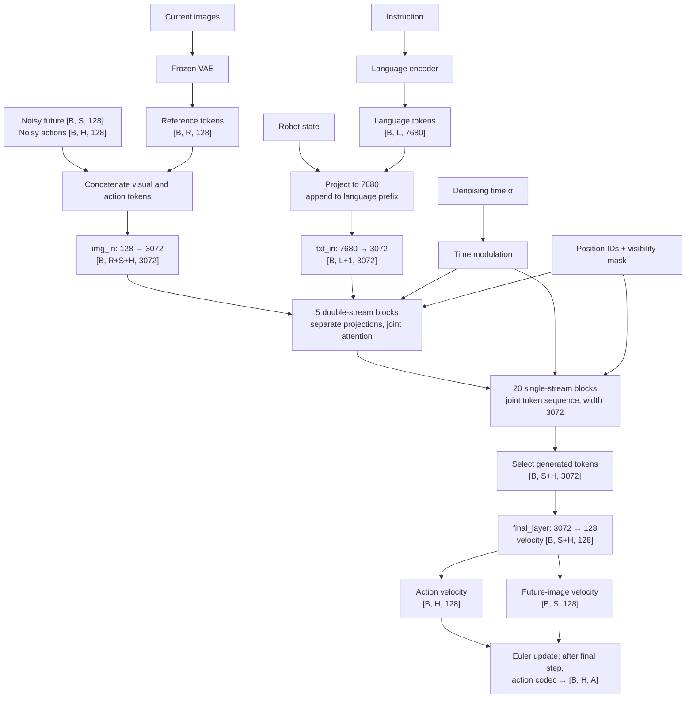

## 2. Approach or Method

### 2.1 Method summary, inputs, outputs, and high-level architecture

PatchWAM makes the action chunk a first-class member of the transformer's token sequence instead of a separate regression head. A parameter-free codec repeats each of the `A` normalized action coordinates until it fills a width-128 "action patch" token, so an `H`-step chunk becomes `H` tokens living in the same space as the visual latents produced by a frozen FLUX.2 autoencoder. One denoising transformer then runs a single rectified flow over two generated groups (a future visual raster and the action chunk), conditioned on a prefix built from the language instruction, the robot state, and the current (plus optional historical) visual raster.

Because future-image tokens and action tokens share the width-128 space, the same weights form a *joint* world/action model: they can sample actions, sample the future, or run inverse dynamics. Training matches a velocity field on both groups with a weighted objective (`0.5` video + `1.0` action by default). The conditioning prefix is barred from attending to the generated tokens, so the model can never read the future it is asked to produce.

#### Inputs and outputs

| Interface | Shape | Consumer / role |
|---|---|---|
| World observation video | `[B, V, 3, T, H, W]`, `V` views, `T>=2` for training | Frozen FLUX.2 autoencoder; frame `0` is the current raster, frame `-1` the future endpoint |
| Camera / frame validity | `img_masks [B, V]`, `frame_masks [B, T]` (`True` = valid, future endpoint last) | Zeroed before the autoencoder; expanded into reference/future raster-validity masks |
| Instruction | `task_description` string, or precomputed `text_tokens [B, L, 7680]` | Instruction encoder; becomes the first part of the conditioning prefix |
| Robot state (proprioception) | `states / proprio [B, P]` (or `[B, H, P]`, step 0 used) | Projected to a single token of width `text_dim`, appended to the prefix |
| Action target | `actions [B, H, A]`, normalized | Supervision for the action flow; encoded into `H` width-128 tokens |
| Action validity | `action_masks [B, H]` or `[B, H, A]`, `action_dim_masks [B, A]` or `[B, H, A]` (`True` = valid) | Converted to source padding masks; padded coordinates leave the loss |
| Flow noise and time | Gaussian tensors shaped like the two token groups; `sigma ~ U(0,1)` | Interpolation in training and the Euler schedule at inference |
| Reference tokens | `[B, R, 128]` (`R = V * h * w`, or plus pooled history) | Condition the denoiser (keys/values) |
| Future tokens | `[B, S, 128]` (`S = V * h * w`) | Training target; also a generated output |
| Language tokens | `[B, L, 7680]`, `text_valid [B, L]` | Conditioning prefix |
| Per-token positions | `reference_ids [B, R, 4]`, `future_ids [B, S, 4]` | RoPE coordinates (raster or sequence layout) |
| Training loss | `loss`, `loss_video`, `loss_action`, `sigma_mean` (`+ loss_subtask` when the VL auxiliary objective is active) | Native training runner |
| Policy output | `action [B, H, A]` normalized, plus `future_tokens [B, S, 128]` | Native runner / decoder; denormalization happens once downstream |

#### High-level block diagram

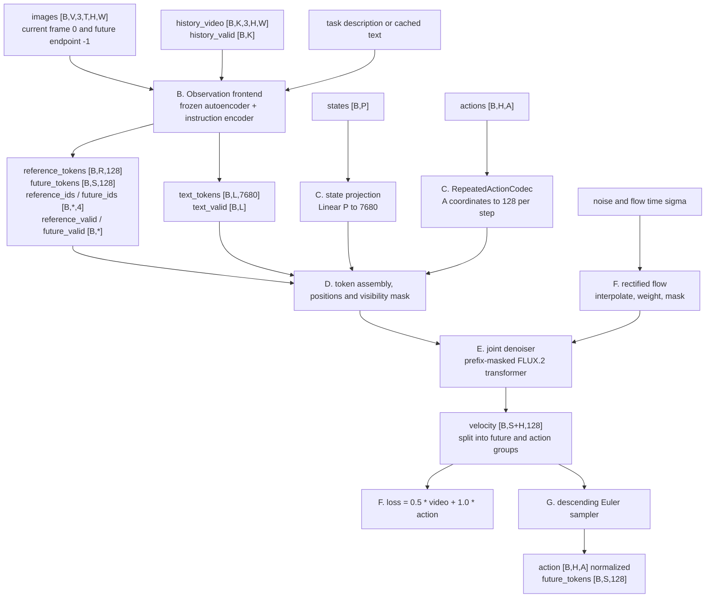

Two facts about this diagram are easy to miss. First, `future_tokens` is both a training target (Block F) and a generated output (Block G): the same transformer predicts world and action together. Second, the action path enters the transformer only as width-128 tokens; the `A`-dimensional action vector is reconstructed solely by the decoder at the end. Block A (the native wrapper) is omitted here for clarity and is detailed in §2.2.

#### Notation and interfaces

| Symbol | Meaning | Source of the value |
|---|---|---|
| `B` | Batch size | Runtime |
| `V` | Number of world camera views | Config; port accepts `1..10` separate views |
| `T` | Sampled window length in frames | Config; `17` rows in the shipped recipes |
| `h`, `w` | Autoencoder latent raster height/width | Defined by the official FLUX.2 autoencoder, not the port |
| `R`, `S` | Reference / future token counts, `V * h * w` | Computed in `encode_observations` |
| `128` (`token_dim`) | Packed-latent channel width shared by images and action tokens | [patchwam_backbone.py:52](../fluxvla/models/backbones/vlms/patchwam_backbone.py#L52) |
| `7680` (`text_dim`) | Instruction-encoder feature width | 3-layer Qwen3 hidden-state readout, equal to `Klein4BParams.context_in_dim` |
| `A` (`action_dim`) | Action coordinates per step | `7` (LIBERO) / `14` (RobotWin, RoboDojo) |
| `P` (`proprio_dim`) | Proprioception width | `8` (LIBERO) / `14` (RobotWin) |
| `H` (`action_horizon`) | Action-chunk length | `16` in the shipped recipes |
| `L` | Instruction token count | `context_length = 128` for the plain Qwen3 encoder |
| `sigma` | Flow time in `[0, 1]` | `ShiftedFlow.sample`; `0` noise, `1` data |
| `s` (`shift`) | Schedule warp parameter | `5.0` |

#### Dimensions shipped by the configs

| Setting | LIBERO | RobotWin |
|---|---|---|
| World input | 2 cameras, `224x448` horizontal mosaic | 3 cameras, compact `288x256` mosaic |
| Instruction encoder | Qwen3 text, 3 readout layers | Qwen3-VL, frozen, current image only, no LoRA |
| `token_dim` / `text_dim` | `128` / `7680` | `128` / `7680` |
| `action_dim` / `proprio_dim` | `7` / `8` | `14` / `14` |
| `action_horizon` / frames | `16` / `17` sampled rows | `16` / `17` sampled rows |
| Normalization | `min_max` | `mean_std` |
| `video_weight` / `action_weight` | `0.5` / `1.0` | `0.5` / `1.0` |
| Denoiser | `PatchWAMFluxDenoiser`, `klein-base-4b` | `PatchWAMFluxDenoiser`, `klein-base-4b` |

### 2.2 Block A: Native wrapper and batch adaptation

#### Role and interface

[`PatchWAMVLA`](../fluxvla/models/vlas/patchwam_vla.py#L302) is the only FluxVLA-registered model. It owns no trainable parameters of its own. It translates the shared FluxVLA batch into the encoded-batch contract, calls the backbone and then the head, and returns either the flow losses (training) or normalized actions (inference). It declares `all_module_keys = ['vlm_backbone', 'vla_head']`, so backbone and head parameters are disjoint and checkpoint/FSDP ownership is clean.

#### Detail diagram

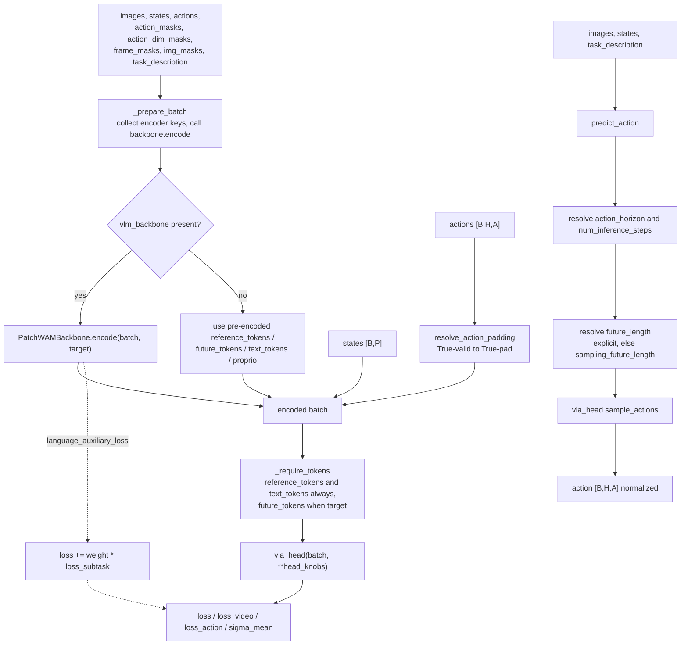

#### Operations (**pseudo code**)

```text
forward(images, states, actions, masks..., task_description):
    kwargs += frame_masks, img_masks
    batch = _prepare_batch(images, task_description, target = actions is not None)
    if states: batch.proprio = states
    if actions:
        step_pad, dim_pad = resolve_action_padding(actions, action_masks, action_dim_masks)
        batch.action = actions; batch.action_is_pad = step_pad; batch.action_dim_is_pad = dim_pad
    require_tokens(batch, target)
    result = vla_head(batch, **head_knobs)          # head knobs only, not encoder keys
    if batch.language_auxiliary_loss and result.loss:
        result.loss_subtask = batch.language_auxiliary_loss
        result.loss      += auxiliary_weight(vlm_backbone) * result.loss_subtask
    return result

predict_action(images, states, task_description, horizon, steps, seed):
    batch = _prepare_batch(images, task_description, target = False)
    if states: batch.proprio = states
    future_length = explicit, else batch.sampling_future_length, else future_ids.shape[1]
    generator = seeded torch.Generator on the encoder device      # full device incl. CUDA index
    return vla_head.sample_actions(batch, horizon, steps, generator,
                                   future_length, guidance_scale, action_guidance_scale).action
```

Key behaviours:

* The encoder receives only `_ENCODE_KEYS`; anything else is dropped before the call, so head-only knobs never leak into encoding. [patchwam_vla.py:413](../fluxvla/models/vlas/patchwam_vla.py#L413)
* Without a backbone the wrapper runs in a CPU-test mode that consumes pre-encoded tensors (`_TOKEN_KEYS`) directly, and `_require_tokens` then demands them explicitly. [patchwam_vla.py:438](../fluxvla/models/vlas/patchwam_vla.py#L438), [patchwam_vla.py:445](../fluxvla/models/vlas/patchwam_vla.py#L445)
* `resolve_action_padding` flips the polarity of the native masks: native `True` means *valid*, the vendored policy's pad masks mean *invalid*. It keeps step and dimension validity separable and avoids the right-aligned broadcast hazard when `B == H`. [patchwam_vla.py:96](../fluxvla/models/vlas/patchwam_vla.py#L96)
* Only head knobs in `_HEAD_KNOB_KEYS` (`generator`, `sigma`, `future_noise`, `action_noise`, `condition_drop_mask`, `token_sigma`, ...) are forwarded to the head. [patchwam_vla.py:80](../fluxvla/models/vlas/patchwam_vla.py#L80)
* EMA / Self-Flow constructor options are rejected as deferred rather than silently ignored. [patchwam_vla.py:351](../fluxvla/models/vlas/patchwam_vla.py#L351)
* `action_horizon` and `num_inference_steps` (default `10`) are wrapper-level defaults; the vendored policy's own default is `20` steps. [patchwam_vla.py:388](../fluxvla/models/vlas/patchwam_vla.py#L388), [policy.py:409](../fluxvla/models/third_party_models/patchwam/policy.py#L409)

### 2.3 Block B: Observation frontend: frozen autoencoder and instruction encoder

#### Role and interface

[`PatchWAMBackbone`](../fluxvla/models/backbones/vlms/patchwam_backbone.py#L32) owns the packed-latent autoencoder and the instruction encoder and nothing else. Its single public method `encode(batch, target)` delegates to [`encode_observations`](../fluxvla/models/third_party_models/patchwam/encoding.py#L47), which mirrors the reference policy's `_encode` and produces the token/ID/validity contract the head consumes. The autoencoder is always frozen; the encoder base is frozen, with only optional LoRA residual projections left trainable.

#### Detail diagram

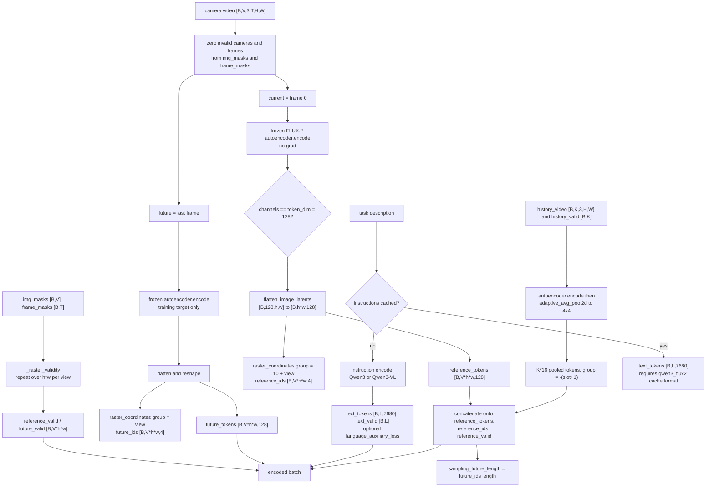

#### Operations (**pseudo code**)

```text
encode_observations(batch, target):
    if reference_tokens cached:
        cast to encoder dtype; require future_tokens when target; forward ids and validity
    else:
        normalize video to [B,V,3,T,H,W]; require T >= 2 when target
        zero out invalid cameras (img_masks) and frames (frame_masks)
        current = video[:, :, :, 0]; future = video[:, :, :, -1]
        latents = autoencoder.encode(current.flatten(0,1))          # no grad
        require latents.channels == token_dim                       # already packed 128
        reference_tokens = flatten(latents).reshape(B, V*h*w, 128)
        reference_ids    = concat over views of raster_coordinates(group = 10 + view)
        future_ids       = concat over views of raster_coordinates(group = view)
        reference_valid, future_valid = route img_masks and frame_masks over h*w tokens
        if target: future_tokens = encode(future) reshaped identically

    if history_video:
        require history_valid [B,K]; zero invalid slots
        pooled = adaptive_avg_pool2d(autoencoder.encode(history), (4,4))
        append K*16 pooled tokens to reference_tokens with ids group = -(slot+1)
        append matching validity to reference_valid

    sampling_future_length = future_ids.shape[1]        # history never changes it

    if text_tokens cached: accept (requires qwen3_flux2 cache format)
    else: text_tokens, text_valid [, auxiliary_loss] = instruction_encoder(prompts)
    require text_tokens [B,L,text_dim]
```

Design points:

* The autoencoder is run under `torch.no_grad()` and the port asserts that its output is *already* the packed 128-channel latent the transformer expects; the port never re-derives the FLUX.2 spatial factor. [encoding.py:131](../fluxvla/models/third_party_models/patchwam/encoding.py#L131)
* Raster tokens carry a 4-component position `(group, row, column, 0)`. Reference views use `group = 10 + view`, future views `group = view`, and pooled history slots `group = -(slot + 1)`. This is what lets the FLUX.2 adapter apply the correct 4-axis rotation. [geometry.py:7](../fluxvla/models/third_party_models/patchwam/geometry.py#L7)
* Validity is tracked at token granularity: per-camera masks are repeated across the token grid and per-frame masks select index `0` (reference) or the last index (future). Invalid rasters are zeroed *before* the autoencoder so padded pixels cannot contaminate the latents. [encoding.py:19](../fluxvla/models/third_party_models/patchwam/encoding.py#L19)
* History is context only. It extends `reference_tokens`, `reference_ids` and `reference_valid`, and it never changes the generated future length. [encoding.py:160](../fluxvla/models/third_party_models/patchwam/encoding.py#L160), [encoding.py:201](../fluxvla/models/third_party_models/patchwam/encoding.py#L201)
* Instruction encoders are interchangeable. [`LocalInstructionEncoder`](../fluxvla/models/third_party_models/patchwam/flux.py#L424) uses a plain Qwen3 causal LM, concatenates a fixed set of hidden-state layers, and returns `(features, attention_mask)`. [`VisualInstructionEncoder`](../fluxvla/models/third_party_models/patchwam/vision_language.py#L42) uses Qwen3-VL, feeds *only* current and valid past head-camera images (never the future), pools past visual grids, optionally adds low-rank residual adapters, and can emit a subtask cross-entropy auxiliary loss. [vision_language.py:15](../fluxvla/models/third_party_models/patchwam/vision_language.py#L15)
* Trainability is centralized: `apply_trainable_policy` freezes the autoencoder and encoder base and unfreezes only `residual_in` / `residual_out` when adapters are enabled; `train()` keeps the autoencoder in eval mode permanently. [patchwam_backbone.py:148](../fluxvla/models/backbones/vlms/patchwam_backbone.py#L148), [patchwam_backbone.py:169](../fluxvla/models/backbones/vlms/patchwam_backbone.py#L169)
* `token_dim` and `text_dim` must agree between backbone and head; the wrapper checks this at construction. [patchwam_vla.py:395](../fluxvla/models/vlas/patchwam_vla.py#L395)

### 2.4 Block C: State conditioning and the action codec

#### Role and interface

Block C converts the two non-visual inputs into tokens of the transformer's width: the robot state is projected into one instruction-width token, and the action chunk is packed into `H` width-128 tokens. Both happen inside the head ([`PatchFlowPolicy`](../fluxvla/models/third_party_models/patchwam/policy.py#L18)), not the backbone, so the split stays disjoint.

#### Detail diagram

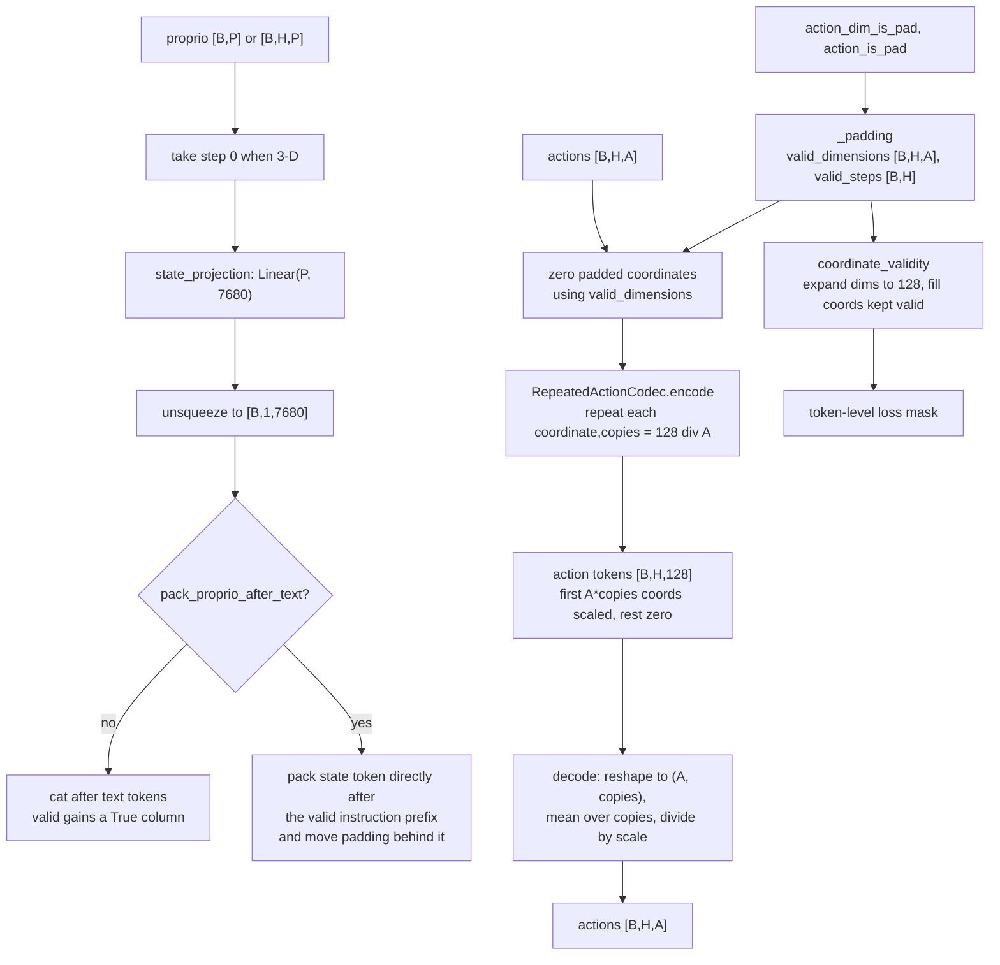

#### Operations (**pseudo code**)

```text
codec.encode(actions [B,H,A]):
    copies   = token_dim // action_dim          # e.g. 128 // 14 = 9
    occupied = action_dim * copies              # e.g. 126, leaving zeros
    expanded = repeat each coordinate 'copies' times
    result[..., :occupied] = expanded * scale
    result[..., occupied:] = 0
    return [B,H,128]

codec.decode(tokens [B,H,128]):
    groups = tokens[..., :occupied].unflatten(-1, (action_dim, copies))
    return groups.mean(-1) / scale              # parameter-free, exact inverse

context(batch):
    context = text_tokens
    state = proprio[:, 0] if 3-D
    context = cat(context, state_projection(state).unsqueeze(1), dim = 1)
    context_valid = cat(text_valid, all True column)
```

Design points:

* The codec is parameter-free and exactly invertible on the occupied coordinates; decoding is a group average, so the representation is redundant on purpose. [codec.py:11](../fluxvla/models/third_party_models/patchwam/codec.py#L11)
* Time padding and coordinate padding are tracked separately and only combined at the loss, so a fully padded step contributes nothing while a partially padded step still supervises its valid coordinates. [policy.py:164](../fluxvla/models/third_party_models/patchwam/policy.py#L164)
* `pack_proprio_after_text` changes where the state token sits and how positional IDs are formed. It is a checkpoint-compatibility switch for the ImageWAM-lineage recipes, not an architectural improvement; it must match the trained recipe. [policy.py:132](../fluxvla/models/third_party_models/patchwam/policy.py#L132)
* Invalid future targets are zeroed before perturbation, and invalid text columns are zeroed before attention because masked NaNs would otherwise contaminate scaled dot-product attention. [policy.py:119](../fluxvla/models/third_party_models/patchwam/policy.py#L119)

### 2.5 Block D: Joint token layout, positions, and prefix-masked attention

#### Role and interface

Block D fixes the sequence the transformer sees and, crucially, which token may attend to which. It is implemented by [`_context`](../fluxvla/models/third_party_models/patchwam/policy.py#L109), the coordinate helpers in [geometry.py](../fluxvla/models/third_party_models/patchwam/geometry.py), and [`joint_visibility`](../fluxvla/models/third_party_models/patchwam/geometry.py#L25).

#### Detail diagram

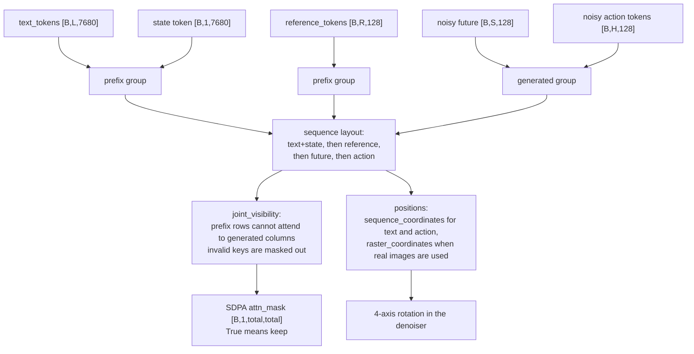

#### Operations (**pseudo code**)

```text
visibility(text_len, ref_len, future_len, horizon, valid masks, isolate_actions):
    prefix = text_len + ref_len
    allowed[:prefix, prefix:] = False            # prefix never sees generated tokens
    if isolate_actions:
        block future-to-action and action-to-future columns
    for each of text_valid, reference_valid, future_valid:
        allowed[..., key_columns] &= key_valid    # invalid keys cannot be attended
    return allowed[None,None] expanded to [B,1,total,total]
```

Design points:

* The prefix is `[text + state, reference]`; the generated group is `[future, action]`. Future and action tokens are in the *same* attention block, so by default they can condition on each other, which is what makes joint world/action modelling possible. `isolate_actions` is the switch that separates them. [geometry.py:25](../fluxvla/models/third_party_models/patchwam/geometry.py#L25)
* `isolate_actions` is `False` in both shipped configs, so action tokens are predicted *with* the future latent context rather than in a separate stream. [patchwam_robotwin_vlm_full_finetune.py:147](../configs/patchwam/patchwam_robotwin_vlm_full_finetune.py#L147)
* Real observations use raster IDs; cached/synthetic batches fall back to `sequence_coordinates`, which is how the CPU tests run without images. [policy.py:214](../fluxvla/models/third_party_models/patchwam/policy.py#L214)
* The mask is passed straight into `scaled_dot_product_attention` by the FLUX.2 adapter, so the "prefix sees only prefix" rule is enforced inside the official attention kernel, not by post-hoc slicing. [flux.py:72](../fluxvla/models/third_party_models/patchwam/flux.py#L72)

### 2.6 Block E: Joint denoising transformer

#### Role and interface

Block E is the only large trainable module. [`OfficialFluxDenoiser`](../fluxvla/models/third_party_models/patchwam/flux.py#L47) wraps the official FLUX.2 Klein transformer and reimplements its attention execution with an explicit visibility mask; [`SmallJointTransformer`](../fluxvla/models/third_party_models/patchwam/tiny.py#L50) is a deliberately tiny stand-in used by the offline tests. [`PatchWAMHead`](../fluxvla/models/heads/patchwam_head.py#L81) subclasses the vendored policy and builds/validates whichever denoiser the config names.

#### Detail diagram

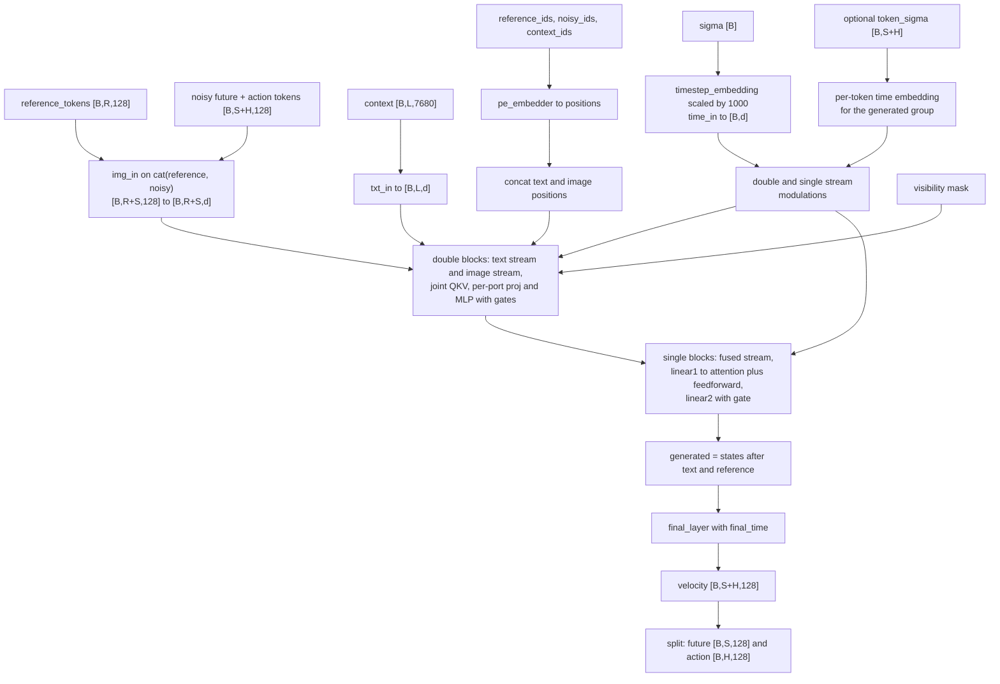

#### Double-stream vs single-stream blocks

The Klein transformer stacks two different layer types. `depth` counts the double-stream blocks and `depth_single_blocks` the single-stream blocks; the adapter reads both from the loaded params instead of hard-coding them, and exposes their sum as `representation_layers`. [flux.py:66](../fluxvla/models/third_party_models/patchwam/flux.py#L66)

| Loaded variant | Double blocks | Single blocks | Total layers |
|---|---|---|---|
| `klein-base-4b` (both PatchWAM configs) | 5 | 20 | 25 |
| `klein-base-9b` | 8 | 24 | 32 |

Both types are residual blocks with adaLN modulation and joint attention over one sequence. They differ in how much is shared between the text and image tokens:

* **Double-stream**: text and image stay in separate streams with their own norms, qkv, output projection and MLP, but the q/k/v of both streams are concatenated into one joint attention and split back per stream afterwards. Each stream receives two modulation triples, one for attention and one for the MLP.
* **Single-stream**: everything is fused. One shared `linear1` emits the qkv part and the feedforward part together, attention and the MLP run in parallel from that same input, their outputs are concatenated, and one `linear2` plus one gate produces the residual. One modulation triple for the whole block.
* **Order**: the double blocks run first, while the text and image streams are still distinct; the streams are then concatenated and the single blocks refine them as one sequence; the text tokens are stripped only before `final_layer`. [flux.py:137](../fluxvla/models/third_party_models/patchwam/flux.py#L137) The Block D visibility mask applies in both phases.
* **Cost**: a single block is cheaper per layer (roughly `13 * d^2` weights against `26 * d^2`, where `d` is the transformer width, 3072 for 4B), but the stack is four times deeper, so it carries about two thirds of the transformer parameters.

The offline `SmallJointTransformer` has no such split: it is `depth=2` of one uniform block type.

#### Operations (**pseudo code**)

```text
OfficialFluxDenoiser.forward(reference, noisy, sigma, context, ids, visibility, token_sigma):
    images = img_in(cat(reference, noisy))
    text   = txt_in(context)
    time   = time_in(timestep_embedding(sigma * 1000, 256))
    if token_sigma: per-token times for the generated group, shared time for the prefix
    position = pe_embedder(cat(context_ids, reference_ids, noisy_ids))
    for block in transformer.double_blocks:      # separate text/image streams, joint attention
        text, images = paired_block(block, text, images, ...)
    states = cat(text, images)
    for block in transformer.single_blocks:      # fused stream
        states = unified_block(block, states, ...)
    generated = states[text_len + reference_len :]
    return final_layer(generated, final_time)    # [B, S+H, token_dim]
```

Design points:

* The denoiser is prefix-masked by construction: the attention mask, not the sequence, is what prevents information flow from generated tokens back into the prefix. The adapter also asserts the official Klein layer contract (`img_in`/`txt_in`/`double_blocks`/`single_blocks`, and `use_guidance_embed == False`) before running, so an incompatible checkpoint fails loudly. [flux.py:47](../fluxvla/models/third_party_models/patchwam/flux.py#L47)
* `token_sigma` allows per-token flow times for the generated group (used by the Self-Flow variants); with a single `sigma`, the whole batch shares one time. [flux.py:122](../fluxvla/models/third_party_models/patchwam/flux.py#L122)
* `representation_layer` returns intermediate features for EMA-based Self-Flow distillation. The native port rejects a nonzero `self_flow_variant`, so this path is present but unused. [patchwam_head.py:120](../fluxvla/models/heads/patchwam_head.py#L120)
* `_validate_denoiser_dims` checks `txt_in.in_features == text_dim` and `img_in.in_features == token_dim`, so a width mismatch between the encoder readout and the transformer fails at construction rather than at the first forward. [patchwam_head.py:222](../fluxvla/models/heads/patchwam_head.py#L222)
* The tiny denoiser shares the same method signature and a 4-axis rotation, which is why it can substitute into the same tests. [tiny.py:10](../fluxvla/models/third_party_models/patchwam/tiny.py#L10)
* FLUX.2 weights are loaded strictly, from local paths only. `PatchWAMFluxDenoiser` reads the transformer with `load_file` under a `meta` device and validates the variant (`klein-base-4b` / `klein-base-9b`) before moving to the target device. [patchwam_head.py:175](../fluxvla/models/heads/patchwam_head.py#L175)

### 2.7 Block F: Rectified-flow objective

#### Role and interface

Block F turns the denoiser into a training loss. [`ShiftedFlow`](../fluxvla/models/third_party_models/patchwam/flow.py#L9) supplies the time warp, the time-weighting function, and the interpolation; [`PatchFlowPolicy.forward`](../fluxvla/models/third_party_models/patchwam/policy.py#L246) assembles the two flows, applies the masks, and returns the weighted sum.

#### Detail diagram

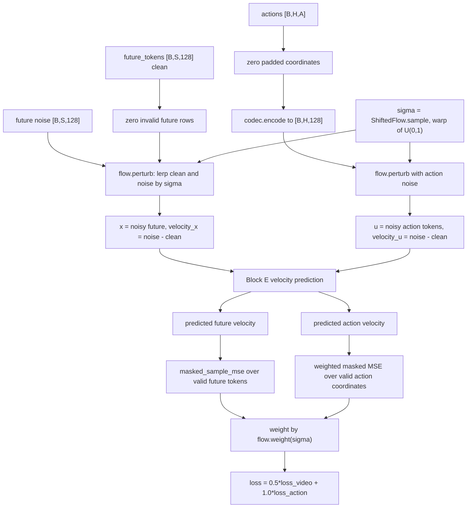

#### Operations (**pseudo code**)

```text
ShiftedFlow:
    warp(u)      = s * u / (1 + (s - 1) * u)                     # s = shift = 5
    raw(sigma)   = clamp(exp(-2*(sigma - 0.5)^2) - exp(-0.5), min = 0)
    weight(sigma)= raw(sigma) / normalizer                       # normalizer by fixed quadrature
    sample(B)    = warp(rand(B))
    perturb(c,n,s) = lerp(c, n, s), n - c                        # noisy token, target velocity

forward(batch):
    clean_future, actions = batch.future_tokens, batch.action
    zero invalid future; derive valid_dimensions and valid_steps from the pad masks
    drop_mask = condition_dropout draw when training               # per-sample CFG drop
    action_tokens = codec.encode(zeroed actions)
    sigma    = sample time; future_noise, action_noise ~ N(0, I)
    x, v_x = perturb(clean_future, future_noise, sigma)
    u, v_u = perturb(action_tokens, action_noise, sigma)
    pred_x, pred_u = velocity(batch, x, u, sigma, drop_mask)
    loss_video  = mean( flow.weight(sigma) * masked_mse(pred_x, v_x, valid_future) )
    loss_action = mean( flow.weight(sigma) * masked_mse(pred_u, v_u, valid_token_coordinates) )
    return { loss, loss_video, loss_action, sigma_mean }
```

Design points:

* One noise level drives both flows; there is no separate action diffusion head. The future and action targets differ only in what `clean` contains. [policy.py:329](../fluxvla/models/third_party_models/patchwam/policy.py#L329)
* `sigma` is sampled from the *warped* distribution, and the loss multiplies by the same normalized weight, so the objective is the standard rectified-flow weighting rather than a uniform estimate. [flow.py:26](../fluxvla/models/third_party_models/patchwam/flow.py#L26)
* Losses are per-sample means over valid coordinates, so fully padded samples contribute exactly zero and never need a special case. [flow.py:103](../fluxvla/models/third_party_models/patchwam/flow.py#L103)
* `condition_dropout` is the CFG training hook: a per-sample mask nulls the instruction tokens, which is later reused at sampling to build the unconditional branch. [policy.py:98](../fluxvla/models/third_party_models/patchwam/policy.py#L98)
* The language auxiliary objective is *not* part of this block; the wrapper adds it once, with the encoder's own weight. [patchwam_vla.py:502](../fluxvla/models/vlas/patchwam_vla.py#L502)

### 2.8 Block G: Sampling, guidance, and the dynamics variants

#### Role and interface

Block G is inference. [`sample_actions`](../fluxvla/models/third_party_models/patchwam/policy.py#L407) integrates the learned velocity field from noise to data with a descending Euler schedule and decodes the action tokens back to `[B, H, A]`.

#### Detail diagram

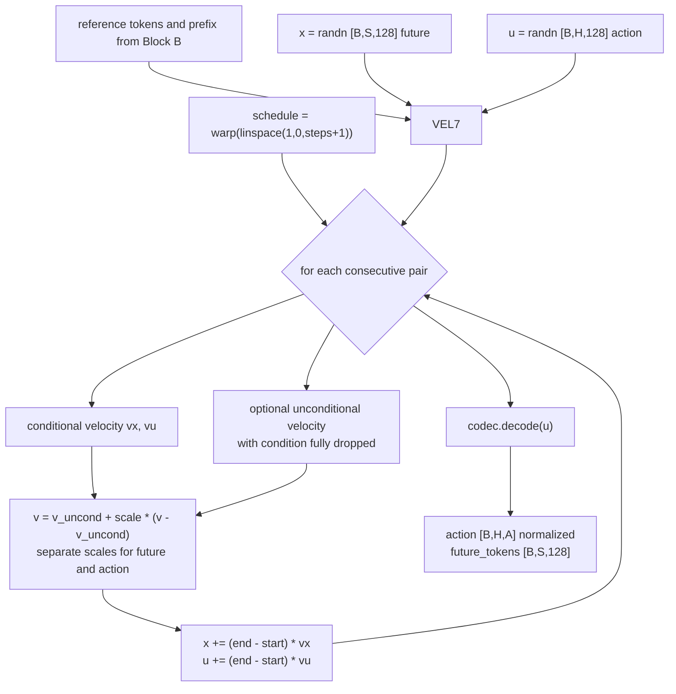

#### Operations (**pseudo code**)

```text
sample_actions(batch, horizon, future_length, steps, generator, guidance_scale, action_guidance_scale):
    x = randn [B, future_length, 128]
    u = randn [B, horizon, 128]
    for start, end in consecutive pairs of warp(linspace(1, 0, steps + 1)):
        vx, vu = velocity(batch, x, u, start)
        if guidance != 1:
            uncond_x, uncond_u = velocity(batch, x, u, start, condition dropped)
            vx = uncond_x + guidance_scale        * (vx - uncond_x)
            vu = uncond_u + action_guidance_scale * (vu - uncond_u)
        x += (end - start) * vx
        u += (end - start) * vu
    return { action: codec.decode(u), future_tokens: x }
```

Design points:

* Guidance is applied per group, so the future raster and the action chunk can be steered with different strengths. `action_guidance_scale` defaults to `guidance_scale`. [policy.py:415](../fluxvla/models/third_party_models/patchwam/policy.py#L415)
* The sampler is deterministic given `generator`. The wrapper builds a seeded `torch.Generator` on the encoder device so multi-GPU runs stay reproducible. [patchwam_vla.py:558](../fluxvla/models/vlas/patchwam_vla.py#L558)
* [`sample_actions_from_future`](../fluxvla/models/third_party_models/patchwam/policy.py#L446) (inverse dynamics: clamp future tokens, generate actions) and [`sample_future_from_actions`](../fluxvla/models/third_party_models/patchwam/policy.py#L471) (forward dynamics) exist but require `self_flow_variant >= 2`, which the native port rejects. Only the primary action sampler runs today.
* Sampling does not denormalize. The native runner or action decoder applies the configured inverse normalization exactly once downstream. [patchwam_vla.py:523](../fluxvla/models/vlas/patchwam_vla.py#L523)

### 2.9 Checkpoint mapping, loading, and FSDP

#### Role and interface

The port has to accept three on-disk layouts and one released third-party layout without ever silently leaving trainable weights random. [`load_patchwam_state_dict`](../fluxvla/models/vlas/patchwam_vla.py#L581) performs the whole resolution and validation before mutating any parameter.

#### Detail diagram

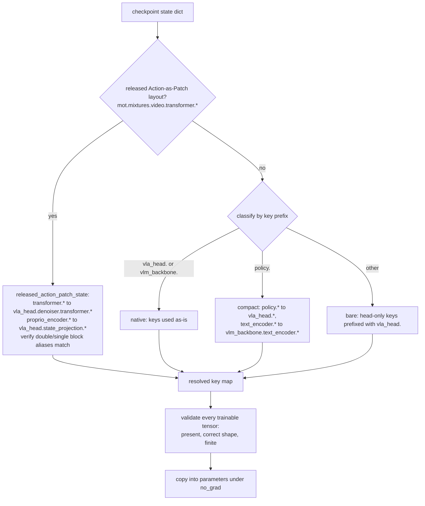

#### Operations (**pseudo code**)

```text
load_patchwam_state_dict(state, strict):
    released = released_action_patch_state(state)      # returns None when no Action-as-Patch markers
    if released: available, format = released, "action_patch"
    else:        available, format = state, classify_checkpoint(state)
    for name in available: map to a model key for this format, else mark unexpected
    missing = trainable model keys with no resolved source
    if strict and (missing or unexpected): raise
    check shape and finiteness for every resolved pair
    copy_ into parameters under torch.no_grad()
    return { format, loaded_tensors }
```

Design points:

* The default FluxVLA-to-source mapping is `vlm_backbone.autoencoder. -> autoencoder.`, `vlm_backbone.text_encoder. -> text_encoder.`, `vla_head. -> policy.`; the prefixes are disjoint, so application order does not matter. [patchwam_vla.py:35](../fluxvla/models/vlas/patchwam_vla.py#L35)
* The released RoboTwin C2R checkpoint stores the fine-tuned FLUX.2 transformer under `mot.mixtures.video.transformer.*` and the proprio projection under `proprio_encoder.*`; the port checks that the `double_blocks` / `single_blocks` aliases are numerically identical to the transformer copy before dropping them. [patchwam_vla.py:243](../fluxvla/models/vlas/patchwam_vla.py#L243)
* `from_pretrained` accepts a `.safetensors` file, a directory of safetensors, or `.pt`/`.pth` loaded with `weights_only=True` and memory mapping for multi-GB payloads. [patchwam_vla.py:653](../fluxvla/models/vlas/patchwam_vla.py#L653)
* FSDP wraps exactly one unit, `PatchWAMHead`, because the official denoiser calls its inner blocks through `_paired_block` / `_unified_block` instead of their `forward`, which would bypass auto-wrapping hooks. [patchwam_vla.py:726](../fluxvla/models/vlas/patchwam_vla.py#L726)

### 2.10 Training and inference at a glance

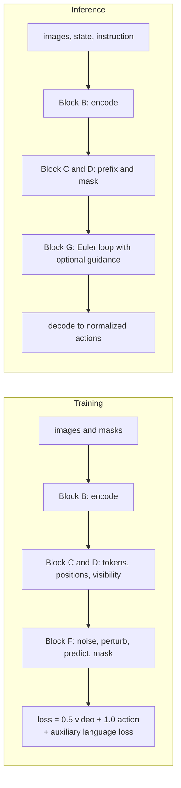

The two paths share Blocks B, C, D and the denoiser; they differ in whether the action/future tensors are targets (training) or free latents integrated from noise (inference). The backbone encodes observations identically in both, except that `target=True` additionally encodes the future endpoint.

### 2.11 Block-to-code index

| Block | Primary implementation |
|---|---|
| A: wrapper and batch adaptation | [patchwam_vla.py:302](../fluxvla/models/vlas/patchwam_vla.py#L302), [patchwam_vla.py:413](../fluxvla/models/vlas/patchwam_vla.py#L413), [patchwam_vla.py:460](../fluxvla/models/vlas/patchwam_vla.py#L460), [patchwam_vla.py:96](../fluxvla/models/vlas/patchwam_vla.py#L96) |
| B: observation frontend | [patchwam_backbone.py:32](../fluxvla/models/backbones/vlms/patchwam_backbone.py#L32), [encoding.py:47](../fluxvla/models/third_party_models/patchwam/encoding.py#L47), [flux.py:424](../fluxvla/models/third_party_models/patchwam/flux.py#L424), [vision_language.py:42](../fluxvla/models/third_party_models/patchwam/vision_language.py#L42) |
| C: state projection and action codec | [policy.py:59](../fluxvla/models/third_party_models/patchwam/policy.py#L59), [policy.py:109](../fluxvla/models/third_party_models/patchwam/policy.py#L109), [codec.py:11](../fluxvla/models/third_party_models/patchwam/codec.py#L11) |
| D: token layout and attention mask | [policy.py:185](../fluxvla/models/third_party_models/patchwam/policy.py#L185), [geometry.py:7](../fluxvla/models/third_party_models/patchwam/geometry.py#L7), [geometry.py:25](../fluxvla/models/third_party_models/patchwam/geometry.py#L25) |
| E: joint denoiser | [patchwam_head.py:43](../fluxvla/models/heads/patchwam_head.py#L43), [patchwam_head.py:81](../fluxvla/models/heads/patchwam_head.py#L81), [flux.py:47](../fluxvla/models/third_party_models/patchwam/flux.py#L47), [tiny.py:50](../fluxvla/models/third_party_models/patchwam/tiny.py#L50) |
| F: flow objective | [policy.py:246](../fluxvla/models/third_party_models/patchwam/policy.py#L246), [flow.py:9](../fluxvla/models/third_party_models/patchwam/flow.py#L9), [flow.py:103](../fluxvla/models/third_party_models/patchwam/flow.py#L103) |
| G: sampling | [policy.py:407](../fluxvla/models/third_party_models/patchwam/policy.py#L407), [patchwam_vla.py:512](../fluxvla/models/vlas/patchwam_vla.py#L512) |
| Checkpoints and FSDP | [patchwam_vla.py:243](../fluxvla/models/vlas/patchwam_vla.py#L243), [patchwam_vla.py:581](../fluxvla/models/vlas/patchwam_vla.py#L581), [patchwam_vla.py:726](../fluxvla/models/vlas/patchwam_vla.py#L726) |

### 2.12 Notes, unknowns, and deferred features

* **Spatial compression is not owned by the port.** The number of reference tokens is `V * h * w`, where `(h, w)` is whatever the official FLUX.2 autoencoder emits for the configured mosaic. The port only asserts that the channel count is `128`. Any statement of a concrete latent grid must come from the FLUX.2 asset, not from this code.
* **Self-Flow, EMA, and the dynamics samplers are present but disabled.** The vendored policy implements dual timesteps, representation distillation, pseudo-labels, inverse dynamics, and forward dynamics, but `PatchWAMHead` rejects a nonzero `self_flow_variant` and the wrapper rejects `self_flow*` / `ema` constructor options. Only the single-timestep joint flow runs in the native port.
* **`future_length` defaults are layer-dependent.** The policy falls back to `reference.shape[1]` when neither `future_length` nor `future_ids` is given, while the wrapper prefers `sampling_future_length` (the current-raster token count, including any image views but excluding pooled history).
* **Instruction width is asset-defined.** `text_dim = 7680` comes from the FLUX.2 Klein base 4B context width and a three-layer Qwen3 hidden-state readout; a different base or encoder changes it, and `_validate_denoiser_dims` will reject a mismatch.
* **The action codec leaves fill coordinates.** With `A` not dividing `128`, the trailing token coordinates are permanently zero and are supervised by construction, which is intentional in the reference design rather than a padding bug.
* **Vocabulary.** "Patch" here means a width-128 action token, not a vision patch. The autoencoder's own patch packing is a separate, upstream step.

**Diagram verification:** node wiring, mask direction, reshaping steps, and shape annotations were checked against the listed files. Mermaid rendering was not executed in this environment; the diagrams are intended as wiring references, not as a guarantee of a particular layout engine's routing.
