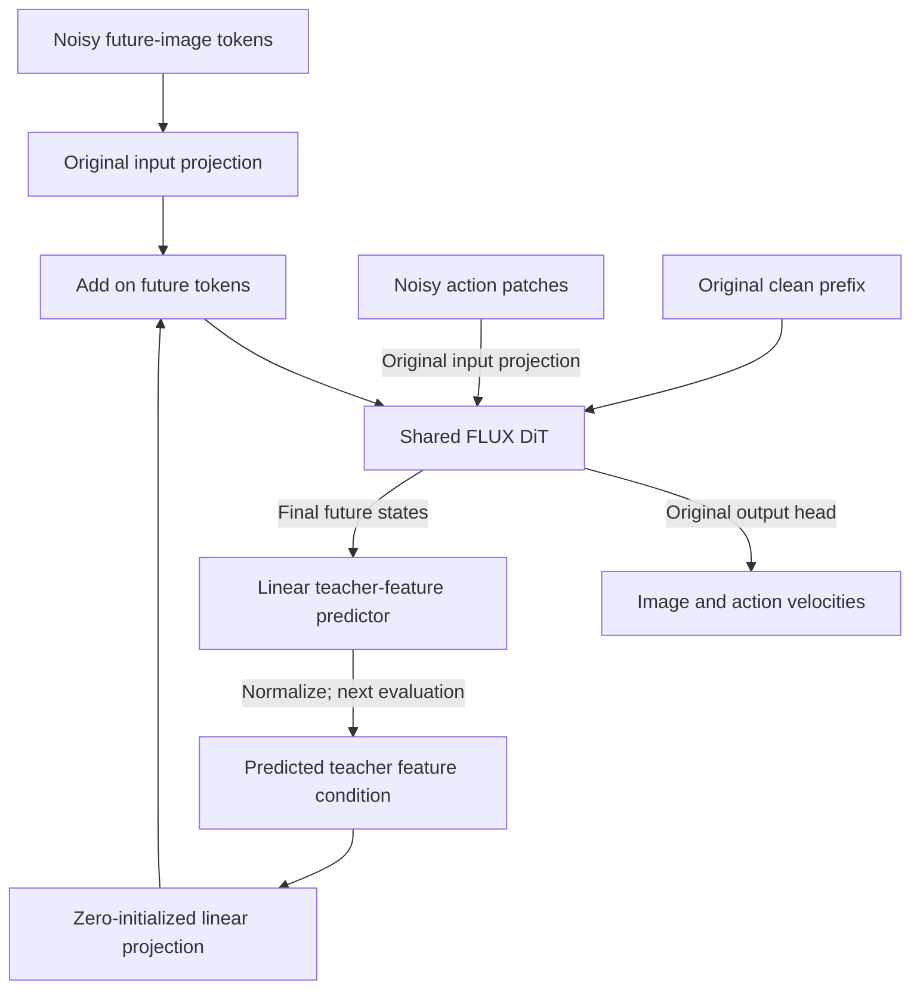

# PatchWAM with Teacher Feature Forcing — Design Proposal

Date: 2026-10-13  
Revision: 2026-10-13 — generalized from DINO-only to configurable teacher features.  
Status: Agreed linear architecture; teacher-specific and multiple-teacher benefits remain to be validated.  
Filename retained for continuity: PatchWAM_DINO_Forcing_Design_Proposal.md.

## 1. Objective and scope

Improve PatchWAM’s future-image pathway by directly predicting clean future **teacher features** and feeding those predictions back as representation conditioning. The frozen teacher is configurable: DINOv2, C-RADIO v4, VGGT-Omega, or another teacher providing spatially indexed descriptors.

Preserve the pretrained FLUX.2 backbone, shared visual/action projections, and fixed Action-as-Patch codec. Retain future-image latent and action flow matching. Teacher features have **no Gaussian initialization, feature velocity, or feature ODE**: they are clean-feature predictions reused at the next solver evaluation.

This follows DINO Forcing’s prediction/self-conditioning principle while generalizing the target representation. Using geometry features is inspired by Spatial Forcing, but this design predicts the **future observation** and carries features during sampling; original Spatial Forcing aligns **current-observation intermediate states** only during training. The proposed extension has not been validated by those papers.

## 2. Final architectural decisions

| Decision | Agreed design |
|---|---|
| Fusion | Add original latent projection and teacher-conditioning projection in DiT hidden space |
| Existing latent projection | Reuse pretrained weights and fine-tune |
| Conditioning projection | Bias-free linear layer, zero-initialize and train |
| Feature predictor | Trainable linear readout from final future-token hidden states, random initialization |
| Fusion/prediction MLP or extra learnable gate | None |
| Placement | One input projection and one output prediction head per selected teacher, at network boundaries |
| Image/action flows, codec, attention, positions | Preserve original PatchWAM |
| Teacher | Configurable frozen checkpoint and specified spatial feature stream |
| Feature width | Configurable \(d_T\), determined by actual selected tensor |
| Feedback | Previous solver evaluation’s normalized future-feature prediction |
| Teacher inference | Training target extraction only; absent from robot deployment |
| Multiple teachers | Optional; independent projections, heads, losses, and feedback maps |

Concatenating inputs and applying a linear projection is equivalent to adding separate linear projections:

\[
[W_x\;\;W_T][x;f]=W_xx+W_Tf.
\]

This does not impose independence. The shared DiT supplies nonlinear interactions. Zero-initialize only the new conditioning projection, not both a gate and the projection.

## 3. Architecture and tensor interfaces

Let \(t\) denote environment time, \(H=16\) the retained baseline action horizon, \(\sigma\) the flow noise level, \(k\) a solver evaluation, \(S\) the future visual-token count, and \(d\) the FLUX hidden width. Let \(d_T\) denote the selected teacher feature width after its fixed extraction/alignment pipeline. Teacher outputs need not have the same channel width or native patch grid.

| Tensor | Shape, omitting batch | Meaning |
|---|---|---|
| \(c\) | Original prefix | Language, state, current-image conditioning |
| \(x_0,x_\sigma\) | \(S\times128\) | Clean/noisy endpoint-image VAE tokens |
| \(u_0,u_\sigma\) | \(H\times128\) | Clean/noisy encoded action tokens |
| \(f_T^*\) | \(S\times d_T\) | Spatially aligned clean future teacher target |
| \(f_{T,\mathrm{cond}}\) | \(S\times d_T\) | Zero or normalized predicted feature condition |
| \(H_{\mathrm{future}}\) | \(S\times d\) | Final future-token hidden states |
| \(v^x,v^u\) | \(S\times128;\ H\times128\) | Image/action velocities |
| \(\hat f_T\) | \(S\times d_T\) | Direct future-feature prediction |

### 3.1 Input fusion

\[
\boxed{
h_i^{\mathrm{future}}
=W_{\mathrm{in}}x_{\sigma,i}+b_{\mathrm{in}}
+W_T f_{T,\mathrm{cond},i}
}
\]

\(W_{\mathrm{in}}:128\rightarrow d\) retains its checkpoint weights and bias and stays trainable and shared. \(W_T:d_T\rightarrow d\) is bias-free, zero-initialized, and trainable. Apply its additional term only at future-image token positions. Other tokens retain their original construction.

### 3.2 Output prediction

\[
\boxed{
\hat f_{T,i}=W_{\mathrm{pred},T}H_i^{\mathrm{future}}+b_T
}
\]

The new head maps \(d\rightarrow d_T\), with normal random initialization. Read final transformer future-token states before the existing visual velocity head; use a consistent extraction point relative to final normalization in implementation. Predict a clean representation, not its velocity. Preserve the shared 128-channel image/action readout.

### 3.3 Normalization and wiring

For the initial cosine-loss design, normalize each patch vector for feedback:

\[
\operatorname n(z)=\frac{z}{\max(\|z\|_2,\varepsilon_{\mathrm{norm}})},\qquad \operatorname n(0)=0.
\]

Use the same convention in training and inference. This emphasizes feature direction and discards magnitude; a magnitude-sensitive target would need an explicitly revised normalization and loss.

Preserve the PatchWAM attention mask: prefix queries read only the prefix; future/action queries read the prefix and both noisy groups. Action tokens receive feature conditioning through shared attention. Do not introduce future-target information into the clean-prefix path.

### 3.4 Optional multiple-teacher version

For a selected teacher set \(\mathcal T\), e.g. DINOv2 plus VGGT-Omega:

\[
h_i^{\mathrm{future}}
=W_{\mathrm{in}}x_{\sigma,i}+b_{\mathrm{in}}
+\sum_{q\in\mathcal T}W_q f_{q,\mathrm{cond},i},
\qquad
\hat f_{q,i}=W_{\mathrm{pred},q}H_i^{\mathrm{future}}+b_q.
\]

Each teacher has its own channel width, normalization, predictor, zero-initialized conditioning projection, and loss weight. Align all feature maps to the same future-token positions. A single teacher is the default; multiple teachers are an optional comparison, not an assumption that more teachers improve control.

## 4. Configurable future-feature supervision

\[
f_T^*=\operatorname{stopgrad}\!\left[
\operatorname{Align}_T\!\left(
\operatorname{Extract}_T\!\left(\phi_T(I_{t+H}^{1:V})\right)
\right)\right].
\]

The teacher sees clean endpoint observations. \(\operatorname{Extract}_T\) chooses a specific spatial tensor; \(\operatorname{Align}_T\) maps its locations to the future VAE-token grid using fixed preprocessing/resampling. No learned teacher-side target projection is included initially.

### 4.1 Teacher examples

These are candidate configurations, not measured rankings or interchangeable feature APIs.

| Teacher | Proposed target | Configuration needed |
|---|---|---|
| DINOv2 | Normalized spatial patch descriptors; exclude CLS/register tokens | Exact checkpoint, layer, crop/grid; DINOv2-B is the earlier 768-channel example |
| C-RADIO v4 | Native dense `spatial_features` output | Exact v4 checkpoint, supported input resolution, native versus adaptor stream, returned channel width and grid |
| VGGT-Omega | Dense spatial backbone descriptors from a specified extraction point | Exact checkpoint, tensor/layer, consistent ordered image set, special-token removal, returned width and grid |
| Other teacher | Spatial descriptors with known correspondence | Frozen extraction pipeline satisfying the same interface |

Official RADIO usage returns a global summary and spatial features, with spatial output available in NLC or NCHW format. Use the **spatial** stream, not the global summary, for this patchwise design. Native RADIO features and teacher-adaptor outputs are different representation choices and must not be silently mixed. [RADIO official README](https://github.com/NVlabs/RADIO)

VGGT-Omega’s public quick start exposes depth, pose, camera/register tokens, and a separate text-alignment embedding for its text-aligned checkpoint. It does not establish a universal dense-backbone-feature output key. The geometry-feature candidate therefore requires an explicit internal extraction hook verified against the chosen implementation; do not treat camera/register tokens, depth, or the text-alignment embedding as interchangeable dense spatial descriptors. [VGGT-Omega official README](https://github.com/facebookresearch/vggt-omega)

### 4.2 Spatial and multi-view correspondence

Teacher-specific photometric normalization follows its official input interface; geometric crops, flips, view layout, and field of view must match the VAE future target. Resample teacher feature grids explicitly when needed. Channel widths such as 128 or \(d_T\) are not spatial coordinates.

For a multi-view geometry teacher, process synchronized future views jointly with a consistent camera order and checkpoint-specific preprocessing. The resulting descriptors depend on that image context. Retain the descriptors associated with the views actually represented by future tokens; never pool views together merely to match token counts. The initial geometry target uses endpoint views only, avoiding an unspecified temporal target context.

Teacher targets are frozen and detached. Predictions supply the ordinary feedback condition; ground-truth future features supply supervision only. No teacher runs during ordinary deployment.

### 4.3 Configuration contract

Record the teacher identifier/checkpoint revision, extraction layer and tensor key or hook, native/adaptor stream, special-token policy, input resolution and normalization, view/time context, native grid and channel width, alignment/resampling, feedback normalization, loss reduction, and \(\lambda_T\).

Validate the extracted shape and spatial correspondence before initializing \(W_T\) and \(W_{\mathrm{pred},T}\). Swapping teachers changes these new modules and supervision settings while retaining pretrained FLUX architecture. Heads trained for one teacher cannot simply be reused for another representation, even when channel widths match.

## 5. Training procedure

Form the original clean prefix c. Encode the endpoint image and normalized action chunk as x₀ and u₀.

Sample one σ and two independent Gaussian tensors:

$$
x_\sigma=(1-\sigma)x_0+\sigma\epsilon_x,\qquad
u_\sigma=(1-\sigma)u_0+\sigma\epsilon_u.
$$

Keep PatchWAM’s shifted schedule:

$$
\sigma=\frac{5\tau}{1+4\tau},\qquad \tau\sim U(0,1).
$$

For the single-teacher procedure below, write \(f_{\mathrm{cond}}=f_{T,\mathrm{cond}}\); the teacher index is omitted on the condition for readability. Write the extended model interface as:

$$
F_\theta(x_\sigma,u_\sigma,\sigma;c,f_{\mathrm{cond}})
=(v_\theta^x,v_\theta^u,\hat f_T).
$$

### Standard update: proposed probability 90%

1. Evaluate Fθ with f_cond = 0 under no gradient recording.
2. Retain the predicted feature map f̂¹; ignore the first pass’s velocities.
3. Set f_cond = n(stopgrad(f̂¹)).
4. Evaluate the same model again with exactly the same noisy xσ, uσ, σ, and c.
5. Apply the joint image/action flow objective and teacher-feature alignment objective to the second pass.
6. Update the shared transformer, original trainable projections, state projection, W_T, and W_pred,T.

There is no backpropagation through the look-ahead pass. Its detached prediction is an input to the trainable second pass.

### Zero-condition update: proposed probability 10%

Run a single zero-conditioned evaluation with gradients and apply all three loss terms. This trains the model for the first inference step, when no feature prediction is available. For multiple teachers, zero all conditions together; obtain all look-ahead predictions in the same first pass and supervise all predictions in the same second pass.

The 10% frequency follows DINO Forcing’s first-pass-only training setting; its suitability for PatchWAM remains an experimental choice. The initial proposal uses model-generated feedback rather than adding a ground-truth-feature conditioning branch.

## 6. Optimization objective

Retain PatchWAM’s two flow losses:

$$
\mathcal L_x=\operatorname{MSE}(v_\theta^x,\epsilon_x-x_0),\qquad
\mathcal L_u=\operatorname{MSE}_{\mathrm{valid}}(v_\theta^u,\epsilon_u-u_0).
$$

Each loss averages over its own token group. Preserve the original action-step validity mask; exclude steps past the demonstration endpoint while retaining the codec’s zero-padded channel entries in regression.

Add a patchwise cosine alignment objective:

$$
\mathcal L_T=
\frac{1}{S}\sum_{i=1}^{S}
\left[1-\cos(\hat f_{T,i},f_{T,i}^*)\right].
$$

The proposed total loss is:

$$
\boxed{
\mathcal L_{\mathrm{total}}
=
\mathbb E\!\left[
w(\sigma)(0.5\,\mathcal L_x+1.0\,\mathcal L_u)
+\lambda_T\mathcal L_T
\right].
}
$$

Use PatchWAM’s existing noise-level weight:

$$
w(\sigma)=
\frac{\exp[-2(\sigma-\tfrac12)^2]-e^{-1/2}}{Z},
\qquad \mathbb E_\sigma[w(\sigma)]=1.
$$

The teacher-feature term is separately weighted in this proposal, rather than automatically multiplied by the flow weight. This lets feature supervision train the initial high-noise condition as well.

For multiple teachers, replace \(\lambda_T\mathcal L_T\) with \(\sum_{q\in\mathcal T}\lambda_q\mathcal L_q\). Average each loss over its own valid spatial tokens, rather than summing channels, and tune weights per representation; 0.1 is not a universal optimum.

Start experiments with λ_T = 0.1 and compare 0.05, 0.1, and 0.3. These are proposed trial values, not validated settings. Keep the original image/action weights for the first comparison.

## 7. Inference and robot execution

1. Construct c from the instruction, current images, and current state.
2. Initialize x⁽⁰⁾ and u⁽⁰⁾ independently from standard Gaussian noise.
3. Set f_cond⁽⁰⁾ = 0.
4. For each Euler step, evaluate the extended model once:

$$
(v_x^{(k)},v_u^{(k)},\hat f_T^{(k)})
=
F_\theta(x^{(k)},u^{(k)},\sigma_k;c,f_{\mathrm{cond}}^{(k)}).
$$

Use the original decreasing schedule:

$$
\sigma_k=\frac{5(1-k/K)}{1+4(1-k/K)},\qquad
\Delta\sigma_k=\sigma_{k+1}-\sigma_k<0.
$$

Update the original flow states:

$$
x^{(k+1)}=x^{(k)}+\Delta\sigma_k v_x^{(k)},\qquad
u^{(k+1)}=u^{(k)}+\Delta\sigma_k v_u^{(k)}.
$$

Replace the feature condition:

$$
\boxed{f_{\mathrm{cond}}^{(k+1)}=\operatorname{n}(\hat f_T^{(k)}).}
$$

5. Decode the final action tokens with the original group-averaging codec and inverse action normalization.
6. Execute the original benchmark-specific action prefix, then replan from fresh observations. Reset every teacher feedback map for the new chunk.

Keep K = 10 for comparison with PatchWAM’s reported evaluations. This is a baseline comparison setting, not a claim that ten steps are optimal for the extension.

The negative schedule increment matches PatchWAM’s noise-minus-clean velocity targets. Do not copy DINO Forcing’s opposite noise-to-data velocity sign. Future RGB decoding remains unnecessary for action execution.

Feature feedback is replacement by a prediction, not ODE integration. Sampling does not repeat both training passes at every step. With multiple teachers, carry each normalized prediction separately; all heads share the same model evaluation.

## 8. Trainable modules and added cost

| Module | Treatment |
|---|---|
| Shared FLUX DiT and original input/velocity projections | Fine-tune from checkpoint; preserve original sharing |
| Existing state projection | Train |
| Teacher-conditioning projection \(W_T\) | Train, initially zero |
| Feature head \(W_{\mathrm{pred},T}\) and bias | Train, initially random |
| Image autoencoder / standard text encoder | Frozen; preserve baseline-specific exceptions |
| Selected feature teacher(s) | Frozen, training only |
| Action-as-Patch codec | Fixed |

For one bias-free conditioning layer and one biased prediction head:

\[
P_{\mathrm{added}}=d_Td+dd_T+d_T=2dd_T+d_T.
\]

For multiple teachers, sum this expression over \(q\in\mathcal T\). Frozen teacher weights are excluded from this trainable count but contribute to training memory and extraction cost. No additional transformer tokens are introduced.

Training normally adds one no-gradient look-ahead evaluation and target extraction. Frozen features may be cached only when the cache exactly preserves checkpoint, augmentation, view context, and alignment settings. Inference adds the configured linear projections/heads and feedback buffers, without teacher execution or another ODE. Measure wall-clock cost; large teacher widths can make these heads substantial.

## 9. Validation and ablation plan

| Variant | Purpose |
|---|---|
| Original PatchWAM | Matched reference |
| Teacher prediction head and loss only | Isolate representation supervision without feedback |
| Single-teacher forcing: DINOv2, C-RADIO v4, or VGGT-Omega | Compare configurable teacher targets |
| Multiple-teacher forcing | Test complementary information, e.g. DINOv2 + VGGT-Omega |
| Reduced image-loss weight after stabilization | Test reduced appearance supervision separately |

Compare the same data, action horizon, evaluation seeds, and solver steps. Report both update budgets and elapsed training cost, including teacher extraction/cache cost.

Primary outcome is manipulation success, including background, texture, lighting, and geometric perturbations. Also measure latency, memory, and feature alignment. Feature similarity alone does not establish better control. Different teachers are not guaranteed to be complementary.

Implementation checks: original velocity equivalence at zero conditioning weights; future-only injection; correct per-view spatial correspondence; frozen teacher and detached look-ahead; consistent normalized feedback; unchanged action masks and flow convention; and no teacher at deployment. Check these per selected teacher configuration.

## 10. Scope limits and optional follow-up experiments

The initial design still optimizes RGB-derived future VAE latents. It adds representation guidance, not feature-only world modeling. Retain supervision for every flow state that is integrated; removing the image-flow loss while evolving image latents leaves their velocity unsupervised.

An “arbitrary teacher” means a teacher with an explicit, stable feature interface that can be aligned with future tokens. It does not mean every global embedding, numerical geometry output, or hidden tensor can be substituted without changing the objective.

If static background dominates dense alignment, optionally weight manipulated-object/gripper regions. Teacher geometry descriptors do not automatically guarantee metric depth, contact accuracy, or correct dynamics. Cosine supervision may lose magnitude information; evaluate a magnitude-preserving objective separately if required.

No fusion/prediction MLP, residual concatenation branch, or additional gate is included. Direct current-prefix Spatial Forcing supervision would be another optional branch, not part of the future-feature feedback design.

## 11. Sources

| Source | Relevant basis |
|---|---|
| [PatchWAM, arXiv:2609.25961v1](https://arxiv.org/abs/2609.25961v1) | §§3.1–3.5: shared visual/action pathway, codec, losses, attention, solver; Appendices E–F: token layout and settings |
| [DINO Forcing, arXiv:2610.11751v1](https://arxiv.org/abs/2610.11751v1) | §3: detached look-ahead, alignment, predicted-feature rollout; Appendix A: teacher/head settings |
| [DINO Forcing implementation supplied by the user](https://github.com/arijit-hub/dino_forcing/tree/master/src) | Code reference for future implementation work; not inspected in this design session |

The per-teacher two-linear-layer architecture, future-only additive conditioning, zero initialization, normalization convention, and proposed hyperparameter trials are design decisions from this conversation. They are not reported experimental findings from the cited papers.

### Teacher implementation references

- [DINOv2 official repository](https://github.com/facebookresearch/dinov2)
- [C-RADIO v4 / RADIO official repository](https://github.com/NVlabs/RADIO)
- [VGGT-Omega official repository](https://github.com/facebookresearch/vggt-omega)
- [Spatial Forcing project](https://spatial-forcing.github.io/)

Official README interfaces were checked for the teacher examples. No teacher extraction or policy training was run. The exact selected checkpoint, feature hook, channel width, and grid must be bound in implementation configuration rather than inferred from the model family name.

