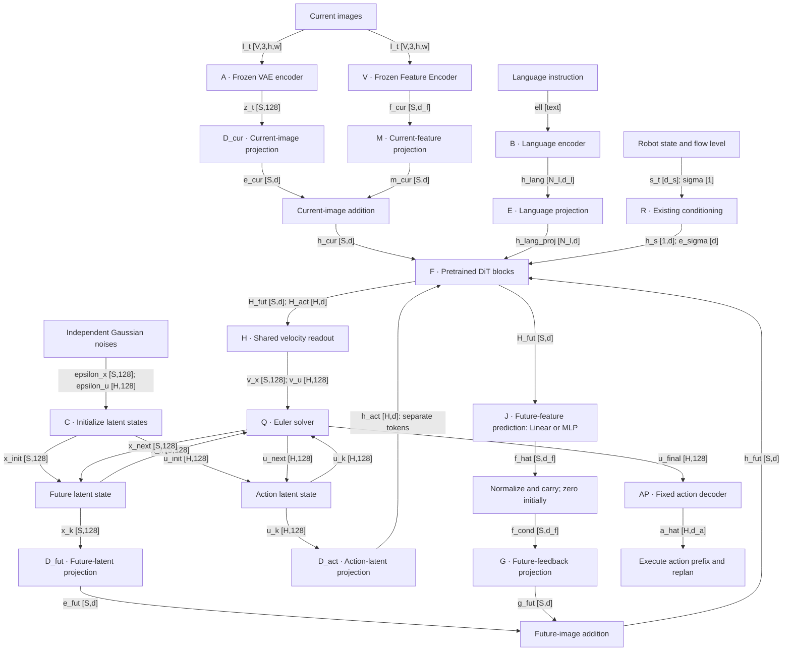
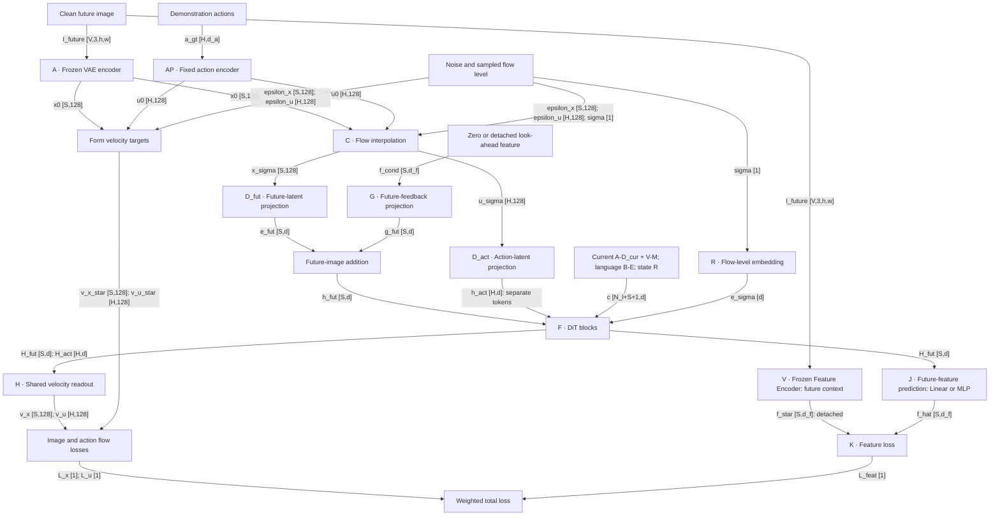

# PatchWAM with Feature Forcing — Design Proposal

Revision: 2026-10-16. Proposed architecture; control improvements remain to be validated. Tensor shapes below omit batch size. Block V is the **Feature Encoder**. Its selected input resolution and patch layout produce S tokens already spatially aligned with the VAE tokens; no spatial-alignment block is used.

## Update 1 — High-level network diagrams

### 1.1 Inference: observed current features and predicted future feedback

**D_cur**, **D_fut**, and **D_act** denote the current-image, future-latent, and action-latent projection interfaces separately. Matching dimensions do not require shared weights. This proposal permits independent parameters and imposes no equality between these interfaces; follow the official PatchWAM implementation for actual module reuse, weight sharing, and checkpoint initialization. The additions are **D_cur(z_t) + M(f_cur)** and **D_fut(x) + G(f_cond)**, with M's normalization as in Eq. (9). **D_act(u)** enters F separately.

### 1.2 Training: noisy inputs and separate supervision targets

Current conditioning is identical to Figure 1.1 and active in both training passes. Current and future Feature Encoder contexts are separate. A clean future latent supplies both the noisy training input and the velocity target; no future observation is available at inference. Figure 1.2 shows one model evaluation, not an unrolled inference solver; the training look-ahead pass is described in §5.

## 2. Tensor names and dimensions

**Our setting uses \(S_c=S\).** Write \(S\) for the token count of each current/future image group. Equal counts do not imply that an object stays at the same patch between times.

| Symbol / diagram name | Shape, excluding batch | Meaning |
|---|---|---|
| \(I_t,I^+\) / I_t, I_future | \(V\times3\times h\times w\) | Current and clean endpoint RGB views; composed images may use \(V=1\) |
| \(\ell\) / ell | Text before tokenization | Command instruction |
| \(S_c=S\) | Scalar count | Equal current/future VAE patch counts |
| \(d= d_{\mathrm{DiT}}\) | Scalar width | Selected backbone's hidden width |
| \(d_f\) | Scalar width | Selected Feature Encoder output width; not universally 768 |
| \(d_m\) | Scalar width | Configured hidden width of J when the two-layer MLP is selected |
| \(N_\ell,d_\ell\) / N_l, d_l | Token count, width | Language encoder output interface |
| \(H,d_a,d_s\) | Counts/widths | Action horizon \(H=16\), action channels, state channels |
| \(z_t\) | \(S\times128\) | Clean current VAE tokens |
| \(x_0\) / x0 | \(S\times128\) | Clean future VAE tokens |
| \(u_0\) / u0 | \(H\times128\) | Clean fixed-codec action tokens |
| \(\epsilon_x,\epsilon_u\) | \(S\times128;\ H\times128\) | Independent Gaussian realizations |
| \(x_\sigma,u_\sigma\) | \(S\times128;\ H\times128\) | Noisy training inputs at shared \(\sigma\) |
| \(x^{(k)},u^{(k)}\) / x_k, u_k | \(S\times128;\ H\times128\) | Evolving inference states; x_init/u_init are \(k=0\), x_next/u_next are \(k+1\) |
| \(\sigma,e_\sigma\) | \(1;\ d\) | Flow noise level and backbone conditioning embedding |
| \(f_t,f^*\) / f_cur, f_star | \(S\times d_f\) | Direct current Feature Encoder output and detached future targets |
| \(f_{\mathrm{cond}}\) | \(S\times d_f\) | Normalized predicted future features, or zero |
| \(\hat f\) / f_hat | \(S\times d_f\) | Direct prediction of clean future features |
| \(e_t,e_x\) / e_cur, e_fut | \(S\times d\) | Original projected current/future VAE tokens |
| \(m_t,g_x\) / m_cur, g_fut | \(S\times d\) | Projected observed current features and predicted future feedback |
| \(h_t,h_x,h_u\) / h_cur, h_fut, h_act | \(S\times d;\ S\times d;\ H\times d\) | Separate current, future, and action token groups entering F |
| \(h_\ell,\bar h_\ell\) / h_lang, h_lang_proj | \(N_\ell\times d_\ell;\ N_\ell\times d\) | Language embeddings before/after E |
| \(s_t,h_s\) | \(d_s;\ 1\times d\) | Robot state and its projected token |
| \(c\) | \((N_\ell+S+1)\times d\) | Clean conditioning prefix \([\bar h_\ell;h_s;h_t]\) |
| \(H_x,H_u\) / H_fut, H_act | \(S\times d;\ H\times d\) | Final future/action hidden states |
| \(v_\theta^x,v_\theta^u\) / v_x, v_u | \(S\times128;\ H\times128\) | Predicted image/action velocities |
| \(v_x^*,v_u^*\) / v_x_star, v_u_star | \(S\times128;\ H\times128\) | Analytic velocity targets |
| \(u^{(K)},\hat a\) / u_final, a_hat | \(H\times128;\ H\times d_a\) | Final action tokens and decoded physical actions |
| \(\mathcal L_x,\mathcal L_u,\mathcal L_{\mathrm{feat}},\mathcal L_{\mathrm{total}}\) | Scalar each | Image, action, feature, and total losses |

Image height and width are \((h,w)\). The selected Feature Encoder outputs exactly \(S\) spatial tokens in the same view/patch order as the VAE; no grid mapping or resampling is performed. Widths \(d,d_\ell,d_f\) come from the actual selected checkpoints. The homogeneous d-width sequence describes the interface after existing backbone projections; preserve any checkpoint-specific text-stream processing internally.

## 3. Blocks and equation reference

Equation numbers below belong to **this proposal**, not the source papers.

| Block | Name / role | Equation(s) | Treatment |
|---|---|---|---|
| A | RGB → VAE latent tokens | (1) | Frozen |
| B | Language → instruction embeddings | (2) | Frozen baseline; retain any baseline-specific LoRA exception |
| V | Feature Encoder spatial descriptor extraction | (3) | Frozen; separate current/future contexts |
| Normalization helper | Per-token vector normalization; no spatial operation | (4) | Fixed |
| C | Training interpolation / inference initialization | (5)–(6), (18) | Fixed |
| D_cur | Current VAE-token projection | (7) | Follow official PatchWAM initialization and sharing |
| D_fut | Noisy/evolving future-latent projection | (7) | Follow official PatchWAM initialization and sharing |
| D_act | Noisy/evolving action-latent projection | (7) | Follow official PatchWAM initialization and sharing |
| E | Existing language input projection | (8) | Preserve checkpoint construction/training convention |
| M | Current-feature projection and current fusion | (9) | New bias-free linear; standard linear-adapter initialization |
| G | Future-feedback projection and future fusion | (10) | New bias-free linear; initialization follows official DINO Forcing code |
| R | Original state/timestep conditioning | (11) | Train state projection; retain backbone time embedding |
| F | Pretrained DiT stack and original attention | (12)–(13) | Fine-tune |
| H | Shared velocity readout and flow losses | (14)–(15) | Pretrained, fine-tune |
| J | Configurable future-feature predictor: Linear or two-layer MLP | (16) | Default architecture/settings follow the original DINO Forcing source code |
| K | Future-feature supervision loss | (17) | Fixed objective |
| Q | Joint Euler solver and feature carry | (18)–(21) | Fixed inference procedure |
| AP | Fixed action encoder/decoder | (22)–(23) | No trainable parameters |
| Current/future additions | D_cur + M and D_fut + G | (9)–(10) | No parameters beyond M/G |
| Total loss | Combine flow and feature objectives | (24)–(25) | Existing flow weights plus \(\lambda_f\) |

## 4. Block details

The proposal retains PatchWAM's image/action flows, fixed action codec, pretrained FLUX backbone, and original positional/attention conventions. It adds observed current-feature conditioning and direct future-feature prediction with feedback. M and G remain linear input projections. J is configurable as a linear layer or a two-layer MLP, with the default following the original DINO Forcing source code. All added modules remain at the network boundaries; no fusion MLP or extra zero gate is introduced.

### 4.1 A — Frozen VAE encoder

Encode current RGB into the clean conditioning latents. During training, encode the endpoint RGB into clean future target latents:

\[
z_t=\mathcal A(I_t),\qquad x_0=\mathcal A(I^+),
\qquad z_t,x_0\in\mathbb R^{S\times128}.
\tag{1}
\]

Use the original VAE preprocessing, packing, and scaling. Current latents go directly to D_cur; future x0 goes through C and also supplies the velocity target at H. There is no new VAE loss or future-image VAE call at inference.

### 4.2 B — Language encoder

\[
h_\ell=\mathcal B(\ell)\in\mathbb R^{N_\ell\times d_\ell}.
\tag{2}
\]

Use the original instruction encoding and masking. B feeds E, with no new language objective. Preserve the chosen PatchWAM variant's encoder/LoRA convention.

### 4.3 V — Frozen Feature Encoder

Use the selected Feature Encoder's dense spatial output directly:

\[
f_t=\operatorname{stopgrad}[\operatorname{Extract}_f(\phi_f(I_t))],
\qquad
f^*=\operatorname{stopgrad}[\operatorname{Extract}_f(\phi_f(I^+))],
\qquad f_t,f^*\in\mathbb R^{S\times d_f}.
\tag{3}
\]

The Feature Encoder resolution, patch layout, and output ordering are selected so that its S spatial tokens already correspond to the VAE's S tokens. There is no separate spatial-alignment module, grid interpolation, or resampling. Use the selected spatial output rather than global or special tokens.

Current features go directly to M during training and inference. Future features go directly to K as training targets. Process current and future view sets in separate contexts, especially for an encoder with cross-image attention. Current descriptors must not depend on future observations. The weights are shared and frozen. V has no trainable loss of its own.

### 4.4 Shared feature normalization

\[
\operatorname n(v)=\frac{v}{\max(\|v\|_2,\varepsilon_{\mathrm{norm}})},
\qquad \operatorname n(0)=0.
\tag{4}
\]

This is channel-vector normalization at each existing token position; it does not change token count, spatial locations, or token ordering. M normalizes current features before projection, future predictions are normalized before G, and K uses the same normalization for cosine similarity. It introduces no separate network block.

### 4.5 C — Training latent preparation

At a single sampled noise level, mix clean future/action targets with independent Gaussian tensors:

\[
x_\sigma=(1-\sigma)x_0+\sigma\epsilon_x,\qquad
u_\sigma=(1-\sigma)u_0+\sigma\epsilon_u,
\quad \epsilon_x,\epsilon_u\ \text{independent standard Gaussian}.
\tag{5}
\]

\[
\sigma=\frac{5\tau}{1+4\tau},\qquad \tau\sim U(0,1).
\tag{6}
\]

Current latents remain clean. C sends x_sigma to D_fut and u_sigma separately to D_act. At inference C initializes from noise once, as in Eq. (18); subsequent evaluations use Q's updated states, not newly sampled Gaussian noise.

### 4.6 D_cur, D_fut, D_act — Input projections by token group

Define the three input interfaces with separate parameter names, without requiring them to be equal:

\[
\begin{aligned}
e_t&=\mathcal D_{\mathrm{cur}}(z_t),&
\mathcal D_{\mathrm{cur}}(v)&=W_{\mathrm{cur}}v+b_{\mathrm{cur}},\\
e_x&=\mathcal D_{\mathrm{fut}}(x),&
\mathcal D_{\mathrm{fut}}(v)&=W_{\mathrm{fut}}v+b_{\mathrm{fut}},\\
h_u&=\mathcal D_{\mathrm{act}}(u),&
\mathcal D_{\mathrm{act}}(v)&=W_{\mathrm{act}}v+b_{\mathrm{act}},\\
W_{\mathrm{cur}},W_{\mathrm{fut}},W_{\mathrm{act}}&\in\mathbb R^{d\times128},&
b_{\mathrm{cur}},b_{\mathrm{fut}},b_{\mathrm{act}}&\in\mathbb R^d.
\end{aligned}
\tag{7}
\]

**D_cur:** project clean current VAE tokens \(z_t\in\mathbb R^{S\times128}\) into \(e_t\in\mathbb R^{S\times d}\); add M's output afterward.

**D_fut:** project the noisy training input \(x_\sigma\), or evolving inference state \(x^{(k)}\), into \(e_x\in\mathbb R^{S\times d}\); add G's output afterward.

**D_act:** project noisy/evolving action tokens into \(h_u\in\mathbb R^{H\times d}\); send them directly to F as separate tokens.

**Implementation convention:** follow the official PatchWAM implementation for whether these interfaces reuse one module, tie any parameters, or use independently parameterized projections, and preserve its checkpoint initialization. The separate symbols allow either arrangement and do not introduce a mandatory untied variant.

The paper's §3.2 explicitly states that action tokens use the same learned input/output projections as visual patches. That statement supports action/visual sharing, but does not separately establish every current-image versus future-image module call. This proposal therefore does not enforce a three-way equality based on that sentence. None of these input projections has a standalone loss.

### 4.7 E — Language input projection

\[
\bar h_\ell=\mathcal E(h_\ell)
=h_\ell W_\ell^\top+b_\ell
\in\mathbb R^{N_\ell\times d}.
\tag{8}
\]

This denotes the existing backbone language input interface; retain the checkpoint's actual normalization/projection arrangement and any intermediate text-stream width. E is not a newly added Feature Encoder adapter. Its output supplies language tokens to F.

### 4.8 M — Current-feature projection and fusion

\[
m_t=\operatorname n(f_t)W_{f,\mathrm{cur}}^\top,\qquad
\boxed{h_t=e_t+m_t},
\qquad W_{f,\mathrm{cur}}\in\mathbb R^{d\times d_f}.
\tag{9}
\]

M is a new bias-free learnable linear layer with standard linear-adapter initialization. Use the selected implementation/framework's usual initialization for a linear projection; do not explicitly zero-initialize M. Add it **after D_cur**, at current-image positions only. Extract current Feature Encoder features once per observation and reuse them across solver evaluations. This branch supplies observed conditioning; it has no new current-feature prediction loss.

### 4.9 G — Future-feedback projection and fusion

\[
g_x=f_{\mathrm{cond}}W_f^\top,\qquad
\boxed{h_x=e_x+g_x},
\qquad W_f\in\mathbb R^{d\times d_f}.
\tag{10}
\]

G is a separate bias-free learnable linear layer. Its initialization follows the official DINO Forcing implementation; this proposal specifies no zero-initialization override. Its input is zero or normalized model-predicted future features. Ground-truth future Feature Encoder features do not condition G. Keep G separate from M because observed and predicted features have different roles. No extra gate is introduced.

### 4.10 R — Existing robot-state and flow-level conditioning

\[
h_s=W_s s_t\in\mathbb R^d,\qquad
e_\sigma=\operatorname{TimeEmbed}_{\mathrm{base}}(\sigma)\in\mathbb R^d.
\tag{11}
\]

Treat h_s as one prefix token; retain the original state projection and backbone timestep conditioning. The e_sigma notation summarizes existing conditioning machinery, not a new linear layer or additive image feature. Use the same sigma for future and action groups.

### 4.11 F — Shared pretrained DiT blocks

\[
c=[\bar h_\ell;h_s;h_t]\in\mathbb R^{(N_\ell+1+S)\times d},
\qquad
Z_{\mathrm{in}}=[c;h_x;h_u]
\in\mathbb R^{(N_\ell+1+2S+H)\times d}.
\tag{12}
\]

\[
Z_{\mathrm{out}}
=\mathcal F_\theta(Z_{\mathrm{in}},e_\sigma;\mathrm{mask},\mathrm{positions}),
\qquad
H_x=\operatorname{Slice}_{\mathrm{future}}Z_{\mathrm{out}},
\quad
H_u=\operatorname{Slice}_{\mathrm{action}}Z_{\mathrm{out}}.
\tag{13}
\]

These equations describe logical group wiring; preserve FLUX's existing stream-specific internal processing and PatchWAM layout. Prefix queries read the clean prefix; future/action queries read the prefix and both noisy groups. Preserve original positional coordinates and masks. Feed final future states to both H and J, and final action states to H. All new input projections occur before the stack and output heads after it, once per evaluation.

### 4.12 H — Shared velocity readout and flow losses

\[
v_\theta^x=\mathcal H_{\mathrm{base}}(H_x)\in\mathbb R^{S\times128},
\qquad
v_\theta^u=\mathcal H_{\mathrm{base}}(H_u)\in\mathbb R^{H\times128}.
\tag{14}
\]

H denotes the original shared output projection including any existing output normalization/conditioning. Train against the analytic targets:

\[
v_x^*=\epsilon_x-x_0,\qquad v_u^*=\epsilon_u-u_0;
\qquad
\mathcal L_x=\operatorname{MSE}(v_\theta^x,v_x^*),\quad
\mathcal L_u=\operatorname{MSE}_{\mathrm{valid}}(v_\theta^u,v_u^*).
\tag{15}
\]

Average each loss over its own token group. Retain the original action-step validity mask and codec zero-padded channels in regression. The clean future latent supplies both C's interpolation and this target; it is not a clean inference input. Inference velocities feed Q.

### 4.13 J — Configurable future-feature prediction head

Apply the selected head tokenwise to final future hidden states:

\[
\hat f=\mathcal J_{\mathrm{cfg}}(H_x)
=
\begin{cases}
H_xW_{\mathrm{pred},f}^{\top}+b_f,
&\text{Linear},\\
\psi(H_xW_1^\top+b_1)W_2^\top+b_2,
&\text{two-layer MLP},
\end{cases}
\qquad \hat f\in\mathbb R^{S\times d_f}.
\tag{16}
\]

The linear mapping has \(W_{\mathrm{pred},f}\in\mathbb R^{d_f\times d}\). The two-layer MLP has \(W_1\in\mathbb R^{d_m\times d}\), \(W_2\in\mathbb R^{d_f\times d_m}\), and hidden activation \(\psi\). Both options preserve the same input/output tensor interface and block name J.

**Configuration:** select Linear or two-layer MLP. The default head type, hidden width, activation, bias/normalization settings, and initialization follow the original [DINO Forcing source code](https://github.com/arijit-hub/dino_forcing/tree/master/src) at the revision used for implementation. Adapt the input/output widths to this proposal's d and d_f. The equation shows the basic affine/activation forms; preserve any source-defined normalization and related settings. Do not hard-code Linear as the default or invent unverified source defaults.

Read H_x before the low-dimensional velocity output, retaining a consistent extraction point relative to final normalization. Predict clean features directly. J feeds K during training and normalized feedback to G during inference. M uses standard linear-adapter initialization; G and J follow the official DINO Forcing implementation's applicable initialization.

### 4.14 K — Future-feature supervision

\[
\mathcal L_{\mathrm{feat}}
=\frac1S\sum_{i=1}^{S}
\left[1-\operatorname n(\hat f_i)^\top\operatorname n(f_i^*)\right].
\tag{17}
\]

The target comes from detached future V features. The loss trains J and the shared backbone, not the frozen Feature Encoder. Current observations receive Feature Encoder features through M without another supervision objective. K is absent at inference.

### 4.15 Q — Solver initialization, updates, and feature carry

\[
x^{(0)}=\epsilon_x,\qquad u^{(0)}=\epsilon_u,\qquad
f_{\mathrm{cond}}^{(0)}=0.
\tag{18}
\]

\[
\sigma_k=\frac{5(1-k/K)}{1+4(1-k/K)},\qquad
\Delta\sigma_k=\sigma_{k+1}-\sigma_k<0,\quad k=0,\ldots,K-1.
\tag{19}
\]

\[
x^{(k+1)}=x^{(k)}+\Delta\sigma_kv_x^{(k)},\qquad
u^{(k+1)}=u^{(k)}+\Delta\sigma_kv_u^{(k)}.
\tag{20}
\]

\[
f_{\mathrm{cond}}^{(k+1)}=\operatorname n(\hat f^{(k)}).
\tag{21}
\]

Run one joint model evaluation per Euler step. Only x/u are integrated; Feature Encoder features are predicted and carried without Gaussian feature noise, feature velocity, or ODE. The negative step matches the noise-minus-clean targets in Eq. (15). Retain \(K=10\) for matched baseline comparison. Reset feedback and latent states when replanning a new chunk; future RGB decoding is unnecessary for action execution.

### 4.16 AP — Fixed action codec

Let \(\bar a_h=\mathcal N(a_h)\) be the original dataset-normalized action, \(r=\lfloor128/d_a\rfloor\), and \(\beta=1\) the original fixed codec scale. For step h:

\[
u_{0,h}
=\beta\operatorname{concat}(\bar a_{h,1}\mathbf1_r,\ldots,
\bar a_{h,d_a}\mathbf1_r,\mathbf0_{128-rd_a})\in\mathbb R^{128}.
\tag{22}
\]

\[
\hat{\bar a}_{h,j}
=\frac1{\beta r}\sum_{m=(j-1)r+1}^{jr}u^{(K)}_{h,m},
\qquad
\hat a_h=\mathcal N^{-1}(\hat{\bar a}_h).
\tag{23}
\]

AP has no trainable parameters or reconstruction objective. Preserve baseline normalization, horizon, and execution prefix. Action tokens do not pass through A.

## 5. Training execution and total objective

Compute current A–D_cur and V–M conditioning plus language/state once for the training window, preserving gradients through trainable modules. Freeze A/B/V as above. Build x_sigma/u_sigma with C.

For the proposed 90% two-pass updates:

1. Evaluate the model with future feature condition zero under no gradient recording; retain its predicted future features.
2. Normalize and detach that prediction and evaluate again with the same c, x_sigma, u_sigma, and sigma.
3. Apply image/action velocity losses at H and future-feature loss at K to the second pass.

Retain a trainable construction of c for the second pass; do not detach the current-feature projection M or original D_cur/D_fut/D_act merely because Feature Encoder outputs are detached. There is no backpropagation through the look-ahead prediction.

On the proposed remaining 10% of updates, train a single zero-future-feedback evaluation with all losses. Observed current Feature Encoder conditioning remains active. These frequencies are initial experimental settings.

\[
\boxed{
\mathcal L_{\mathrm{total}}
=\mathbb E\left[
w(\sigma)(0.5\mathcal L_x+1.0\mathcal L_u)
+\lambda_f\mathcal L_{\mathrm{feat}}
\right].
}
\tag{24}
\]

\[
w(\sigma)=
\frac{\exp[-2(\sigma-\tfrac12)^2]-e^{-1/2}}{Z},
\qquad \mathbb E_\sigma[w(\sigma)]=1.
\tag{25}
\]

Retain original flow weights and tune \(\lambda_f\), initially comparing 0.05, 0.1, and 0.3. The feature term is separately weighted and is not automatically multiplied by w. Train all three new projections/heads and the existing trainable backbone/state components. No ground-truth future feature enters the clean prefix or G. Ordinary training samples a flow level rather than unrolling Q.

## 6. Feature Encoder configuration and optional multiple encoders

| Feature Encoder candidate | Spatial stream to bind | Required configuration |
|---|---|---|
| DINOv2 | Dense patch embeddings, excluding CLS/register tokens | Checkpoint, layer, preprocessing, matching S-token output; DINOv2-B is the earlier 768-channel example |
| C-RADIO v4 | Native dense spatial_features | Checkpoint, selected resolution, native/adaptor stream, matching S-token layout and width |
| VGGT-Omega | Verified dense internal feature extraction point | Checkpoint, output hook/layer, image-set context, matching S-token layout and width |
| Other Feature Encoder | Spatial descriptors with explicit correspondence | Frozen extraction with S directly corresponding spatial tokens |

RADIO's global summary is not the dense stream. VGGT-Omega's camera/register tokens, depth, and text-alignment outputs are not automatically interchangeable dense backbone features; verify the selected hook. Resolve actual dimensions from the checkpoint rather than assume a family-wide width.

Record the output tensor/layer, checkpoint revision, preprocessing, selected resolution, patch layout, token/view order, normalization, and loss weight. Require native output shape S × d_f with VAE-matched token positions and ordering; there is no spatial transformation after V. Current and endpoint input contexts stay separate.

For multiple Feature Encoders q, replace the added features and loss with:

\[
h_t=\mathcal D_{\mathrm{cur}}(z_t)+\sum_q\operatorname n(f_{q,t})W_{q,\mathrm{cur}}^\top,\qquad
h_x=\mathcal D_{\mathrm{fut}}(x)+\sum_qf_{q,\mathrm{cond}}W_q^\top,\qquad
\lambda_f\mathcal L_{\mathrm{feat}}\ \longrightarrow\ \sum_q\lambda_q\mathcal L_q.
\tag{26}
\]

Each Feature Encoder has its own M/G/J, normalized feedback buffer, feature width, and loss reduction. Extract all look-ahead features in one shared first pass and carry them in the same subsequent model evaluation. A single Feature Encoder is the initial default; multiple Feature Encoders are optional comparisons.

## 7. Cost, validation, and scope

With two bias-free Feature Encoder input projections M/G and a configurable J:

\[
P_{\mathrm{added}}=2dd_f+P_J,\qquad
P_J=
\begin{cases}
dd_f+d_f,&\text{Linear with bias},\\
dd_m+d_m+d_md_f+d_f,&\text{two-layer MLP with both biases}.
\end{cases}
\tag{27}
\]

These expressions count the displayed affine layers. Adjust for disabled biases, normalization, or other source-defined parameters in the actual selected J configuration. The earlier \(3dd_f+d_f\) total applies to the biased linear J case only.

Sum over Feature Encoders when applicable. Feature Encoder weights are frozen but occupy memory. Training adds Feature Encoder extraction for current/future observations and normally a no-gradient look-ahead evaluation. Inference requires current V once per observation/chunk plus the M/G projections, configured J operations, and feature buffers. There are no extra image/action tokens. Measure actual latency and memory.

Compare baseline PatchWAM, supervision without feedback, current-feature fusion only, future-feature forcing only, the combined design, and optional multiple-Feature Encoder configurations. Compare Linear versus two-layer MLP J while holding the remaining settings fixed when evaluating the head choice. Hold data, action horizon, solver steps, and evaluation seeds fixed; report both update budgets and elapsed cost. Evaluate manipulation success, nuisance/geometric robustness, feature cosine similarity, and inference latency.

Verify official PatchWAM projection sharing/initialization is followed, M uses standard linear-adapter initialization, and G/J initialization follows official DINO Forcing code; action tokens bypass both visual additions; current and future token counts both equal S; spatial view correspondence is correct; Feature Encoder/look-ahead are detached while M/G/J learn; and current descriptors have no future dependency.

This design retains RGB-derived future latent supervision. Do not remove the image velocity loss while still integrating image latents. Region-weighted feature losses or direct current-prefix feature supervision would be separate experiments. Geometry descriptors and improved feature cosine similarity do not by themselves establish improved control or metric accuracy.

## 8. Sources and interpretation

| Source | Basis |
|---|---|
| [PatchWAM, arXiv:2609.25961v1](https://arxiv.org/abs/2609.25961v1) | Original codec, joint image/action flow, attention, solver; §3.2 states shared visual/action projections; source Eq. (10) is training interpolation, source Eq. (14) is Euler inference |
| [DINO Forcing, arXiv:2610.11751v1](https://arxiv.org/abs/2610.11751v1) | Direct feature prediction, detached look-ahead, prediction feedback |
| [DINO Forcing implementation](https://github.com/arijit-hub/dino_forcing/tree/master/src) | Implementation reference supplied by the user |
| [DINOv2](https://github.com/facebookresearch/dinov2) | Feature Encoder checkpoint/feature extraction reference |
| [C-RADIO v4 / RADIO](https://github.com/NVlabs/RADIO) | Feature Encoder checkpoint/feature extraction reference |
| [VGGT-Omega](https://github.com/facebookresearch/vggt-omega) | Feature Encoder checkpoint/feature extraction reference |
| [Spatial Forcing](https://spatial-forcing.github.io/) | Geometry representation supervision motivation |

The current-feature injection and future-feature feedback architecture, configurable feature head, linear input projections, initialization, normalization, and initial hyperparameter trials are design choices from this conversation. This document does not report model training or code reproduction. The supplied sources were used for the earlier method verification; reorganizing this proposal does not establish that a Feature Encoder hook or policy implementation has been executed. G's initialization and J's exact default are deferred to the original DINO Forcing implementation; the linked source could not be retrieved for this edit, so no specific source default is claimed here.

