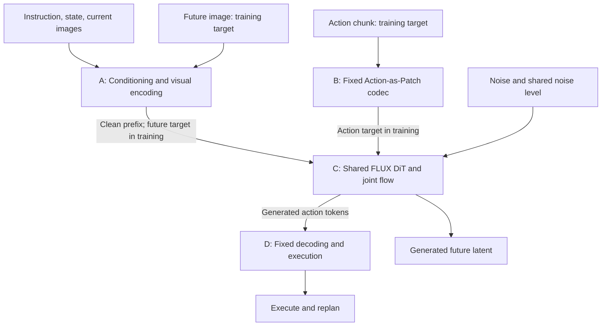
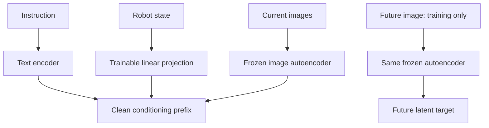
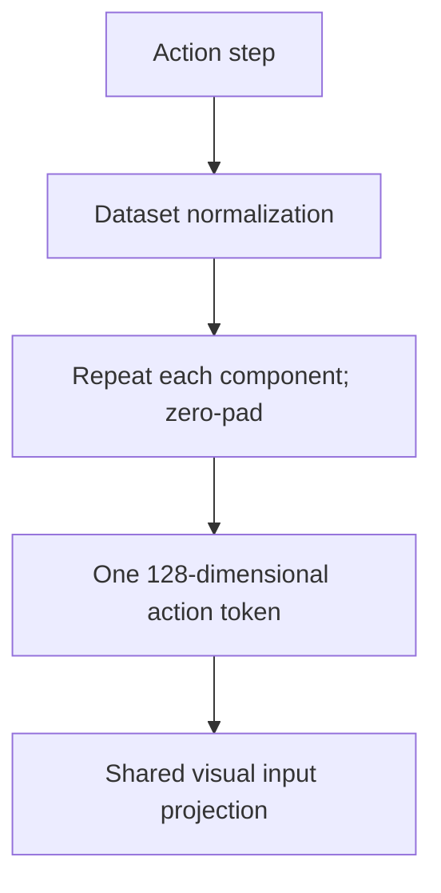
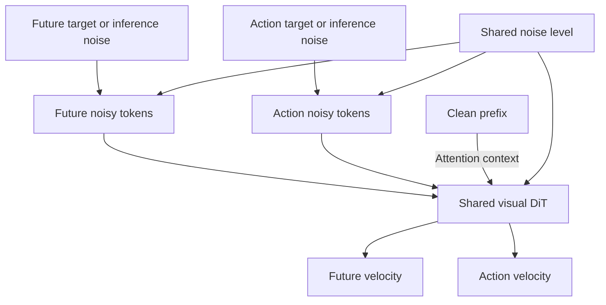
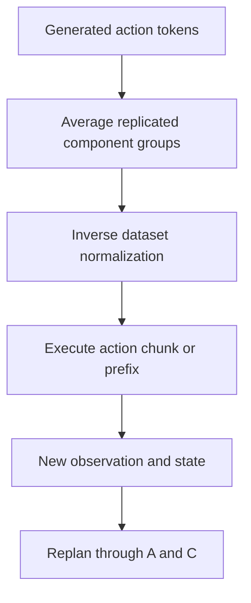

# PatchWAM — Reorganized Method

Source: Wang et al., *An Action Is Worth One Patch: Unified World–Action Modeling with PatchWAM*, arXiv:2609.25961v1, 22 September 2026. This brief summary describes the original method, using the supplied paper, including Appendices E–F. Diagrams are explanatory. Implementation questions are omitted as requested.

## 2. Approach or Method

### 2.1 Method summary and interfaces

**PatchWAM turns continuous actions into visual-width patch tokens using a fixed, reversible codec.** A single pretrained FLUX.2 [klein] 4B Base transformer jointly generates an action chunk and the visual endpoint of that chunk. Unlike ImageWAM’s dual-expert design, there is no separate action expert, trainable action encoder, or action-specific output projection: actions reuse the visual backbone’s existing learned input/output projections. The pretrained transformer is fully fine-tuned, rather than trained from scratch or kept frozen. (§§3.1–3.2)

Language, robot state, and current images form a clean conditioning prefix. Future-image and action tokens are jointly denoised, conditioned on that prefix. Future RGB reconstruction is used through latent supervision during training; decoding the predicted image into RGB is unnecessary for control.

| Interface | Contents / shape | Consumer / role |
|---|---|---|
| Runtime inputs | Instruction ℓ, current multi-camera observation oₜ, proprioception sₜ | Block A: conditioning prefix |
| Training targets | Endpoint oₜ₊ₕ; H × A action chunk | Blocks A/B: clean latent targets |
| Visual latents | Current x_ref and future x₀, each S × D; D = 128 | Block C |
| Action latents | u₀, H × D; H = 16, one token per action step | Block C |
| Internal noise | Independent Gaussian εₓ and εᵤ; shared noise level σ | Block C |
| Network predictions | Visual/action velocities with the corresponding token shapes | Joint Euler integration |
| Runtime output | H × A actions, decoded and inverse-normalized | Block D: execute and replan |

**Overview: both phases.** Target encoding feeds training; Gaussian initialization replaces targets at inference.

Here t denotes environment time, H the action horizon, h an action-step index, σ the noise level, and k a numerical solver step. D = 128 is the visual latent patch width, **not** the transformer hidden width. A = 14 on RoboTwin/RoboDojo and A = 7 on LIBERO. S depends on the image configuration.

### 2.2 Block A — Conditioning and visual encoding

A frozen FLUX.2 image autoencoder converts current and future observations into patch tokens. A text encoder embeds the instruction; a trainable linear state projection supplies one proprioceptive token. (§3.1, Eqs. 3–4)

$$
x_{\mathrm{ref}}=\mathcal V(o_t),\quad
x_0=\mathcal V(o_{t+H}),\quad
h_\ell=\mathcal T(\ell),\quad h_s=W_s s_t,
\qquad c=[h_\ell;h_s;x_{\mathrm{ref}}].
$$

RoboTwin and LIBERO compose camera views into one image. RoboTwin uses a 288 × 256 composite → 18 × 16 = 288 tokens per frame. With 128 text slots, one state token, two frames, and 16 action tokens, the sequence has 721 tokens. The state token is inserted after valid instruction text; padded text keys are masked. (Appendix E)

The standard text encoder is frozen Qwen3-4B. **RoboDojo variant:** separate camera images and up to 20 past head-camera frames enter the visual prefix; Qwen3-VL-4B-Instruct also reads current/past images. Its language model uses trainable LoRA and auxiliary subtask prediction, while its vision encoder stays frozen. Transformer text conditioning concatenates instruction hidden states from layers 9/18/27 and last-prompt-token states from layers 18/27/36. (Appendix F)

### 2.3 Block B — Fixed Action-as-Patch codec

Normalize each action using dataset statistics: z-score for RoboTwin/RoboDojo, min–max for LIBERO. Each normalized step is copied into one D-dimensional token, with no learned parameters. (§3.2)

With replication factor r = ⌊D/A⌋ and scale α = 1, the encoder is (Eq. 6):

$$
E(\bar a_h)=\alpha[
\underbrace{\bar a_{h,1},\ldots,\bar a_{h,1}}_{r},
\ldots,
\underbrace{\bar a_{h,A},\ldots,\bar a_{h,A}}_{r},
\underbrace{0,\ldots,0}_{D-rA}]^\top.
$$

For A = 14, r = 9; for A = 7, r = 18. Both occupy 126 entries plus two zeros. The codec is information-preserving; actions never pass through the image autoencoder or a discrete vocabulary. No token-type embedding is added.

### 2.4 Block C — Shared transformer and joint flow matching

The same DiT predicts both velocity fields (Eq. 5):

$$
(v_\theta^x,v_\theta^u)=v_\theta(x_\sigma,u_\sigma,\sigma;c).
$$

**Attention direction:** prefix queries see only prefix keys. Future/action queries see the prefix and both noisy groups, permitting bidirectional future–action interaction; the prefix cannot read noisy targets. (§3.4)

Four-axis positional coordinates separate modalities: current images (10,y,x,0), future images (0,y,x,0), actions (20,0,0,h), text (0,0,0,i). The first-axis values are group identifiers, not physical timestamps.

During training, independent noise tensors share a single σ (Eqs. 10–11):

$$
x_\sigma=(1-\sigma)x_0+\sigma\epsilon_x,\quad
u_\sigma=(1-\sigma)u_0+\sigma\epsilon_u,\qquad
\sigma=\frac{s\tau}{1+(s-1)\tau},\ \tau\sim U(0,1),\ s=5.
$$

The joint objective is (Eqs. 12–13):

$$
\mathcal L=\mathbb E\!\left[
w(\sigma)\left(
0.5\,\mathrm{MSE}(v_\theta^x,\epsilon_x-x_0)
+\mathrm{MSE}_{\mathrm{valid}}(v_\theta^u,\epsilon_u-u_0)
\right)\right],
$$

$$
w(\sigma)=\frac{\exp[-2(\sigma-\tfrac12)^2]-e^{-1/2}}{Z}.
$$

Z normalizes the expected weight under the shifted sampling distribution to one. Each modality loss averages over its own token group. Invalid action steps beyond the demonstration end are excluded, but the two zero-padded token dimensions remain supervised. Both losses update the same transformer; no separate action pathway or detached visual-to-action handoff is introduced.

### 2.5 Block D — Fixed decoding and execution

The decoder averages the r copies of each action component and inverts normalization (Eq. 8):

$$
[D_E(\hat u_h)]_i=\frac{1}{\alpha r}
\sum_{j=(i-1)r+1}^{ir}\hat u_{h,j},
\qquad
\hat a_h=\mathcal N^{-1}(D_E(\hat u_h)).
$$

This decoder is the encoder’s pseudoinverse: it exactly recovers encoded actions and gives the least-squares action for arbitrary predicted tokens. The final two token entries are ignored. No codec reconstruction loss is needed. (§3.2, Eqs. 8–9)

### 2.6 Training and inference across blocks

| Stage | Objective / supervision | Frozen / trainable | Cross-block connection |
|---|---|---|---|
| Standard training | Joint visual/action velocity regression | Frozen VAE and Qwen3-4B; full DiT and state projection trained | Targets from A/B; both losses reach C |
| RoboDojo additions | Same joint loss plus subtask cross-entropy, weight 0.1 | Qwen3-VL language LoRA trained; base weights/vision encoder frozen | Visual history and VL hidden states condition C |
| Inference | Joint Euler generation; fixed action readout | No optimization | A → C → D; future RGB decoding unnecessary |

Initialize future and action tokens from Gaussian noise. Write their concatenation as z^(0) = [x₁;u₁]. Integrate along σₖ = φ₅(1−k/K), from σ₀ = 1 to σ_K = 0 (Eq. 14):

$$
z^{(k+1)}=z^{(k)}+(\sigma_{k+1}-\sigma_k)
v_\theta(z^{(k)},\sigma_k;c).
$$

The negative schedule increment matches the noise-minus-data velocity targets. All reported evaluations use K = 10 steps, without classifier-free guidance; the method’s default is 20. Decode actions after the final step and replan after executing 16 steps on RoboTwin, 12 on LIBERO/Plus, or 8 on RoboDojo. (Appendix F)

**Practical distinction from ImageWAM:** pretrained visual projections and the visual transformer are reused, while the separate action expert is removed. Future tokens still participate in every solver step, so removing action parameters does not by itself imply faster inference. (§3.5)

Source index: architecture/tokenization §3.1; codec §3.2; losses §3.3; attention/positions §3.4 and Appendix E; solver §3.5; dataset dimensions §4.1; freezing, RoboDojo additions, and execution settings Appendix F.

