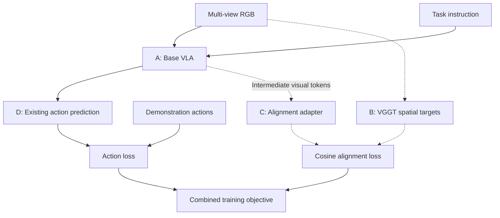
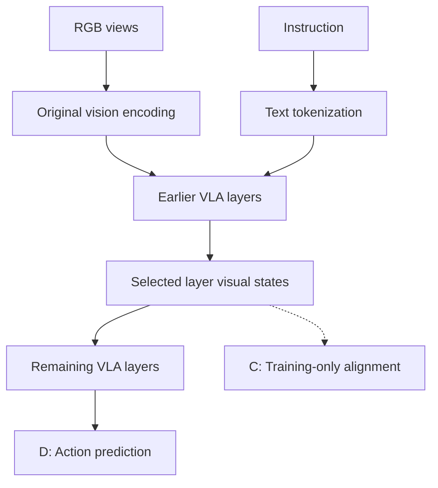
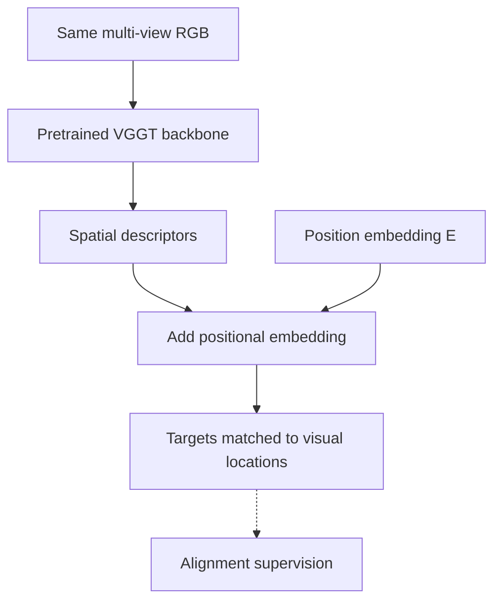
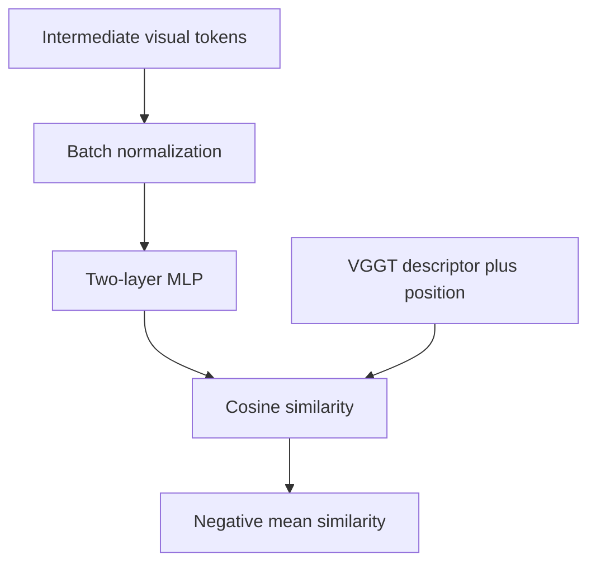
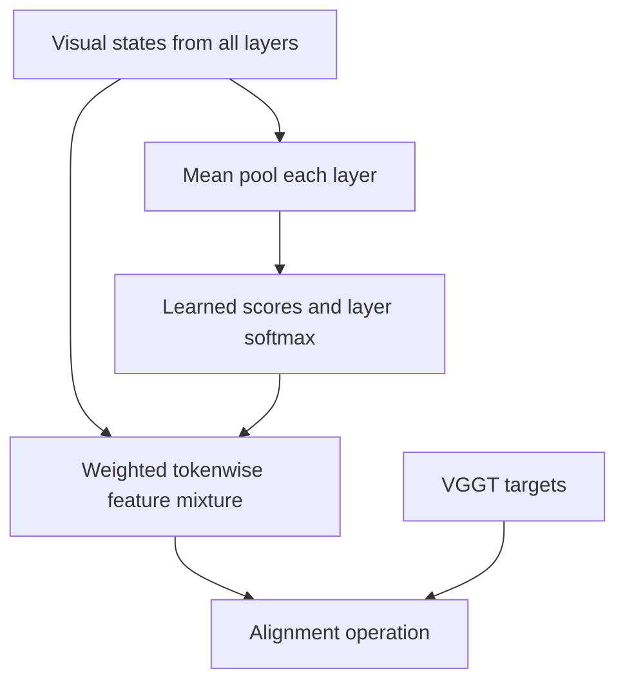
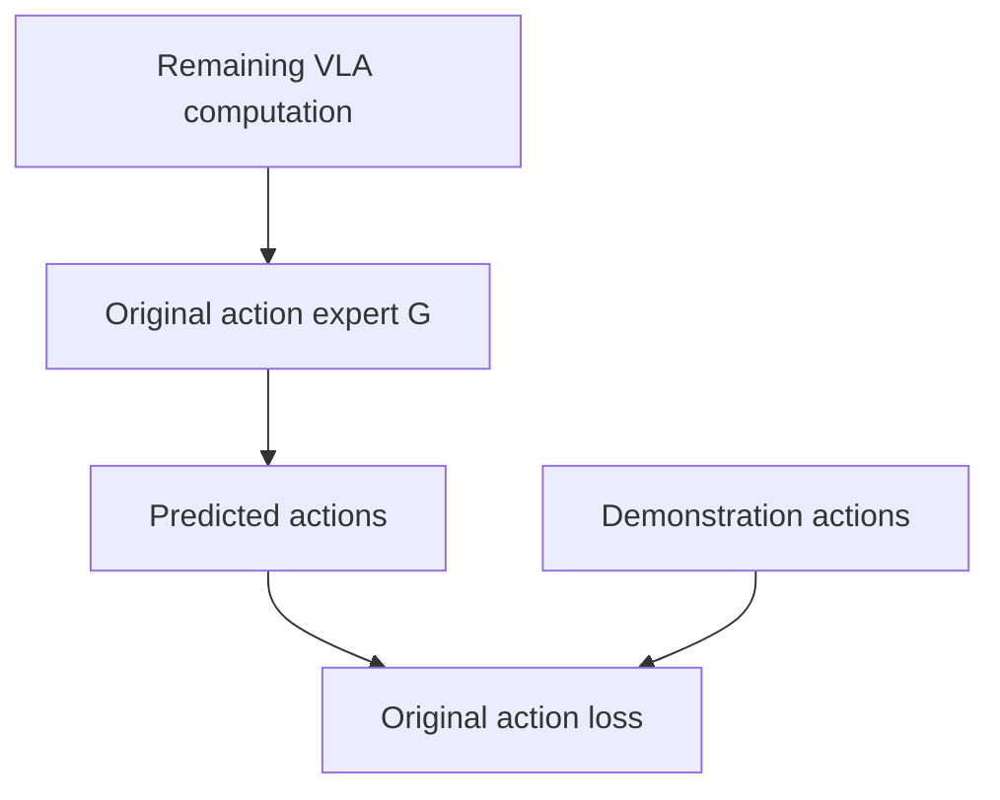

# Spatial Forcing — Reorganized Method

**Paper:** *Spatial Forcing: Implicit Spatial Representation Alignment for Vision-Language-Action Model*, Fuhao Li et al., ICLR 2026.  
**Sources inspected:** supplied 22-page paper, including method, implementation settings, and appendices C, G, I, J. [Project page](https://spatial-forcing.github.io/). This document summarizes the original method; official implementation was not inspected. Questions are omitted as requested.

## 2. Approach or Method

### 2.1 Method summary, inputs, outputs, and high-level architecture

Spatial Forcing (SF) adds a **training-only representation alignment objective** to an existing VLA. The same multi-view RGB observations enter the policy and a pretrained VGGT geometry teacher. Intermediate **visual-token hidden states inside the VLA backbone** are projected into the teacher representation space and aligned by cosine similarity. The policy retains its ordinary action prediction objective.

The teacher supplies latent spatial descriptors, rather than depth maps or point clouds as policy inputs. At inference, remove the teacher and alignment modules: the trained base policy consumes its usual inputs and produces actions. SF does not predict a future image or feed predicted geometry back into a sampling loop. [§2.3, pp. 4–5]

| Interface | Contents / shape | Consumer / role |
|---|---|---|
| Runtime observations | Multi-view RGB images \(I\), including primary/wrist views in LIBERO | Policy and training-only VGGT |
| Runtime instruction | Task text | Base VLA tokenizer/backbone |
| Other policy inputs | Whatever the selected base policy normally requires | Unchanged base policy |
| Action supervision | Demonstration actions \(A_{\mathrm{gt}}\) | Ordinary action loss |
| Teacher targets | Spatial descriptors \(f_i^{3D}(I)\), associated with visual-token locations | Alignment loss |
| Intermediate policy features | \(X^{(l)}\in\mathbb R^{N\times D}\) | Later policy layers and alignment branch |
| Runtime output | Base policy's action/chunk representation | Robot execution |
| No extra SF noise | No new diffusion state or noise schedule | Existing policy may still use flow matching |

**Training architecture; dashed arrows denote auxiliary supervision paths.**

| Symbol | Meaning / interface |
|---|---|
| \(N\) | Number of visual tokens included in alignment |
| \(D\) | VLA hidden width; base-model dependent |
| \(l,L\) | Selected layer and total backbone layers |
| \(x_i^V\) | Visual-token hidden state at selected layer |
| \(f_i^{3D}(I)\) | VGGT descriptor matched to token \(i\)'s image location |
| \(E\) | Additional positional embedding on teacher target; token-index dependence implicit in Eq. (3) |
| \(\Gamma\) | Batch normalization on student visual features |
| \(S(a,b)\) | Cosine similarity |
| \(\alpha\) | Alignment loss weight; reported default \(0.5\) |
| \(d_g\) | Teacher descriptor width; exact extraction interface not specified in §2.3 |

### 2.2 Block A — Base VLA and intermediate visual-token extraction

**Role/interface.** Use the original vision encoder(s), multimodal backbone, and token arrangement. Extract the visual positions from an intermediate backbone layer; these states still continue through later layers to support action prediction. Supervise visual tokens, not action tokens or a pooled scene vector. [§2.1–2.3]

The paper's generic autoregressive formulation is:

\[
x_t^A\sim p_\theta\!\left(x_t^A\mid
\{x_i^V\}_{i=1}^{N},\{x_j^L\}_{j=1}^{M},x_{<t}^A\right).
\tag{1}
\]

This is a motivating formulation, not a requirement to replace every base policy's execution with sequential decoding. The experiments use OpenVLA-OFT and \(\pi_0\), preserving their respective action pathways.

**Reported layer choice:** layer 24 of the 32-layer backbone in the OpenVLA-OFT component study. Do not transfer “24” automatically to another architecture. The appendix additionally supplies adaptive layer mixing. [§3.3, Table 2; Appendix G]

### 2.3 Block B — VGGT spatial target construction

**Role/interface.** Process the observation views jointly through pretrained VGGT and use its latent representations as spatial supervision. VGGT alternates frame-wise self-attention with global self-attention across the image set; the descriptors therefore carry both within-view and cross-view information. SF does not require VGGT's geometry prediction heads in its main latent-alignment method. [§2.1, §2.3]

The alignment target is \(f_i^{3D}(I)+E\), with spatial correspondence between teacher descriptor \(i\) and policy visual token \(i\). The paper describes normalized spatial representations; cosine similarity also normalizes vector magnitudes in the loss.

The exact VGGT extraction layer, descriptor width, positional-embedding construction, and grid reconciliation are not specified in the method text. “Pixel-level” means spatially indexed supervision here; it does not establish that the VLA contains one token for every RGB pixel. Preserve view identity and spatial token correspondence when implementing this interface.

The pretrained teacher is used as the supervision source, rather than a new robot-trained geometry predictor. Teacher features are not inserted into the deployed policy's forward path.

### 2.4 Block C — Student projection and cosine alignment

**Role/interface.** Map intermediate policy visual states to the teacher descriptor space using **batch normalization followed by a two-layer MLP**. This auxiliary mapping is used to calculate a loss; its output is not reported as an input to the remaining VLA layers. [§2.3, Eq. (3)]

The paper's alignment objective is:

\[
\mathcal L_{\mathrm{align}}
=-\frac1N\sum_{i=1}^{N}
S\!\left[
\operatorname{MLP}\!\left(\Gamma(x_i^V)\right),
f_i^{3D}(I)+E
\right].
\tag{3}
\]

Equivalently, minimizing \(1-\cos\) per token has the same gradients, differing by an additive constant. The reported loss uses **negative cosine similarity**, not an RGB reconstruction loss or numerical depth regression.

The alignment gradient updates the adapter and the trainable policy parameters upstream of the extracted states. Later policy layers remain trained by the ordinary action objective. Exact MLP hidden width/activation and batch-normalization axes are not given in §2.3.

**Optional adaptive layer selection — Appendix G.** Instead of extracting a fixed layer, pool each layer's visual tokens and obtain a learned scalar gate:

\[
P^{(l)}=\frac1N\sum_{i=1}^{N}x_i^{V,(l)},
\tag{5}
\]
\[
s_l=M_g(l)\,P^{(l)\top},\qquad M_g\in\mathbb R^{L\times D},
\tag{6}
\]
\[
F_{\mathrm{align}}\!\left[
\sum_{l=1}^{L}
\frac{\exp(s_l)}{\sum_{j=1}^{L}\exp(s_j)}
X^{(l)},\,f^{3D}
\right].
\tag{7}
\]

Here \(F_{\mathrm{align}}\) denotes the alignment operation. Eq. (7) mixes token feature tensors before alignment; it is not a weighted sum of independent layer losses. The paper leaves the normalization/projection internals implicit in this notation.

The adaptive gates are auxiliary training machinery and are unnecessary for action inference.

### 2.5 Block D — Existing action prediction

**Role/interface.** Keep the base action expert and action representation. Geometry supervision influences actions through the trained backbone's visual representations; VGGT targets are not direct action-expert inputs. [§2.1, Eq. (2)]

\[
\mathcal L_{\mathrm{action}}
=\mathcal L\!\left[
G(\{x_t^A\}_{t=1}^{K}),A_{\mathrm{gt}}
\right].
\tag{2}
\]

The paper permits different base objectives, including regression or flow matching. OpenVLA-OFT retains its continuous action/chunk prediction with L1 training; \(\pi_0\) retains its flow-matching action expert. SF introduces no new action decoder or solver.

### 2.6 Training and inference across blocks

\[
\boxed{\mathcal L_{\mathrm{SF}}
=\mathcal L_{\mathrm{action}}+\alpha\mathcal L_{\mathrm{align}}}
\tag{4}
\]

Appendix C reports \(\alpha=0.5\) as the default used in the other experiments.

| Stage | Objective / supervision | Frozen and trainable modules | Cross-block connection |
|---|---|---|---|
| Teacher extraction during training | VGGT spatial targets from observation RGB | Pretrained teacher supplies targets | B supervises C |
| Joint policy adaptation | Action loss plus weighted alignment | Base-policy adaptation parameters and auxiliary BN/MLP; optional learned gates | C backpropagates into extracted policy states |
| Deployment | Base policy's action procedure | Learned policy; auxiliary branches removed | A → D |

**Reported setups** [§3.1]:

| Base policy / setting | Reported configuration |
|---|---|
| OpenVLA-OFT / LIBERO | Prismatic backbone; fused SigLIP and DINOv2 vision encoder; primary and wrist RGB; 150k iterations on 8 H100s |
| \(\pi_0\) / RoboTwin | PaliGemma backbone; LoRA adaptation; 30k iterations on 1 H100 |
| OpenVLA-OFT component study | 32-layer backbone; fixed alignment at layer 24; 1 H100 |

These are benchmark-specific configurations, not universal SF requirements. The paper says training/evaluation otherwise follow official base-policy settings.

**Inference:** acquire ordinary policy observations and instruction, run the trained base policy, generate its action/chunk output, and execute according to its existing protocol. No VGGT forward pass, alignment projector, geometry reconstruction, or feature-feedback recurrence is required. Any iterative flow solver belongs to the base policy, not SF. [§2.3]

**Auxiliary analyses are not required method blocks.** Depth/color probing freezes the trained VLA and trains diagnostic heads (Appendix I). Appendix J examines an alternative supervision strategy using VGGT depth, point-map, or track outputs and trainable downstream heads; it is separate from the primary latent-descriptor alignment.

### 2.7 Source-location index

| Detail | Source |
|---|---|
| Base policy and VGGT preliminaries | §2.1, p. 3, Eqs. (1)–(2) |
| Spatial targets, adapter, positional embedding, cosine loss | §2.3, p. 4, Eq. (3) |
| Combined objective and unchanged inference | §2.3, p. 5, Eq. (4) |
| Base-model adaptation settings | §3.1, pp. 5–6 |
| Fixed alignment layer and target choices | §3.3, pp. 6–7, Table 2 |
| Default loss weight | Appendix C, p. 16 |
| Adaptive layer mixing | Appendix G, p. 19, Eqs. (5)–(7) |
| Diagnostic probing / alternative downstream supervision | Appendices I–J, pp. 20–22 |

For implementation, prioritize matching visual-token positions to teacher descriptors, selecting the backbone extraction layer, and retaining the base policy's training and inference conventions. This summary contains no proposed architecture changes and no questions section.

